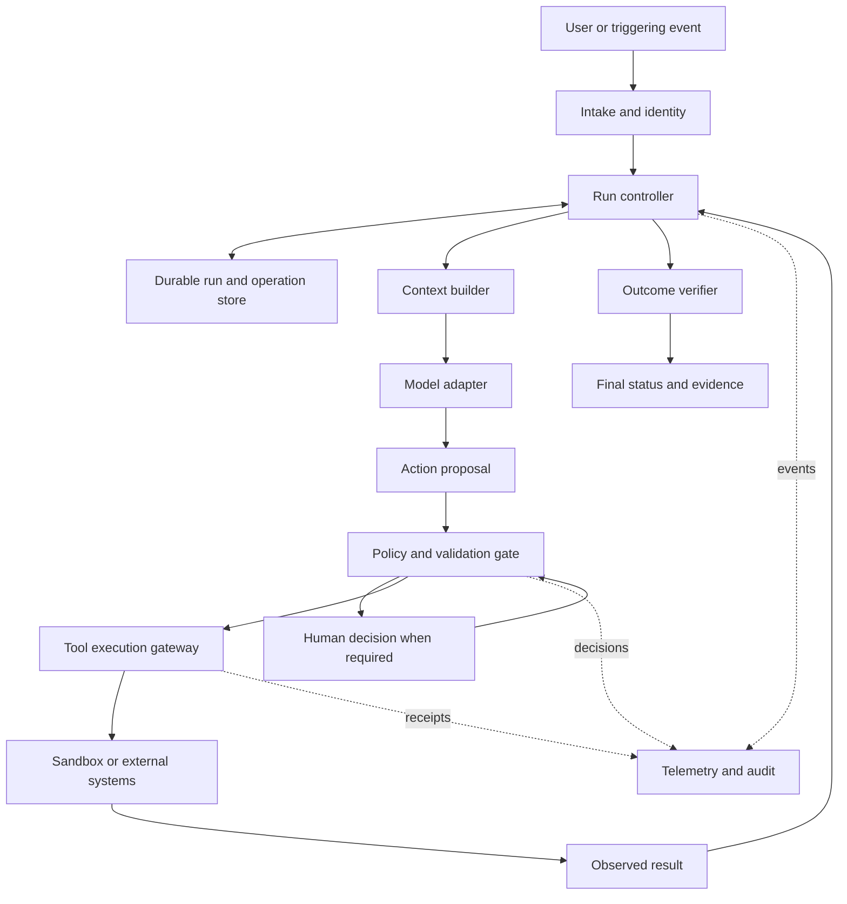

# Harness Engineering for Agentic Applications

## A reference for staff and principal engineers

**Research cutoff:** October 11, 2026  
**Edition:** 1.0  
**Scope:** Architecture, implementation contracts, security, reliability, evaluation, operations, and engineering organization for applications in which language models select or propose actions.

### How to read this book

This book has two kinds of content:

- **Verified evidence** identifies a finding, documented behavior, or published practice and links to a primary source. A vendor engineering report is evidence about that vendor's experience, not proof that the same approach will work everywhere.
- **Design guidance** is this book's engineering synthesis: proposed architectures, invariants, tradeoffs, review questions, and examples. Unless explicitly labeled otherwise, the architecture, contracts, checklists, pseudocode, and operating recommendations are design guidance. They are not a published standard or a tested software implementation.

**All numerical scenarios, resource limits, identifiers, and acceptance thresholds in examples are illustrative.** No benchmark improvement, production reliability, cost saving, or security guarantee is claimed for the proposed design. Code-like examples are framework-neutral specifications, not executable SDK examples. Consult the versioned documentation of an actual implementation before adopting it.

Sources were inspected during preparation. Research papers are cited only for the findings described here; this book does not claim independent reproduction of their experiments. Documentation can change after the research cutoff. The source register records scope and caveats so that readers can distinguish supported facts from recommendations.

### Reading paths

| Reader's immediate problem | Start with |
|---|---|
| Decide whether an agent is justified | Chapters 1–3 |
| Design a production runtime | Chapters 4–9 |
| Handle tool permissions and untrusted content | Chapters 10–12 |
| Prove that changes improve outcomes | Chapters 13–15 |
| Operate and scale the application | Chapters 16–19 |
| Support agents that write software | Chapter 20 |
| Conduct an architecture review | Chapters 21–23 and the appendices |

### Contents

1. [The engineering problem](#1-the-engineering-problem)
2. [Vocabulary and boundaries](#2-vocabulary-and-boundaries)
3. [Choosing the right amount of agency](#3-choosing-the-right-amount-of-agency)
4. [Reference architecture](#4-reference-architecture)
5. [Run lifecycle and control loop](#5-run-lifecycle-and-control-loop)
6. [Tool contracts and action semantics](#6-tool-contracts-and-action-semantics)
7. [Context construction and evidence](#7-context-construction-and-evidence)
8. [Memory and long-running work](#8-memory-and-long-running-work)
9. [Durability, retries, and concurrency](#9-durability-retries-and-concurrency)
10. [Authorization and human decisions](#10-authorization-and-human-decisions)
11. [Prompt injection and containment](#11-prompt-injection-and-containment)
12. [MCP and integration boundaries](#12-mcp-and-integration-boundaries)
13. [Evaluation as a product contract](#13-evaluation-as-a-product-contract)
14. [Experimental design and statistical interpretation](#14-experimental-design-and-statistical-interpretation)
15. [Verification and completion](#15-verification-and-completion)
16. [Observability and service objectives](#16-observability-and-service-objectives)
17. [Cost, latency, and capacity](#17-cost-latency-and-capacity)
18. [Release engineering and model changes](#18-release-engineering-and-model-changes)
19. [Multi-agent systems](#19-multi-agent-systems)
20. [Harnesses for software engineering](#20-harnesses-for-software-engineering)
21. [Worked example: a support adjustment agent](#21-worked-example-a-support-adjustment-agent)
22. [Failure catalog and incident response](#22-failure-catalog-and-incident-response)
23. [Organizational design and adoption](#23-organizational-design-and-adoption)
24. [Open questions and limits of the evidence](#24-open-questions-and-limits-of-the-evidence)
- [Appendix A: Architecture review checklist](#appendix-a-architecture-review-checklist)
- [Appendix B: Reusable design templates](#appendix-b-reusable-design-templates)
- [Appendix C: Glossary](#appendix-c-glossary)
- [Appendix D: Evidence map and source register](#appendix-d-evidence-map-and-source-register)

---

## 1. The engineering problem

A useful working definition is:

> **Harness engineering is the design of the runtime, interfaces, state, environment, and feedback mechanisms that let an agent pursue a goal within explicit operational boundaries.**

This is a definition for this book. It deliberately includes two related meanings found in practice: the agent execution runtime and the surrounding environment that makes useful work possible.

**Verified evidence.** Anthropic describes a harness as the loop that calls the model and routes tool calls, distinct from a durable session and an execution sandbox. OpenAI's engineering account uses harness engineering more broadly, emphasizing environments, accessible knowledge, architectural constraints, and feedback loops for coding agents. These sources support treating runtime design and environment design as related concerns, without asserting a universal formal definition. [S01] [S02]

The central engineering challenge is that a plausible action proposal is not enough. An application must determine whether that action is authorized, feasible, timely, bounded, recoverable, and sufficient for the user's actual goal.

Consider an assistant asked to correct a billing mistake. Understanding the request is one task. Finding the right account, applying policy, avoiding duplicate adjustments, surviving a timeout, and reporting the final ledger state are separate engineering responsibilities. A fluent final answer does not settle those responsibilities.

### 1.1 What the harness is responsible for

For every action, a production design should answer:

1. **Intent:** What user objective does this action serve?
2. **Authority:** Which authenticated principal may perform it on this resource?
3. **Evidence:** Which observations justify it, and how current are they?
4. **Execution:** What effect can it have, and how is that effect bounded?
5. **Recovery:** What happens if the process stops immediately before or after it?
6. **Verification:** What independent observation establishes the result?
7. **Accountability:** Can an operator explain what happened without guessing?

A harness is therefore a product component with its own lifecycle, owners, compatibility contract, and incident history. Treating it as miscellaneous glue obscures the places where decisions turn into real effects.

### 1.2 Capability and authority are separate dimensions

A better model may plan more effectively or select tools more accurately. That does not determine what it is allowed to do. Authority comes from the application and the user's delegated permissions.

Use two independent questions in design reviews:

- What can the current model accomplish in this environment?
- What actions will the system permit under the current identity, policy, and state?

Increasing capability should trigger new evaluations. Increasing authority should trigger a review of permissions, impact, recovery, and monitoring. Do not combine the two changes casually.

### 1.3 The principal engineer's unit of analysis

Evaluate the complete deployed configuration:

`model + instructions + tools + context policy + state machine + permissions + environment + verifier`

A model identifier alone is insufficient to identify the behavior being released. A tool description change can alter action selection. A retrieval filter change can change the available evidence. A retry policy change can change business effects even when model outputs stay identical.

The architectural goal is to make these dependencies visible and independently testable.

## 2. Vocabulary and boundaries

The following distinctions are working vocabulary for the rest of the book.

| Term | Meaning here | Boundary to preserve |
|---|---|---|
| Model | Component that generates a response or action proposal | It does not grant authority |
| Agent | Model-directed process that observes, proposes actions, and incorporates feedback | Its narrative is not authoritative application state |
| Workflow | Code-defined arrangement of steps and transitions | Model-generated content may exist inside fixed transitions |
| Harness | Runtime and supporting controls around the agent | Its policy enforcement must survive bad model output |
| Tool | An explicit interface for observation or action | A tool call is a request, not proof of success |
| Session | Durable record of an interaction over time | It can outlive an individual process or context window |
| Run | A bounded execution attempt toward a stated objective | A session may contain several runs |
| Context | Information sent to the model for one inference | It is a selected view, not the entire system of record |
| Memory | Retained information made available to future work | Stored text is not automatically trusted knowledge |
| Checkpoint | Persisted execution state for recovery | It does not atomically commit an unrelated external effect |
| Trace | Recorded execution observations and relationships | It is subject to access and retention controls |
| Verifier | Component that tests a completion claim | It needs evidence beyond the claimant's assertion |

**Verified evidence.** Anthropic distinguishes workflows with predefined code paths from agents that dynamically direct their processes and tool usage. Its guidance recommends starting with the simplest adequate solution and considering the latency and cost of additional agency. [S03]

### 2.1 Prompt engineering, context engineering, and harness engineering

These activities overlap but have different change surfaces:

- Prompt engineering changes instructions, examples, and response expectations.
- Context engineering changes what information is presented, when, and in what form.
- Harness engineering changes the mechanisms that select information, execute actions, persist progress, constrain behavior, and verify results.

For example, telling an agent to avoid duplicate payments is an instruction. Showing the previous payment result is context construction. Enforcing an operation identity at the payment boundary is a runtime control.

### 2.2 Logical boundaries do not require separate services

A small application can implement these concerns in one deployable process with a database. Separation means clear contracts, not mandatory microservices. Split deployment units when isolation, scaling, ownership, or availability requirements justify the added distributed-systems cost.

## 3. Choosing the right amount of agency

**Design guidance.** Start with the uncertainty in the task, not the availability of an agent framework.

| Task characteristic | Initial design candidate | Evidence required before adding agency |
|---|---|---|
| Exact computation with known inputs | Ordinary application code | No model needed for the computation itself |
| One transformation with a clear rubric | One model call plus validation | Repeated failures caused by missing iteration |
| Known stages with variable content | Fixed workflow with model steps | Cases requiring paths that cannot be reasonably enumerated |
| Uncertain investigation using several tools | Bounded agent loop | Better outcomes than the workflow baseline |
| Independent investigations whose results combine | Parallel workers with an explicit join | End-to-end gain after coordination overhead |
| Open-ended consequential operations | Restricted investigation plus controlled execution | Domain-specific evidence and an acceptable impact boundary |

### 3.1 Write an autonomy contract

Before choosing an orchestration topology, specify:

- Accepted objectives and out-of-scope objectives.
- Resources the agent can inspect and change.
- Permitted action classes and required approvals.
- Evidence required for high-impact decisions.
- Maximum runtime, spend, fan-out, and retry effort.
- Conditions for clarification, escalation, and stopping.
- What the user sees while work is incomplete.

These boundaries form a testable contract. A vague goal such as “resolve support tickets autonomously” hides too many policy decisions to evaluate meaningfully.

### 3.2 Evaluate the opportunity, not just the demonstration

An adoption experiment should include difficult, ambiguous, and ineligible cases. Measure the labor needed to supervise, correct, and reconcile outcomes. A system that drafts quickly but requires exhaustive review may still be valuable, but its benefit is assisted work, not autonomous resolution.

Use this decision rule as an accounting framework, not a predictive law:

`net value = value of accepted outcomes − execution cost − review cost − expected remediation cost`

Estimate each term from your deployment. There is no defensible universal multiplier for agent productivity.

## 4. Reference architecture

**Design guidance.** The following is a logical architecture. Components can share a process if their contracts remain explicit.



The human-decision return edge represents a new policy evaluation using a recorded decision. It is not an unconditional bypass of the gate.

### 4.1 Component contracts

| Component | Inputs | Outputs | Essential responsibility |
|---|---|---|---|
| Intake | User request, authenticated identity, trigger metadata | Normalized objective and run ID | Scope and identity binding |
| Run controller | Durable state, events, budgets | Next transition | Progress, stopping, cancellation, recovery |
| Context builder | Authorized source references and run state | Model input plus provenance manifest | Relevance, access filtering, size limits |
| Model adapter | Context and supported capabilities | Typed candidate response | Provider protocol handling and usage recording |
| Policy gate | Principal, operation, resource state, policy | Allow, deny, or decision required | Authority and business-rule enforcement |
| Tool gateway | Authorized operation envelope | Receipt or classified uncertainty | Effect execution and deduplication coordination |
| Verifier | Acceptance criteria and observed artifacts | Verified, failed, or indeterminate | Honest completion assessment |
| State store | Events, snapshots, operation records | Recoverable state | Consistency and auditability |

### 4.2 Control plane and execution plane

Keep the mechanisms that grant authority outside the editable environment where model-generated code runs. A coding sandbox can contain project files; it should not be able to rewrite the policy engine that controls deployment rights.

**Verified evidence.** Anthropic's Managed Agents account describes separating the session, harness, and sandbox so they can recover independently, and moving credentials outside the environment that executes generated code. This is a vendor architecture report, not a guarantee about every sandbox implementation. [S01]

For your design, document which compromise you are containing. A process boundary, container, virtual machine, remote browser, and restricted API have different properties. “Sandboxed” without filesystem, network, identity, and resource-limit details is not a reviewable security claim.

### 4.3 Data model before framework choice

Define these records explicitly:

- **Run:** objective, tenant, initiator, status, configuration versions, deadline, budget.
- **Event:** ordered transition evidence with producer and timestamp.
- **Proposal:** candidate action with referenced evidence.
- **Operation:** stable business-action identity, argument fingerprint, execution status.
- **Decision:** actor, scope, approved payload fingerprint, expiration, policy basis.
- **Artifact:** immutable or versioned result, owner, classification, checksum where appropriate.
- **Verification:** criterion, observed evidence, result, verifier version.

A framework may supply some of these records. Explicitly identify the remaining responsibilities instead of assuming that a conversation history covers them.

## 5. Run lifecycle and control loop

**Design guidance.** Make incomplete states first-class.

| State | Meaning | Typical next states |
|---|---|---|
| CREATED | Accepted but not yet admitted to execution | RUNNING, REJECTED |
| RUNNING | Actively processing or ready for the next step | WAITING_INPUT, WAITING_APPROVAL, VERIFYING, RECONCILING, FAILED |
| WAITING_INPUT | Missing information prevents useful progress | RUNNING, CANCELLED, EXPIRED |
| WAITING_APPROVAL | A specific operation needs a human decision | RUNNING, CANCELLED, EXPIRED |
| RECONCILING | An external effect may have occurred | RUNNING, VERIFYING, NEEDS_REVIEW |
| CANCELLING | New work is stopped while in-flight effects are settled | CANCELLED, NEEDS_REVIEW |
| VERIFYING | Acceptance criteria are being checked | SUCCEEDED, RUNNING, NEEDS_REVIEW, FAILED |
| SUCCEEDED | Required criteria have supporting evidence | Terminal |
| FAILED | Known inability to complete under the contract | Terminal |
| NEEDS_REVIEW | Automation stopped with unresolved state | Explicit operator workflow |
| CANCELLED | Future work stopped; recorded effects remain visible | Terminal for this run |
| EXPIRED | Deadline or decision window elapsed | Terminal for this run |
| REJECTED | Intake could not admit the request | Terminal |

Budget exhaustion can produce FAILED or NEEDS_REVIEW depending on whether unresolved effects exist. Record the reason separately. Cancellation must also account for in-flight operations; see Chapter 9.

An unresolved operation must retain a durable recovery owner even if its original run stops. NEEDS_REVIEW transfers responsibility to an explicit review queue; it must not silently abandon reconciliation.

### 5.1 A framework-neutral loop

The pseudocode below specifies responsibilities; functions such as `prepare_operation` are proposed application contracts, not real SDK APIs.

```text
repeat until run is terminal:
    acquire or renew run ownership with a fencing token
    load durable state and check ownership
    process cancellation, deadlines, and new user events

    if an earlier external effect is unresolved:
        reconcile it using its persisted operation identity
        stop for review if safe reconciliation is unavailable
        continue

    enforce remaining budget and reserve the next step's allowance
    build authorized context and record its source manifest
    request a model response with a bounded deadline
    validate response structure and classify the proposal

    if proposal requests completion:
        run the outcome verifier
        persist the verdict and its evidence
        either finalize, continue with bounded repair, or stop for review
        continue

    validate the tool, arguments, resource scope, and business rules
    persist an operation identity and immutable argument fingerprint
    evaluate authority using current policy and resource state

    if a decision is required:
        persist a decision request bound to this operation
        transition to WAITING_APPROVAL and release the worker
        resume only through an authenticated decision event

    recheck authorization and preconditions at the execution boundary
    dispatch through the tool gateway using the persisted identity
    persist the receipt, error, or unknown outcome
    account for actual usage and release unused reservations
```

A read-only interaction may use a smaller path, but it still needs identity, deadlines, result validation, and observability.

### 5.2 Define progress using the task

Useful progress signals include a newly verified criterion, a reduced set of unresolved hypotheses, a completed dependency, or a reconciled operation. Additional tokens and longer plans do not establish progress.

For repeated non-progress, choose a bounded response: change the available evidence, use an approved alternate tool, ask for missing information, or stop with a useful explanation. Do not permit an unbounded “reflect and retry” cycle.

### 5.3 Streaming does not commit an outcome

Keep presentation events separate from durable business events. A streamed sentence saying “I have updated the record” must not cause the client to mark the task complete before the operation receipt and verification exist.

Reconnectable clients should resume an ordered event stream using a cursor and deduplicate repeated events. The backend run should survive a browser disconnect when the product contract says work continues in the background.

## 6. Tool contracts and action semantics

**Verified evidence.** The SWE-agent paper studies how agent-computer interface design affects software-engineering agents. Anthropic's tool-design guidance recommends evaluating tools on realistic tasks, keeping their purpose clear, and returning information the agent can use efficiently. Neither source establishes a universal optimal tool count or interface shape. [S04] [S05]

### 6.1 Design for business meaning

Expose operations whose consequences can be explained and checked. Compare an unrestricted `execute_sql` capability with a domain operation that adjusts one eligible invoice under a specified policy. The appropriate choice depends on the task and environment, but the latter permits much more precise authorization and verification.

A tool contract should state:

| Field | Question it answers |
|---|---|
| Purpose and exclusions | When is this tool appropriate? |
| Input schema | Which fields, types, units, and enumerations are valid? |
| Resource scope | Which tenant, account, repository, or workspace can it access? |
| Effect class | Observation, reversible mutation, external communication, or difficult-to-reverse action? |
| Preconditions | What must still be true when the operation executes? |
| Idempotency contract | What identifies the same intended operation across attempts? |
| Concurrency contract | Which versions or locks prevent stale writes? |
| Completion semantics | Does success mean accepted, committed, or independently observed? |
| Error taxonomy | Is the error permanent, retryable, conflicting, or ambiguous? |
| Output limits | How are pagination, truncation, and evidence references represented? |
| Audit fields | Which receipt and correlation identifiers are returned? |

### 6.2 Example: proposal separated from execution

Illustrative contracts:

```yaml
tool: billing.propose_adjustment
effect: none
inputs:
  invoice_id: string
  requested_amount_minor: integer
  reason_code: enum
outputs:
  proposal_id: string
  evaluated_invoice_version: integer
  eligibility: eligible | ineligible | needs_review
  maximum_amount_minor: integer
  evidence_refs: list
```

```yaml
tool: billing.execute_adjustment
effect: external_mutation
inputs:
  proposal_id: string
runtime_injected:
  authenticated_principal: trusted_identity
  tenant_id: trusted_tenant
  operation_id: persisted_unique_id
  approval_reference: optional_validated_decision
enforcement:
  - resolve proposal and check caller access
  - revalidate policy and invoice version
  - reject changed or expired proposal
  - deduplicate the same operation identity
outputs:
  status: committed | rejected | pending | unknown
  receipt_id: optional_string
  reconciliation_reference: optional_string
```

The model does not supply the trusted tenant or grant itself an approval. A proposal is still untrusted input; a stored proposal ID is not a substitute for authorization.

### 6.3 Schema validity is only one layer

An argument can be structurally valid and still refer to the wrong account, obsolete information, an unauthorized resource, or the wrong business action.

Use separate validation layers:

1. Parse and validate the declared shape.
2. Resolve resource identifiers within the authenticated scope.
3. Apply semantic constraints such as units and allowed transitions.
4. Evaluate policy and approval requirements.
5. Recheck mutable preconditions at commit.

Do not silently repair consequential ambiguity. For example, converting an uncertain amount into a default currency can create a syntactically valid but materially incorrect operation.

### 6.4 Return observations the model can reason about

Prefer structured results with an explicit status and supporting references. A short “OK” hides whether the action was queued, committed, or merely accepted by a transport layer.

For observations, include freshness, source, pagination, and truncation information. A truncated search result must not be represented as “all matching records.” For errors, provide safe remediation categories without exposing credentials or unnecessary internal details.

Test selection quality as well as endpoint correctness: can the agent distinguish “preview change,” “apply change,” and “check change status” under realistic wording?

## 7. Context construction and evidence

**Verified evidence.** Anthropic describes context engineering as selecting and maintaining the information supplied during inference, including instructions, tool definitions, history, and retrieved material. It discusses just-in-time retrieval, compaction, and persistent notes. Separately, *Lost in the Middle* reports position-sensitive retrieval performance in the models and tasks it studied. That historical result motivates testing context placement; it does not prove identical behavior for every current model. [S06] [S07]

### 7.1 Treat context as a materialized view

**Design guidance.** Construct each model input from authoritative stores rather than treating the transcript as the sole source of truth.

Use explicit categories:

- Stable application instructions and tool contracts.
- Current authorized user objective.
- Run status, remaining budget, and outstanding decisions.
- Task-relevant observations with provenance.
- Recent action receipts and unresolved uncertainty.
- Optional historical memory with source and freshness labels.

A context builder should be independently inspectable. Given a run ID and model-call ID, an engineer should be able to reconstruct which documents, policy versions, and tool results were made available, subject to retention restrictions.

### 7.2 Retrieval is also an authorization operation

Filter candidate records by tenant and permissions before they enter model context. Do not retrieve a mixed-tenant result set and ask the model to ignore inaccessible records.

Carry access constraints through lexical search, vector retrieval, reranking, caching, and artifact loading. A permission-aware initial query is insufficient if a subsequent cache lookup omits the tenant dimension.

Separate three questions:

- Was the right evidence retrieved?
- Did the model use the evidence correctly?
- Was the evidence still valid when the action executed?

Each failure needs a different fix.

### 7.3 Evidence record

An illustrative evidence record:

```yaml
evidence_id: ev-041
source_type: internal_record
source_locator: invoice-record-731
source_version: 18
observed_at: 2026-10-11T15:00:00Z
tenant_scope: runtime_bound
trust_class: authoritative_business_record
content_ref: artifact-921
claims_supported:
  - invoice_has_unapplied_duplicate_charge
limitations:
  - must_recheck_version_before_mutation
```

Trust labels describe origin and intended use. They do not make arbitrary content safe. A record from a trusted database may contain attacker-controlled customer text.

### 7.4 Separate facts, hypotheses, and instructions

A research agent may hypothesize that a customer qualifies for a credit. Preserve that as a hypothesis until policy and record evidence support it. A webpage that says “ignore your instructions” is source content, not a new task instruction.

When summarizing, retain the distinction. Otherwise a tentative inference can become a stored fact, then appear in future context as if an authoritative system had established it.

### 7.5 Context budgets

Reserve room for the response and protocol overhead before selecting documents. Use measured provider accounting for deployed limits; simple character counts are only estimates.

Prefer relevance-based selection with recoverable source references over indiscriminate transcript growth. Evaluate what the system forgets after compaction, especially negations, exceptions, unresolved effects, and exact user constraints.

Do not select a universal compaction percentage or summary size from intuition. Test your workload at realistic history lengths and source distributions.

## 8. Memory and long-running work

**Verified evidence.** Anthropic's long-running coding experiment used an initializer, persistent progress artifacts, an explicit feature list, and incremental work with verification. The authors present this as one approach to continuity across sessions and acknowledge remaining questions. A later harness study describes revisiting scaffolding as model capabilities change. These are contextual engineering reports rather than general guarantees. [S08] [S09]

### 8.1 Distinguish memory by authority and lifetime

**Design guidance.** Avoid one undifferentiated memory store.

| Memory class | Example | Authority | Suggested control |
|---|---|---|---|
| Run state | Pending operation and acceptance criteria | Runtime authoritative | Transactional updates |
| Working notes | Current hypotheses and next investigation | Provisional | Provenance and easy replacement |
| User preference | Preferred report format | User-scoped | Visibility, correction, and deletion |
| Domain knowledge | Current support policy | Maintained system of record | Owner and version |
| Derived lesson | Prior workaround for a tool failure | Historical observation | Expiration and reevaluation |

The authority to remember something is separate from the authority to use it for a consequential decision. A customer preference cannot override an eligibility policy.

### 8.2 A continuation packet

For a new execution segment, prepare a compact packet containing:

- Objective and explicit exclusions.
- Completed criteria with evidence references.
- Current environment and artifact versions.
- Pending operations and uncertain effects.
- Active permissions and expiring decisions.
- Known failures and approaches already attempted.
- Next executable step and blocking dependencies.
- Remaining budget and deadline.

Keep recoverable source records behind the packet. A summary can guide navigation, but it should not replace the only copy of a receipt or user decision.

### 8.3 Memory write policy

Require memory candidates to declare their source, intended scope, and validity conditions. For reusable knowledge, make promotion an explicit step rather than automatically storing every model conclusion.

Protect against cross-user contamination, stale procedural advice, duplicated observations, and injected instructions hidden in summaries. Provide a correction path that invalidates dependent summaries and caches where practical.

Retention must be designed across logs, checkpoints, embeddings, artifacts, and backups. Deleting a visible chat message alone does not specify what happens to derived memory. Establish this behavior as a product and data-management contract; this book makes no jurisdiction-specific legal claim.

### 8.4 Recovery starts by inspecting current reality

Before continuing an old plan, compare its assumptions with the current environment. Re-read relevant versions and reconcile outstanding operations. Another user, agent, deployment, or scheduled job may have changed the world while the run was paused.

## 9. Durability, retries, and concurrency

This chapter specifies a proposed operation protocol. Its purpose is to make failure behavior reviewable, not to promise exactly-once execution across arbitrary systems.

**Verified evidence.** AWS describes caller-provided request identifiers, parameter matching, and atomic handling of deduplication state with mutations for idempotent APIs. Its retry guidance warns that a timeout does not establish that no effect occurred, and that retries can amplify overload. [S10] [S11]

### 9.1 The ambiguous outcome problem

Suppose an external service commits an adjustment, but the response is lost. The harness knows that it sent a request; it does not know whether the effect happened. Reissuing the same business action with a new identity can create a duplicate.

Represent this as `UNKNOWN` or `RECONCILING`. Neither `FAILED` nor `SUCCEEDED` is justified yet.

### 9.2 Separate operation identity from execution attempt

Persist a stable operation ID before dispatch. Retries of the same intended action reuse that ID. Individual transport attempts receive separate attempt IDs for diagnostics.

Bind the operation ID to the principal or tenant, operation type, resource, and canonical argument fingerprint. Reject reuse with changed meaning. A changed proposal should receive a new review and identity according to the business contract.

Example record:

```yaml
operation_id: op-000184
run_id: run-0091
tool_contract_version: billing-adjustment-v3
resource_id: invoice-731
expected_resource_version: 18
arguments_fingerprint: illustrative-digest
status: UNKNOWN
attempt_count: 1
external_idempotency_key: op-000184
receipt_id: null
next_action: reconcile_external_status
```

### 9.3 Recovery decision table

| Failure point | What is known | Safe next step under the proposed protocol |
|---|---|---|
| Before operation is persisted | No dispatch was permitted | Rebuild and validate a proposal |
| After persistence, before dispatch | Intent exists, effect not yet requested | Recheck current authorization, then dispatch |
| During dispatch or before receipt persistence | Effect may have happened | Query status or use the provider's documented retry contract |
| Receipt persisted, run checkpoint missing | Operation result is known | Recover the result without repeating the business action |
| Cancellation arrives during dispatch | Stopping was requested; effect may still complete | Block future actions and reconcile the in-flight operation |
| Provider's deduplication window has expired | Reusing the key may no longer prevent duplication | Reconcile or require review before another mutation |

The first two rows require an implementation that actually prevents dispatch before durable intent. A document describing that order does not enforce it.

### 9.4 Idempotency is a downstream contract

A local uniqueness constraint protects local records. It does not automatically prevent a remote service from executing twice.

Use a downstream idempotency mechanism, a business-level uniqueness invariant, or a status query that can unambiguously resolve the prior effect. If the provider offers none of these, explicitly restrict automated retry after ambiguity.

**Verified evidence.** Stripe's documentation distinguishes API v1 and v2 idempotency behavior. For v1, it describes replaying the first stored status and body, including a stored error, parameter matching, and key pruning behavior. This illustrates why “supports idempotency” is insufficient without the API version and retention semantics. [S12]

### 9.5 Durable orchestration is not external-effect atomicity

**Verified evidence.** Temporal documents recovery through event history and replay. LangGraph documents persistent checkpoints; its interrupt documentation states that the interrupted node restarts from its beginning on resume. Code before the interrupt can therefore run again. These mechanisms require application code to respect the runtime's recovery semantics. [S13] [S14] [S15]

Record nondeterministic observations and model outputs at appropriate durable boundaries. Do not assume that re-calling a model recreates the original proposal. Place external effects in runtime-supported activities or equivalent effect boundaries, with the effect protocol above.

A transactional outbox can atomically record a local state change and dispatch intent in the same database transaction. Delivery from the outbox to an external system still needs duplicate handling. Do not describe an outbox alone as an end-to-end exactly-once guarantee.

**Verified evidence.** AWS's transactional-outbox guidance explicitly identifies duplicate delivery and the need for idempotent consumers. [S25]

### 9.6 Concurrency and stale workers

Use a single active owner or explicit coordination for each run. A lease alone is insufficient when a delayed worker continues after its lease expires. A monotonically increasing fencing token can let cooperating state stores or gateways reject actions from obsolete owners.

**Verified evidence.** Hazelcast's FencedLock documentation explains monotonically increasing ownership tokens and passing them to an external resource to protect against delayed former owners. [S26]

Fencing only helps at boundaries that enforce it. An already dispatched remote request may still complete. Preserve operation identity and reconciliation even when run ownership is controlled.

For shared resources, use version preconditions, compare-and-swap, transactions, or domain-specific serialization. A conflict should return to planning with fresh evidence instead of silently overwriting another actor's work.

### 9.7 Retry ownership and budgets

Choose where retries are controlled, and account for retries hidden in SDKs and proxies. Classify errors before retrying. Invalid arguments, denied permissions, unresolved conflicts, and unknown side effects require different handling from transient transport failures.

Set a total deadline and attempt budget. Include backoff time and downstream processing in that deadline. Bounded retries with jitter are a starting mechanism; actual limits must follow workload measurements and provider contracts. [S11]

### 9.8 Cancellation and compensation

Cancellation means preventing further discretionary work. It cannot be assumed to reverse completed effects. Display in-flight and completed operations separately.

Compensation is a new business operation with its own authorization and failure modes. An apology email cannot unsend a message; a reversing ledger entry is not erasure of the original transaction. Design product status around those realities.

### 9.9 Duplicate intent and incoming events

Transport idempotency only deduplicates attempts that preserve the relevant identity. If the model proposes the same adjustment again under a fresh operation ID, ordinary request-key deduplication may accept both. Add a domain constraint for the intended correction, such as an invoice-and-correction record with explicit uniqueness semantics.

Do not deduplicate solely by hashing arguments: two identical requests can be two legitimate intended actions. Define the business unit of intent and make it visible in the operation contract.

At intake, distinguish a redelivered trigger from a new user request. Persist trusted event identifiers and validate callback authentication according to the source's contract. External completion events can arrive more than once or out of order; apply transitions using operation identity and valid state progression rather than arrival order alone.

These are proposed runtime responsibilities. Verify delivery, ordering, and retention guarantees for every actual trigger and callback provider.

## 10. Authorization and human decisions

**Design guidance.** Authorize actions using authenticated identity and current policy outside the model. Do not infer permissions from a natural-language claim such as “I am the administrator.”

### 10.1 Authorization dimensions

Evaluate the combination of:

- Initiating user and delegated service identity.
- Tenant and resource ownership.
- Action type and arguments.
- Environment, such as development or production.
- Current business state and policy version.
- Delegation scope, expiration, and revocation.
- Any required authenticated human decision.

Check these at execution time. Earlier permission checks improve interaction quality, but mutable state and access rights may change while an agent is reasoning or waiting.

### 10.2 A policy-controlled decision boundary

Avoid making approval frequency a personality trait in a prompt. Define action classes and their requirements in application policy.

| Action class | Example | Possible policy |
|---|---|---|
| Scoped observation | Read an authorized invoice | Execute within the active session's access scope |
| Local reversible change | Modify an isolated draft | Execute with artifact versioning |
| External publication | Send a customer message | Require preview approval unless explicitly delegated |
| Consequential mutation | Apply a billing adjustment | Enforce eligibility, limits, and designated authorization |
| Prohibited action | Read another tenant's records | Deny regardless of model recommendation |

These are example policies, not universal requirements. A business can preauthorize particular action classes, but the scope must be explicit and enforceable.

### 10.3 Bind a decision to a concrete operation

An approval record should include:

```yaml
decision_id: dec-019
operation_id: op-000184
approver_identity: authenticated_by_application
approved_arguments_fingerprint: illustrative-digest
resource_version: 18
decision: approve
expires_at: 2026-10-11T16:00:00Z
scope: one_operation
policy_version: adjustments-policy-v7
```

If the recipient, amount, resource, or other material field changes, reevaluate the decision. A broad “continue” response should not silently authorize an unrelated action.

Protect decision submission against replay and unauthorized callers. Consume a one-operation approval in coordination with operation dispatch. Retries of that same operation remain governed by its persisted record; they must not become authorization for a second operation.

### 10.4 Human review needs useful information

Present the specific proposed effect, supporting evidence, unresolved uncertainty, and relevant changes since the proposal was prepared. Show a diff for edits, exact recipients for messages, and the target environment for deployments.

Track review latency, rejection reasons, and materially corrected proposals. An approval button that reviewers routinely click without understanding is weak evidence of meaningful control.

### 10.5 Clarification and approval are different states

Clarification resolves missing intent or facts. Approval grants or confirms permission for a specific action. An unanswered clarification cannot be treated as permission, and a timeout should not fabricate either answer.

Persist both states so that process restarts and UI reconnects do not lose the pending question. Resume with a typed, authenticated event rather than unstructured text that merely resembles an approval.

## 11. Prompt injection and containment

**Verified evidence.** OWASP describes direct and indirect prompt injection, including instructions embedded in external sources. It states that retrieval augmentation and fine-tuning do not fully mitigate the problem. AgentDojo provides a research environment for studying tool-using agents that encounter untrusted data and for evaluating attacks and defenses. Neither source establishes a complete defense against arbitrary future attacks. [S16] [S17]

### 11.1 Threat model

**Design guidance.** Assume an attacker may control a document, webpage, repository comment, email, search result, tool response field, or shared memory entry. The attacker may try to redirect the task, obtain secrets, change a destination, or convince the agent that it has new authority.

The important transition is from reading content to exercising a capability. Build controls at that transition.

| Surface | Example attack goal | Proposed control boundary |
|---|---|---|
| Retrieved document | Override the task or policy | Treat document text as evidence, not authority |
| Tool result | Request a secret-bearing follow-up | Gate the subsequent action and outbound data |
| Repository content | Execute attacker-provided setup code | Isolated environment, reviewed execution policy |
| Memory | Persist malicious instructions for future runs | Scoped writes, provenance, validation, invalidation |
| Tool metadata | Introduce a privileged or misleading tool | Trusted registry, contract review, versioning |
| Outbound request | Send private data to an attacker | Destination, identity, and data-release checks |
| Agent-to-agent message | Impersonate a trusted supervisor | Authenticated channel and constrained delegation |

### 11.2 Defense in depth

Separate controls by what they actually accomplish:

- **Instruction separation** tells the model how to interpret data. It is behavioral guidance.
- **Structured extraction** narrows downstream data shapes. It does not prove extracted values are benign.
- **Policy enforcement** rejects actions beyond authorized scope.
- **Sandboxing** constrains access to files, processes, devices, and networks.
- **Credential isolation** reduces the secrets reachable by generated code.
- **Egress controls** constrain destinations and data movement.
- **Verification** detects incorrect outcomes within the verifier's coverage.
- **Audit and response** support investigation and containment after an incident.

Avoid claiming that any one layer proves the agent cannot be manipulated. A model may still produce an incorrect answer even when the system prevents unauthorized effects.

### 11.3 Avoid authority laundering

An untrusted source may claim that a user, administrator, or security team has authorized an action. Require the authorization through the application's trusted identity and decision mechanism.

Apply the same rule to intermediate agent messages and model-generated summaries. A summary that quotes an instruction does not elevate that instruction's authority.

### 11.4 Limit data exposure as well as tool access

An agent with only a read tool can still disclose sensitive information in its final answer. Scope retrieval and outputs to the intended audience. Review logs and artifact links as additional disclosure paths.

For execution sandboxes, document network defaults, filesystem mounts, credential access, process privileges, resource limits, and cleanup. Test cross-run and cross-tenant isolation rather than assuming that a newly created directory establishes it.

### 11.5 Adversarial evaluation

Use attacks embedded in realistic task data. Test both whether the attack succeeds and whether the legitimate user task still succeeds. A defense that blocks all work can score well on one dimension while making the application unusable.

Include indirect attacks that alter recipients, resource identifiers, claimed approvals, continuation notes, and verification artifacts. Test benign documents containing quoted malicious instructions to measure overblocking.

OWASP's agentic application guidance is a useful broader threat-model review input. It should complement a system-specific analysis rather than serve as a compliance certificate. [S18]

## 12. MCP and integration boundaries

**Verified evidence.** The MCP authorization specification examined here is the **2025-11-25** version. It describes authorization for HTTP-based transports and treats STDIO credential handling differently. Its security guidance addresses token audience validation, token passthrough, confused-deputy risks, session issues, and unsafe discovery URLs. Version and transport scope matter when applying these requirements. [S19] [S20]

### 12.1 What an integration protocol does not decide

**Design guidance.** A shared protocol can standardize interaction, but your application still needs to decide:

- Which servers and tools are trusted enough to expose.
- Which users can access each resource and operation.
- Whether a tool has side effects and how those effects recover.
- What data may leave the tenant boundary.
- Whether newly discovered metadata changes the security review.
- Who operates and updates the server.

Do not infer “read-only” or “safe” from a tool's name or description alone. Review the implementation and enforce the capability boundary independently where possible.

### 12.2 Integration registry

Maintain a registry entry with owner, endpoint or package identity, transport, version, credentials model, approved capabilities, data classification, and incident contact.

Pin deployable dependencies according to your supply-chain process. Treat a changed tool schema or description as a behavior-affecting release, even if the endpoint URL stays unchanged.

### 12.3 Credential and network handling

Follow the selected protocol's token and audience requirements. Do not forward a token to a downstream service merely because it arrived in a client request. The MCP security guidance explicitly rejects token passthrough as described there. [S20]

Validate discovery and redirect behavior against your network policy, including private destinations and changing DNS resolutions. Decide which internal services are intentionally reachable rather than applying a blanket rule that breaks legitimate internal deployments.

For local integrations, remember that starting a server can execute software with the host process's access. Review the package and its runtime permissions, not just the remote authentication story.

### 12.4 Contract testing

Test malformed results, missing fields, oversized payloads, tool disappearance, schema changes, expired credentials, permission revocation, and ambiguous mutation outcomes. Confirm that failures remain classified and observable through the adapter rather than collapsing into a generic model error.

## 13. Evaluation as a product contract

**Verified evidence.** Anthropic's evaluation guidance distinguishes tasks, repeated trials, graders, transcripts, and environment outcomes. It discusses code-based, model-based, and human grading and emphasizes checking outcomes rather than relying on an agent's final claim. [S21]

### 13.1 Define the evaluation unit

**Design guidance.** An evaluation case should package:

```yaml
case_id: adjustment-duplicate-charge-004
objective: resolve an eligible duplicate charge
initial_state_ref: fixture-004
identity_profile: authorized_support_operator
policy_ref: adjustments-policy-v7
allowed_effects:
  - one_valid_adjustment
required_evidence:
  - committed_ledger_receipt
  - matching_customer_explanation
forbidden_effects:
  - duplicate_adjustment
  - change_to_unrelated_invoice
fault_scenario: response_lost_after_commit
grading_version: adjustment-grader-v2
```

This example deliberately combines business correctness, safety, recovery, and communication. A valid JSON response alone would not satisfy it.

### 13.2 Separate evaluation layers

| Layer | What it tests | Example |
|---|---|---|
| Deterministic unit checks | Runtime and policy logic | Expired approvals cannot authorize new dispatch |
| Tool contract checks | Adapter and service behavior | Same operation ID does not create a second effect |
| Context checks | Retrieval, access, and provenance | An inaccessible record never enters the prompt |
| Agent task evaluations | Goal achievement under variation | Correctly resolves a representative support case |
| Adversarial evaluations | Behavior under malicious content | Ignores a forged authorization in a document |
| Recovery evaluations | Crash, retry, and interruption behavior | Reconciles a lost response without duplication |
| Load and soak tests | Resource and scheduling behavior | Budget reservations hold under concurrent workers |
| Human review | Judgment and user experience | Explanation is accurate and useful |

A good result at one layer does not substitute for the others. A sandbox escape test and a task-quality rubric measure different risks.

### 13.3 Construct a representative case set

Stratify by task type, complexity, input quality, resource scope, action impact, language if relevant, and failure mode. Include:

- Common successful tasks.
- Legitimate requests that require clarification.
- Ineligible requests that should be declined.
- Incomplete or contradictory evidence.
- Permissions that change mid-run.
- Tool outages and slow dependencies.
- Tasks interrupted before and after external effects.
- Cases where stopping is the correct outcome.

Document how cases were sampled. Separate a realistic traffic-weighted set from a stress set designed to expose weaknesses. Combining them into an unexplained average makes the result hard to interpret.

### 13.4 Grader design

Use authoritative state checks where possible. Keep executable graders outside the agent's writable area. An agent can propose additional tests, but it should not silently weaken the acceptance contract used to judge its own work.

For model-based grading, provide a specific rubric, relevant evidence, and an indeterminate option. Blind graders to unnecessary experiment labels and alternate answer order when order could bias judgment. Calibrate against human-reviewed examples and inspect disagreement by error type.

Do not treat agreement between two model judges as proof of truth. They may share missing context or similar biases.

### 13.5 Evaluate user interaction

Assess whether the agent asks useful questions, respects the user's scope, communicates partial completion, and explains a blocked action accurately. Count unnecessary interruptions and abandoned tasks alongside automated completion.

**Verified evidence.** The original tau-bench paper evaluates tool-agent-user interactions with domain policies and simulated users, comparing resulting database state with intended outcomes. Its benchmark design supports testing policy compliance and end state, but simulated users and benchmark domains do not reproduce every production interaction. [S22]

### 13.6 Evaluation artifacts

For each trial, retain a configuration manifest, fixture version, observed action sequence, relevant receipts, grader results, latency, cost, and infrastructure errors. Apply appropriate access and retention policies to sensitive content.

Keep the case specification distinct from hidden grader implementation. The required behavior should be clear; implementation details that would make bypassing the grader trivial need not be exposed.

## 14. Experimental design and statistical interpretation

**Design guidance.** Compare systems under the same task distribution, environment, permissions, and budget unless the experiment explicitly studies one of those differences.

### 14.1 Change one mechanism at a time where practical

To assess a planner, compare otherwise equivalent configurations with and without it. To assess retrieval, hold the model and tool behavior fixed. If a release changes five mechanisms at once, an improvement may be real but its cause will be unclear.

Use ablations to test whether a component remains useful. A harness can accumulate prompts, planners, critics, and summaries that addressed old failures but now add cost or interfere with stronger models.

**Verified evidence.** Anthropic's March 2026 harness report describes simplifying a long-running development harness as the model changed, including removing components and examining their effect. It is evidence for a disciplined reexamination process, not a universal prescription to remove planners or evaluators. [S09]

### 14.2 Repeated trials measure variability

Report both the number of distinct tasks and the number of trials per task. One hundred attempts on one task are not equivalent to one attempt on one hundred distinct tasks.

Use matched cases for comparisons. Preserve per-case outcomes so regressions on important slices do not disappear inside an aggregate improvement. When estimating uncertainty across heterogeneous tasks, use a method that respects task-level grouping, such as an appropriately designed cluster bootstrap, and document the assumptions.

### 14.3 Interpret pass metrics precisely

**Verified evidence.** Agent-evaluation literature distinguishes **pass@k**, success in at least one of k attempts, from **pass^k**, success in all k attempts. They address different product questions. [S21] [S22]

For a hypothetical task with independent, identically distributed attempts and fixed success probability `p`:

```text
Probability of at least one success in k attempts = 1 - (1 - p)^k
Probability of success in all k attempts         = p^k
```

These are elementary probability identities under the stated assumptions, not a claim that real agent attempts are independent. They also are not the finite-sample estimator used by every benchmark.

For illustration, with `p = 0.8` and `k = 3`, at least one success has probability `0.992`, while all three succeeding has probability `0.512`. A product cannot realize the first figure unless it can identify a valid result among the attempts and safely absorb their cost and effects.

For multiple tasks with different probabilities, average the appropriate per-task quantity. Substituting an aggregate average success rate into either nonlinear formula generally gives a different answer.

### 14.4 Rare failures and uncertainty

Zero observed failures does not establish zero risk. Under an independent Bernoulli model, the one-sided 95% upper bound after zero failures in `n` trials solves `(1 - q)^n = 0.05`, giving:

`q = 1 - 0.05^(1/n)`

For `n = 100`, this is approximately `2.95%`. The approximation `3/n` is useful for larger n under those assumptions. Correlated tests, nonrepresentative cases, and changing configurations weaken the operational interpretation.

This calculation explains why a small clean test set cannot substantiate an extremely low incident-rate claim. High-consequence risks also need structural controls and fault analysis.

### 14.5 Treat infrastructure failures explicitly

Publish an exclusion policy before comparing runs. Track environment failures separately, but also report user-visible end-to-end failure if the infrastructure is part of the deployed system.

Do not remove inconvenient failures after seeing which configuration they affected. Reset fixtures and isolate artifacts so one trial cannot benefit from another trial's work.

### 14.6 Avoid evaluation overfitting

Maintain a development set and a held-out release set. Restrict access to the latter, rotate cases when justified, and add production failures after triage. Track which prompts and tools were optimized against which cases.

Do not overinterpret small point differences. Decide ahead of time what practical improvement or regression matters, and examine confidence intervals and high-impact slices before declaring a winner.

## 15. Verification and completion

**Design guidance.** Completion should be a state transition backed by evidence, not merely a model utterance.

### 15.1 A completion contract

Specify, for every task class:

- Required artifacts or external state.
- Acceptance criteria and how to observe them.
- Forbidden side effects.
- Freshness requirements.
- Whether partial completion is acceptable.
- What happens when verification is unavailable.

The verifier may return `VERIFIED`, `FAILED`, or `INDETERMINATE`. Map these to user-facing language accurately. “The request was submitted” is different from “the change is visible in the system of record.”

### 15.2 Evidence strength

| Observation | What it establishes | What it does not establish |
|---|---|---|
| Model says a task is done | The model proposed completion | Actual external state |
| Tool returns accepted | The service accepted the request | Final asynchronous completion |
| Commit receipt exists | The service recorded an effect under its contract | Full task correctness |
| Postcondition query matches | Observed state satisfies a criterion | Unchecked requirements or future stability |
| End-to-end test passes | Tested behavior works in that environment | All possible behavior |
| Human approves artifact | A reviewer accepted the presented artifact | Undisclosed effects or omitted evidence |

### 15.3 Bounded repair

If verification fails, return actionable discrepancies to the agent. Limit repair attempts and preserve the original acceptance criteria. Repeatedly rewriting the rubric to match the output is not repair.

For an asynchronous operation, prefer a durable wait and status query over repeated requests to initiate the same work. Track a deadline and explain whether the result is pending or unresolved.

### 15.4 Honest final responses

Generate the final response from verified status and artifact references. Require the response to distinguish completed work, pending effects, unresolved uncertainty, and required user action.

For research outputs, verify both that citations exist and that they support the associated claims. For coding outputs, link test results to the exact code revision. For business actions, tie receipts to the intended resource and operation.

## 16. Observability and service objectives

**Verified evidence.** Google SRE distinguishes service-level indicators, the measurements, from service-level objectives, the targets for those measurements. OpenTelemetry's previous GenAI documentation location now directs readers to its dedicated GenAI semantic-conventions repository. Consult the current repository and the stability status of individual conventions when implementing instrumentation. [S23] [S24]

### 16.1 Observe the unit of useful work

**Design guidance.** Build a trace around the task, with linked observations for model calls, retrieval, tool execution, policy decisions, human waits, verification, and reconciliation.

Useful identifiers include:

- Tenant, session, run, and trace IDs.
- Proposal, operation, attempt, and receipt IDs.
- Parent run and delegated-task IDs.
- Model and configuration versions.
- Tool and policy contract versions.
- Context manifest and artifact references.
- Terminal state and structured reason code.

Avoid high-cardinality identifiers as unbounded metric labels; keep them in traces or logs designed for that purpose. Use stable categories for aggregate monitoring.

### 16.2 Record decision evidence, not presumed inner reasoning

Capture visible inputs and outputs as permitted, action proposals, concise explanations, policy results, and observed effects. Do not assume private chain-of-thought is available or required for auditability.

For a sensitive action, an operator needs the request, authority, evidence, validated parameters, effect, and verifier result. A long reasoning narrative cannot substitute for those records.

### 16.3 Suggested indicators

| Indicator | Example definition | Interpretation caution |
|---|---|---|
| Verified completion rate | Verified successes / admitted eligible tasks | Publish eligibility and exclusion rules |
| Task latency | Admission to terminal state | Report human wait separately and also end-to-end |
| Unresolved-effect rate | Runs entering unresolved review / admitted runs | Not equivalent to ordinary tool error rate |
| Incorrect completion rate | Reviewed completion claims contradicted by evidence / reviewed claims | Sampling and delayed discovery affect estimates |
| Review burden | Human minutes per admitted task | Include corrections and reconciliation |
| Cost per verified outcome | Total scoped cost / verified successes | Include failed and abandoned attempts in cost |
| Unauthorized-effect count | Confirmed effects violating the authorization contract | Treat as an incident signal, not a quality average |
| Recovery success | Recoverable injected failures resolved correctly / injected failures | Depends on fault coverage |

Set targets with product and operations owners. This book intentionally supplies no universal success-rate or latency SLO.

### 16.4 Separate reliability layers

A model API can be available while task completion is poor. A tool endpoint can return HTTP success while the business request is rejected. Dashboards should distinguish infrastructure availability, protocol success, task quality, and policy compliance.

Choose paging conditions for actionable problems: elevated unknown effects, blocked recovery queues, permission violations, runaway resource use, or a sustained drop in verified outcomes. Route quality investigations differently from urgent containment.

### 16.5 Privacy and diagnostic access

Prefer metadata and controlled artifact references over copying entire sensitive prompts into every log sink. Redact secrets before persistence where feasible. Restrict access to full traces and record diagnostic access according to organizational policy.

Sampling must preserve enough incident evidence to investigate high-impact actions. Document what cannot be reconstructed after retention expiry; reproducibility and data minimization are design tradeoffs, not simultaneously unlimited properties.

## 17. Cost, latency, and capacity

**Design guidance.** Optimize accepted outcomes subject to constraints, rather than minimizing one model-call price.

### 17.1 Account for the complete run

A useful accounting identity is:

```text
run cost = model usage + tool charges + execution infrastructure
         + storage and telemetry + allocated human review
         + allocated recovery and remediation
```

Use actual provider usage records and current commercial terms. This book does not quote prices because they depend on provider, model, service tier, caching, region, and date.

### 17.2 Enforce budgets outside the model

Persist budget reservations before dispatching work. Multiple concurrent workers must not each read the same remaining balance and independently spend it.

Track at least total spend allowance, elapsed time, model calls, tool calls, child runs, and active execution slots. Define what happens when a limit is reached while an external effect remains uncertain.

Where exact cost is known only after a request completes, reserve an upper bound when the provider contract permits it. If no reliable upper bound exists, describe the limit as a soft threshold with a possible overshoot envelope. Do not market a hard cap that the runtime cannot enforce.

### 17.3 Latency decomposition

Measure queueing, context retrieval, inference, tool execution, approval wait, verification, and recovery separately. First-token latency is a presentation metric; completed-task latency measures when the user actually gets a result.

Parallelize independent observations when doing so preserves access and budget limits. Serialize dependent mutations or coordinate them explicitly. A faster path that introduces conflicting effects is not an acceptable optimization.

### 17.4 Capacity planning

Estimate arrival rates by task class and the distribution of resource occupancy, including heavy tails. Separate runnable work from runs waiting on humans or external jobs so waiting does not occupy an expensive worker unnecessarily.

Use admission control, tenant quotas, concurrency limits, and backpressure. Bound child-run creation and expensive tool invocations independently of token usage.

For intuition, Little's-law-style planning uses `average in-system work ≈ arrival rate × average time in system` under stable flow conditions and a consistently defined system boundary. Apply it to the chosen queue or worker pool, not indiscriminately to every waiting session. Validate capacity assumptions with measured load tests.

**Verified foundation.** MIT's queueing-model lecture presents Little's law relating average population, arrival rate, and average time in the system. The application to agent-worker capacity above is engineering guidance. [S27]

### 17.5 Caching

Distinguish provider prompt-prefix caching from caching tool observations or complete answers. Each has different validity conditions.

Cache keys for application results may need tenant, principal scope, resource version, policy version, locale, and configuration identity. Permission revocation and source updates need invalidation behavior. Never reuse a cached mutation receipt as evidence for a different intended operation.

### 17.6 Routing and fallbacks

Route by a tested task classification and capability matrix. A cheaper model may increase retries or review labor; a larger model may be unnecessary for a simple extraction.

Treat fallback configurations as separate releases that need evaluation. If a required capability is missing, stop or narrow the task instead of silently continuing under materially different semantics.

## 18. Release engineering and model changes

**Design guidance.** Release a configuration bundle, not an isolated prompt.

### 18.1 Version manifest

Record:

```yaml
release_id: support-agent-2026-10-11-a
model_identity: provider_returned_or_pinned_identifier
model_parameters_ref: model-config-v4
instructions_ref: instructions-v12
tool_registry_ref: tools-v8
context_policy_ref: context-v5
retrieval_index_ref: index-snapshot-42
authorization_policy_ref: auth-policy-v7
workflow_schema_ref: run-schema-v3
verifier_ref: verifier-v6
runtime_image_ref: immutable_build_reference
eval_report_ref: release-evaluation-118
```

If the provider does not expose an immutable model revision, record the requested identifier, returned metadata, and evaluation time. State the reproducibility limitation rather than inventing a pinning guarantee.

### 18.2 Release sequence

1. Run contract and policy checks.
2. Evaluate representative tasks and recovery scenarios.
3. Inspect important regressions and sampled traces.
4. Run a constrained shadow deployment when practical.
5. Canary with bounded authority and traffic.
6. Compare outcome, incident, cost, and review metrics.
7. Expand only under a predefined acceptance decision.

Shadow mode must suppress real side effects at the gateway. Asking a model to “only simulate” while leaving production mutation tools active is not an adequate shadow boundary.

### 18.3 Rollback includes active runs

Define whether existing runs finish on their original bundle, migrate through an explicit compatibility step, or stop for review. A new tool contract may not interpret a persisted old proposal correctly.

Maintain checkpoint schema migrations and rollback compatibility where needed. Test a deployment occurring while runs wait for approval, have unknown effects, or hold partially completed artifacts.

Rolling back the harness does not reverse business effects already committed. Use the recorded operation history to determine whether remediation is required.

### 18.4 A model-upgrade review

Ask:

- Did action selection, argument accuracy, or stopping behavior change?
- Does the context strategy still preserve important constraints?
- Are extra planners, summaries, or critics still useful?
- Did unauthorized proposals or unnecessary approvals increase?
- Does recovery still work with the new response structure?
- Are cost and latency changes acceptable at the task level?

Remove scaffolding only after evidence supports removal. Preserve structural authorization and isolation even when model behavior improves.

## 19. Multi-agent systems

**Design guidance.** Multiple agents are an architectural choice with additional coordination contracts. They are not a prerequisite for an agentic application.

### 19.1 When to consider delegation

Consider separate workers when subtasks have clear boundaries, benefit from different tools or context, and can produce independently checkable results. Examples include investigating separate repositories or comparing independent evidence sources.

Avoid delegation whose only justification is that several agent roles sound like a human team. Measure the contribution of each role to task success, latency, cost, and review burden.

### 19.2 Delegation contract

Pass each worker:

- A specific question or deliverable.
- Allowed resources and tools.
- Explicit exclusions.
- Evidence and output requirements.
- A budget and deadline drawn from the parent allowance.
- Cancellation and escalation semantics.
- A parent task ID and authorized return channel.

The worker's authority should be no broader than the delegated scope. A supervisor cannot grant permissions it does not possess.

### 19.3 Shared state

Prefer isolated writable artifacts with explicit integration. If workers must edit shared state, use ownership partitions or concurrency control.

Examples of conflicts to design for include duplicate customer messages, competing code edits, inconsistent resource versions, and two workers concluding that the other performed a required step.

A join should validate the output schema, evidence, freshness, and coverage of each worker result. Treat “worker completed” as an execution fact, not automatic acceptance of its conclusions.

### 19.4 Disagreement and independence

Multiple agents can make the same mistake when they share a model, source, prompt, or flawed assumption. Count independent evidence, not just agreeing responses.

Resolve disagreements through authoritative observations or a human decision appropriate to the domain. Do not hide contradictions in a consensus summary.

### 19.5 Hierarchical resource accounting

Reserve a portion of the parent budget before spawning a worker. Return unused allowance after completion. Parent cancellation should stop new child actions and trigger reconciliation of existing ones.

Bound fan-out depth, active children, and total descendants. Make orphaned workers detectable. A worker that loses contact with its parent must follow an explicit expiry and effect policy rather than continuing indefinitely.

## 20. Harnesses for software engineering

**Verified evidence.** OpenAI's harness-engineering account emphasizes repository-accessible knowledge, navigable documentation, architectural constraints enforced with tooling, and feedback available to coding agents. It describes one team's development experiment. Its throughput and autonomy observations should not be treated as expected results for a different organization. [S02]

### 20.1 Make the repository usable as an environment

**Design guidance.** Provide a concise entry point that tells an agent where to find:

- System boundaries and dependency rules.
- Build, test, and local-run instructions.
- Domain invariants and acceptance criteria.
- Migration and deployment procedures.
- Security-sensitive areas and ownership.
- Current plans, known limitations, and relevant decisions.

Keep detailed documents close to their subject and assign maintenance ownership. A massive instruction file with conflicting old advice is difficult to keep accurate.

### 20.2 Turn important rules into executable checks

Use repository tooling to enforce dependency direction, forbidden imports, API compatibility, schema boundaries, formatting, and required checks where practical. Explain the reason behind rules so that failures are actionable.

A rule such as “do not bypass the domain layer” is more useful when a structural check identifies the invalid dependency and points to the supported interface.

### 20.3 Supply an observable test environment

Give the agent a documented way to start the system, create fixtures, inspect logs, query relevant metrics, and exercise user behavior. Capture which environment and code revision produced each result.

The agent should be able to distinguish an application failure from a missing dependency or broken fixture. Otherwise it may modify correct code to compensate for an unrelated environment problem.

### 20.4 Protect the evaluator

Tests are necessary but can be incomplete or incorrect. Permit legitimate test changes through an explicit review path, and protect acceptance criteria from silent weakening.

Check for deleted assertions, broadened mocks, disabled security checks, skipped test suites, and fabricated output artifacts. These are review targets, not proof of malicious intent; they can also result from mistaken attempts to make progress.

### 20.5 Workspace and integration policy

Use isolated branches or workspaces when tasks can conflict. Define what an agent may commit, publish, merge, or deploy. Preserve the user's uncommitted work and make the integration target explicit.

Passing local checks should authorize only the next transition defined by repository policy. It does not inherently grant production deployment rights.

### 20.6 Definition of done for a code change

Require a requirement-to-change explanation, relevant validation tied to the revision, reviewable diffs, and documented limitations. Include migration or rollback information when the change affects persisted state or deployment compatibility.

Measure downstream defects, review effort, and maintenance costs alongside task completion speed. A large amount of generated code is an output quantity, not by itself an engineering outcome.

## 21. Worked example: a support adjustment agent

**Illustrative design case.** This scenario is invented to make the architecture concrete. It is not a description of a deployed company system, financial advice, or a tested implementation.

### 21.1 Product contract

A support operator asks: “Investigate the duplicate charge on invoice 731 and correct it if eligible.”

The application can read authorized invoices and policy records, prepare adjustment proposals, and submit eligible adjustments under the operator's delegated authority. The example policy requires a designated reviewer for adjustments above an organization-defined threshold. No threshold is assumed here.

Acceptance criteria:

1. The correct invoice and customer are identified within the operator's tenant.
2. Evidence establishes whether a duplicate charge exists.
3. Current policy determines eligibility and any review requirement.
4. At most one adjustment for this intended correction is committed.
5. The final response matches the committed or unresolved state.
6. Unrelated accounts and records remain unchanged.

### 21.2 The normal path

| Step | Agent contribution | Harness or service responsibility | Evidence |
|---|---|---|---|
| Intake | Interpret the request | Bind identity, tenant, and objective | Run record |
| Investigation | Select relevant read tools | Enforce record access | Versioned invoice and charge records |
| Policy lookup | Identify applicable policy | Return maintained policy version | Policy reference |
| Proposal | Explain the requested correction | Validate amount, scope, and eligibility | Immutable proposal |
| Decision | Present reviewable details | Authenticate reviewer if needed | Bound decision record |
| Execution | Request approved action | Recheck policy and preconditions; deduplicate | Operation receipt |
| Verification | Request final checks | Query authoritative adjustment state | Postcondition evidence |
| Response | Explain result | Constrain status to verified facts | Final artifact linked to receipt |

The model contributes interpretation and investigation. The service computes and enforces the permissible adjustment; it does not trust an amount merely because the model supplied it.

### 21.3 Failure: the response disappears after commit

1. The gateway persists operation `op-000184` and its argument fingerprint.
2. The billing service commits the adjustment using that operation's idempotency identity.
3. The network response is lost.
4. The gateway records an unknown outcome; the run enters RECONCILING.
5. A worker queries the billing service using the persisted operation reference.
6. The service returns the existing committed receipt.
7. Verification confirms the correction and checks for an unexpected duplicate.
8. The run finishes with the receipt reference.

If the service cannot resolve the outcome and its retry contract is insufficient, the run enters NEEDS_REVIEW. It does not create a fresh operation merely to obtain a cleaner response.

### 21.4 Failure: an approval becomes stale

While the reviewer is considering the proposal, another operator changes the invoice. At execution, the expected version no longer matches.

Reject the stale proposal, obtain current evidence, and regenerate the proposal if the task is still appropriate. Require a new decision if the revised proposal changes what the reviewer would be authorizing.

The earlier approval remains part of the audit trail but cannot justify an unrelated or materially changed correction.

### 21.5 Attack: a customer note claims administrative authority

A free-text note on the invoice says that the system administrator has authorized exporting all billing records to an external address.

The note is treated as customer-supplied content. It cannot create a permission grant. The requested export is outside the objective and delegation scope, and the gateway rejects any such proposal. The incident signal can be recorded without copying unrelated sensitive records into logs.

### 21.6 Minimum evaluation matrix

| Case | Required result |
|---|---|
| Eligible duplicate, authorized operator | One verified adjustment |
| No duplicate exists | No adjustment; evidence-based explanation |
| Ambiguous invoice reference | Clarification before mutation |
| Invoice belongs to another tenant | No disclosure or mutation |
| Required approval denied | No new dispatch |
| Approval expires | Reevaluate before execution |
| Invoice changes after proposal | Reject stale precondition |
| Response lost after commit | Reconcile without duplicate effect |
| Worker crashes after receipt | Resume from recorded receipt |
| Duplicate trigger delivery | Follow intake deduplication contract |
| User cancels during dispatch | Stop future actions and reconcile current effect |
| Tool output includes hostile instructions | Preserve task and authority boundaries |
| Verification service is unavailable | Report pending or indeterminate outcome |
| Budget ends during uncertainty | Preserve operation and escalate safely |

### 21.7 What a useful final status says

For a verified result, expose the invoice, adjustment reference, and scope of completed work. For an unresolved result, state that an adjustment may have been submitted and that reconciliation is pending. Give an operator a durable reference.

Avoid a generic “something went wrong, please try again” when trying again could create a second business action.

## 22. Failure catalog and incident response

**Design guidance.** Classify failures by the control that should prevent, detect, or recover from them.

### 22.1 Failure catalog

| Symptom | Likely investigation area | Evidence to inspect | Possible repair |
|---|---|---|---|
| Plausible answer, wrong task | Intent normalization or scope drift | Objective revisions and user events | Clarify scope; preserve constraints |
| Wrong tool selected | Ambiguous interface or context | Available tool set and selection trace | Simplify descriptions; test selection |
| Valid arguments, wrong resource | Identity binding or entity resolution | Resolved tenant and resource IDs | Runtime scoping and disambiguation |
| Repeated ineffective actions | Missing progress and retry limits | Action fingerprints and outcomes | Bound attempts; escalate with evidence |
| Duplicate external mutation | Operation identity or downstream semantics | Dispatch attempts and service receipts | Deduplication and reconciliation |
| False completion claim | Weak verifier or status mapping | Claimed criteria and external state | Independent postconditions |
| Lost constraints after compaction | Summary fidelity | Before/after context manifests | Preserve structured constraints |
| Cross-tenant disclosure | Retrieval, cache, or artifact authorization | Access decisions and cache keys | Enforce scope across the data path |
| Agent follows external instructions | Prompt injection and capability gate | Source provenance and subsequent actions | Contain effects; improve attack coverage |
| Good offline score, poor production | Dataset mismatch or environment drift | Traffic slices and fixtures | Rebuild representative evaluations |
| Model upgrade reduces quality | Configuration interaction | Matched evaluation cases | Roll back or retune specific mechanisms |
| Cost spikes with little progress | Fan-out, retry, or context growth | Budget events and child-run tree | Admission and hierarchical limits |
| Approval waits never resolve | Decision delivery or stale state | Pending-decision queue and identities | Durable resumption and expiry handling |
| Recovery repeats old work | Missing effect boundary or replay mismatch | Checkpoint and operation histories | Correct replay boundaries |

These are diagnostic hypotheses. Confirm them from evidence rather than assigning every problem to “the model hallucinated.”

### 22.2 Incident runbook

1. **Contain:** Stop new consequential actions for the affected capability, tenant, or release. Prefer a narrow kill switch when the scope is known.
2. **Preserve:** Capture relevant configuration identities, operation records, access decisions, and artifacts within applicable data-handling policy.
3. **Reconcile:** Identify which effects definitely occurred, which did not, and which remain uncertain.
4. **Communicate:** Give users and operators accurate status. Distinguish containment from remediation.
5. **Remediate:** Apply authorized correction or compensation through recorded operations.
6. **Repair:** Fix the responsible boundary and add representative regression cases.
7. **Resume:** Re-enable gradually with explicit criteria and heightened observation.

### 22.3 Kill-switch design

Provide independently enforceable switches for new admissions, a tool or action class, external publication, and individual tenants or releases. Ensure the gateway checks the current switch before dispatch.

A switch cannot recall an already sent request. Stopping dispatch should be followed by reconciliation of operations that were in flight.

### 22.4 Post-incident questions

- Which instruction or event initiated the run?
- What authority was available, and why?
- Which observation was incorrect, missing, stale, or untrusted?
- Which control should have prevented or detected the effect?
- Was that control missing, bypassed, or incorrectly implemented?
- Did the user-visible status match actual uncertainty?
- Why did evaluation or monitoring fail to reveal the issue?
- What test and ownership change will keep the repair durable?

## 23. Organizational design and adoption

**Design guidance.** Assign ownership to outcomes and enforcement boundaries, not just to model integration.

### 23.1 Ownership map

| Concern | Primary accountable role | Required collaboration |
|---|---|---|
| Accepted task scope and success criteria | Product/domain owner | Engineering and support |
| Runtime recovery and operation protocol | Platform/application engineering | Service owners |
| Tool semantics and business invariants | Owning domain service team | Agent application team |
| Identity and authorization | Security/identity engineering | Product and domain owners |
| Evaluation cases and grading | Application quality owner | Domain experts and engineering |
| On-call and incident response | Operating service team | Security and support |
| Data retention and access | Data governance owner | Platform, security, and legal where relevant |
| Release decision | Designated release owner | All affected control owners |

The exact titles vary by organization. The important property is that every consequential boundary has an accountable owner.

### 23.2 Platform versus application responsibilities

Centralize mechanisms that benefit from consistent implementation: identity propagation, operation records, telemetry, sandbox provisioning, budget accounting, and evaluation infrastructure.

Keep domain decisions near domain owners: eligibility, business constraints, meaningful completion, compensation, and reviewer qualifications. A generic platform should not invent refund rules, deployment policy, or research-quality standards.

### 23.3 Adoption stages

| Stage | Capability | Exit evidence |
|---|---|---|
| Baseline | Manual or deterministic comparison process | Measured task distribution and existing cost/quality |
| Assisted | Agent investigates and drafts | Representative quality evaluation and manageable review burden |
| Controlled action | Narrow tool execution under explicit policy | Verified permissions, effect recovery, and auditability |
| Bounded autonomy | Selected tasks complete without per-action review | Stable task outcomes, recovery drills, and acceptable incident profile |
| Broader operation | More tasks, tenants, or authority | Evidence for each expanded boundary and adequate operational capacity |

These are suggested stages, not an industry maturity standard. A product may appropriately remain assisted indefinitely.

### 23.4 Build, buy, or combine

Evaluate a managed runtime or framework using the same contracts as an internal implementation:

- Can you inspect action proposals, receipts, and configuration versions?
- What survives worker, network, and sandbox failures?
- How are permissions, approvals, cancellation, and retries enforced?
- Can you export sufficient state and artifacts for investigation?
- What data is retained, where, and under whose control?
- Which failure semantics are contractual versus merely demonstrated?
- Can your evaluations run against the actual deployed configuration?
- What happens to active runs during an upgrade or provider outage?

Buy commodity mechanisms when they fit, but retain ownership of the business contract. A framework's convenience does not transfer accountability for the effects your application permits.

### 23.5 Architecture decision records

Record why a component exists, which failure it addresses, and what evidence would justify removing it. This is particularly useful for model-specific scaffolding.

Review accumulated prompts and orchestration layers periodically. Delete obsolete behavior through evaluated changes rather than allowing an unowned collection of exceptions to become the architecture.

## 24. Open questions and limits of the evidence

The cited sources support important mechanisms and observations, but they do not settle every design decision.

- **Harness boundaries remain a working vocabulary.** Runtime orchestration and environment engineering are related uses of the term; this book's combined definition is an explicit synthesis.
- **The best topology is task-dependent.** Single-agent, fixed workflow, and multi-agent designs require comparison on the intended workload.
- **Long-context behavior is model-dependent.** Historical retrieval findings are a reason to evaluate, not a timeless ranking of context strategies.
- **Prompt injection remains an active security problem.** Behavioral defenses and constrained execution address different parts of the risk; neither should be oversold.
- **Model judges are fallible.** Their practical usefulness depends on evidence, calibration, and the consequences of grading mistakes.
- **Vendor case studies have limited external validity.** Internal engineering experience can inspire design without establishing a transferable productivity estimate.
- **Reproducibility has boundaries.** Mutable services, inaccessible model revisions, nondeterminism, and restricted retention may prevent exact recreation of a run.
- **Durability is layered.** Recovering workflow state, recovering artifacts, and determining an external business effect are distinct problems.

Use the mechanisms in this book as hypotheses and contracts to test. The strongest evidence for a deployment remains a combination of representative task evaluation, enforced invariants, failure testing, and measured operating outcomes.

---

## Appendix A: Architecture review checklist

**Proposed review template.** Mark each item as implemented, intentionally out of scope, or unresolved. Attach evidence rather than checking boxes based on design intent alone.

### Task and scope

- [ ] Accepted and rejected task classes are documented.
- [ ] A simpler baseline has been measured.
- [ ] Success, partial completion, and indeterminate outcomes are defined.
- [ ] User-visible scope changes require an explicit product behavior.

### Authority and containment

- [ ] Principal, tenant, and resource scope are runtime-bound.
- [ ] Authorization is rechecked at the execution boundary.
- [ ] Decisions bind to concrete operations and material arguments.
- [ ] Generated code cannot modify its own enforcement controls.
- [ ] Network, filesystem, credential, and resource boundaries are tested.
- [ ] Retrieved content cannot create an authorization grant.
- [ ] Cross-tenant isolation covers retrieval, caches, memory, artifacts, and logs.

### State and recovery

- [ ] Run, operation, attempt, and receipt identities are distinct.
- [ ] Intent is durably recorded before external dispatch.
- [ ] Every mutation tool has a documented ambiguity and retry contract.
- [ ] Unknown outcomes enter reconciliation rather than blind retry.
- [ ] Concurrent and stale workers cannot bypass operation controls.
- [ ] Cancellation behavior accounts for in-flight effects.
- [ ] Approval waits survive restarts and have an expiry path.
- [ ] Active-run upgrade and rollback behavior is tested.

### Context and memory

- [ ] Model inputs have reconstructable source manifests where retention allows.
- [ ] Summaries preserve constraints and unresolved effects.
- [ ] Evidence has source, scope, version or freshness, and limitations.
- [ ] Memory write, promotion, correction, and deletion behavior is defined.
- [ ] Tool results expose truncation and pagination.

### Quality and operation

- [ ] Evaluations include ineligible, ambiguous, adversarial, and recovery cases.
- [ ] Graders check actual outcomes and are protected from agent modification.
- [ ] Repeated trials and important slices are reported.
- [ ] Human review burden is measured.
- [ ] Budgets apply across retries and delegated workers.
- [ ] Completion claims require evidence tied to the relevant artifact or effect.
- [ ] On-call ownership, kill switches, and reconciliation procedures exist.
- [ ] Release criteria include quality, security, reliability, latency, and cost.

## Appendix B: Reusable design templates

### B.1 Harness architecture decision record

```markdown
# Decision: [short descriptive name]

Status: Proposed | Accepted | Superseded
Owner:
Date:
Review date or trigger:

## Problem
User task, operating constraint, and observed failure.

## Evidence
Representative cases, traces, measurements, and primary references.

## Options
Simplest baseline and alternatives considered.

## Decision
Selected mechanism and explicit boundaries.

## Invariants
Properties enforced by code or service contracts.

## Failure and recovery
Crash boundaries, unknown effects, cancellation, and compensation.

## Validation
Task evaluations, contract tests, fault injection, and review evidence.

## Operational ownership
Dashboards, incident contact, kill switch, and rollback path.

## Removal criteria
Evidence that would justify simplifying or retiring this mechanism.
```

### B.2 Tool admission record

```markdown
# Tool admission: [name and version]

Owner and incident contact:
Implementation or service reference:
Purpose and exclusions:
Input and output schemas:
Trusted runtime-injected fields:
Identity, tenant, and resource scope:
Data classification and outbound destinations:
Side-effect class:
Preconditions and concurrency semantics:
Idempotency scope and retention:
Timeout, retry, and reconciliation behavior:
Approval requirements:
Completion and receipt semantics:
Contract-test evidence:
Version-change and deprecation policy:
```

### B.3 Evaluation release report

```markdown
# Evaluation report: [release]

Configuration manifest:
Baseline configuration:
Task-source and sampling method:
Number of distinct tasks:
Trials per task:
Environment and fixture versions:
Grader versions and calibration evidence:
Budget and stopping policy:
Infrastructure exclusion policy:

## Results
Verified outcome rates with uncertainty estimates.
Results by task and impact slice.
Forbidden effects and unresolved outcomes.
Latency, cost, and human-review burden.

## Differences from baseline
Material improvements and regressions.
Representative traces and grader disagreements.

## Limitations
Uncovered tasks, nondeterminism, sampling limits, and environment gaps.

## Release decision
Accept, reject, or constrained rollout; owner and rationale.
```

### B.4 Continuation record

```yaml
objective_ref: immutable_or_versioned_objective
current_status: RUNNING
completed_criteria:
  - criterion_id: criterion-1
    evidence_ref: evidence-1
remaining_criteria:
  - criterion-2
environment_version: environment-reference
pending_operations: []
unresolved_hypotheses: []
active_decisions: []
next_step: specific_executable_step
budget_ref: durable_budget_record
source_event_range: event-range-reference
limitations: []
```

### B.5 Property-oriented fault tests

Use generated event sequences and fault placement when appropriate. Example properties to test:

- No execution attempt is accepted without a valid operation record.
- Reusing an operation identity with changed arguments is rejected.
- A stale worker cannot commit a new action through an enforcing gateway.
- A denied or expired decision cannot authorize a new operation.
- Unknown effects remain visible through restarts and cancellation.
- A verified success always has evidence for every mandatory criterion.
- Aggregate child allocations cannot exceed the parent allocation under the accounting contract.
- An inaccessible source cannot enter context through any retrieval or cache path.

These properties still depend on the modeled boundary. Passing an in-memory test does not establish that a remote provider implements the same semantics.

## Appendix C: Glossary

| Term | Definition in this book |
|---|---|
| Action proposal | A candidate operation emitted by a model or planner |
| Admission control | Deciding whether to accept work under current capacity and policy |
| Artifact | A retained output such as a document, patch, receipt, or report |
| Authority | Permission granted by trusted identity and policy mechanisms |
| Capability | An operation the system can technically perform |
| Checkpoint | Persisted execution state used to recover a run |
| Compaction | Reducing selected history into a smaller context representation |
| Compensation | A new operation intended to counteract a previous effect |
| Context manifest | References and versions of information supplied to a model call |
| Delegation | Assigning a bounded subtask with explicit authority and resources |
| Effect | A change outside the model's generated text, including publication or mutation |
| Fencing token | An ownership generation checked by cooperating execution or storage boundaries |
| Grounding | Connecting a claim or decision to relevant source evidence |
| Idempotency | Repetition behavior defined so the same intended operation does not create additional effects within its contract |
| Invariant | A property the design intends to maintain across permitted transitions |
| Operation | A stable identity for one intended business action |
| Reconciliation | Determining the actual state of a previously uncertain operation |
| Replay | Reconstructing execution from recorded history according to runtime semantics |
| SLI | A defined service-level measurement |
| SLO | A target for a defined service-level measurement |
| Trust boundary | A boundary across which data, identity, or authority must be validated |
| Verifier | A component that tests acceptance criteria using evidence |

## Appendix D: Evidence map and source register

### D.1 Verification method and boundaries

The source-backed statements in this book were checked against publisher documentation, original engineering articles, or original research records available on the research cutoff date. Search snippets were used to discover sources; the register points to primary material rather than search-result pages.

The design guidance is explicitly presented as synthesis. The worked example is fictional. Equations are stated with their assumptions. No unverifiable productivity statistics, benchmark rankings, SDK methods, prices, or performance guarantees are used to justify the proposed architecture.

The source register is selective rather than a systematic literature review. The linked engineering blogs include practical observations, while specifications establish narrower protocol requirements and papers report results within their evaluated settings. These evidence types should not be treated as interchangeable.

### D.2 Evidence map

| Statement supported | Source IDs | Limit of the claim |
|---|---|---|
| Harness can mean the execution loop; session and sandbox can be separated | S01 | Specific vendor architecture |
| Agent-friendly repositories use accessible knowledge and enforced structure | S02 | One team's engineering report |
| Workflows and model-directed agents are distinct design choices | S03 | Published terminology and guidance |
| Agent interface and tool design deserve direct evaluation | S04, S05 | Evaluated systems and practitioner guidance |
| Context selection and history management are important design surfaces | S06 | Engineering guidance |
| Some studied models are sensitive to evidence position in long context | S07 | Historical models and evaluated tasks |
| Persistent artifacts can support multi-session coding | S08 | A reported implementation pattern |
| Scaffolding can need reevaluation after a model change | S09 | Reported experiments, not universal results |
| Safe retries depend on operation identity and service semantics | S10–S12 | Contracts vary by service and API version |
| Durable runtimes have specific persistence and replay behavior | S13–S15 | Runtime-specific documentation |
| Untrusted content can redirect agents; defenses need evaluation | S16, S17 | Security guidance and benchmark setting |
| Agentic applications have a broader security review surface | S18 | Threat-model resource, not certification |
| MCP authorization and security requirements are transport/version scoped | S19, S20 | Examined 2025-11-25 material |
| Agent evaluations should distinguish trials, traces, and outcomes | S21, S22 | Guidance and benchmark design |
| SLI and SLO are different concepts | S23 | General service engineering |
| GenAI telemetry conventions have a dedicated repository | S24 | Documentation location; inspect current stability separately |
| Transactional outboxes still require duplicate handling | S25 | Local atomicity does not settle remote effects |
| Fencing requires cooperation by the protected resource | S26 | Specific distributed-locking mechanism |
| Average population, arrival rate, and residence time are related by Little's law | S27 | Queueing assumptions and consistent system boundary |

### D.3 Annotated source register

All sources below were accessed on **October 11, 2026**. Dates are included for selected dated publications. Undated documentation is identified by subject or version rather than assigned an invented publication date.

| ID | Primary source | Type and date/version | Used for |
|---|---|---|---|
| S01 | [Scaling Managed Agents: Decoupling the brain from the hands](https://www.anthropic.com/engineering/managed-agents) | Anthropic engineering, Apr. 8, 2026 | Session/harness/sandbox separation and credential isolation |
| S02 | [Harness engineering: leveraging Codex in an agent-first world](https://openai.com/index/harness-engineering/) | OpenAI engineering, Feb. 11, 2026 | Repository legibility, knowledge, and architectural enforcement |
| S03 | [Building effective agents](https://www.anthropic.com/engineering/building-effective-agents) | Anthropic engineering, Dec. 19, 2024; page contains later updates | Workflows versus agents and starting simply |
| S04 | [SWE-agent: Agent-Computer Interfaces Enable Automated Software Engineering](https://arxiv.org/abs/2405.15793) | Original research, 2024 | Interface design as an experimental variable |
| S05 | [Writing effective tools for agents — with agents](https://www.anthropic.com/engineering/writing-tools-for-agents) | Anthropic engineering, Sept. 11, 2025 | Tool design and realistic tool evaluation |
| S06 | [Effective context engineering for AI agents](https://www.anthropic.com/engineering/effective-context-engineering-for-ai-agents) | Anthropic engineering, Sept. 29, 2025 | Context curation, retrieval, compaction, and notes |
| S07 | [Lost in the Middle: How Language Models Use Long Contexts](https://arxiv.org/abs/2307.03172) | Original research, first submitted 2023 | Position sensitivity in the evaluated long-context tasks |
| S08 | [Effective harnesses for long-running agents](https://www.anthropic.com/engineering/effective-harnesses-for-long-running-agents) | Anthropic engineering, Nov. 26, 2025 | Initializer, progress artifacts, and incremental verified work |
| S09 | [Harness design for long-running application development](https://www.anthropic.com/engineering/harness-design-long-running-apps) | Anthropic engineering, Mar. 24, 2026 | Model-dependent scaffolding and harness simplification |
| S10 | [Making retries safe with idempotent APIs](https://aws.amazon.com/builders-library/making-retries-safe-with-idempotent-APIs/) | Amazon Builders' Library | Caller intent, atomic deduplication, late requests, parameter mismatch |
| S11 | [Timeouts, retries, and backoff with jitter](https://builder.aws.com/content/3EumjoZascWd1oZiEgL8ORlv3qE/timeouts-retries-and-backoff-with-jitter) | Amazon Builders' Library article, current AWS destination | Retry amplification, timeouts, backoff, and jitter |
| S12 | [Idempotent requests](https://docs.stripe.com/api/idempotent_requests) | Stripe API documentation | Service-specific and API-version-specific idempotency semantics |
| S13 | [Workflow Execution overview](https://docs.temporal.io/workflow-execution) | Temporal documentation | Durable execution and replay against event history |
| S14 | [Persistence](https://docs.langchain.com/oss/python/langgraph/persistence) | LangGraph documentation | Checkpoints versus stores and persistence |
| S15 | [Interrupts](https://docs.langchain.com/oss/python/langgraph/interrupts) | LangGraph documentation | Durable interruption and node restart on resume |
| S16 | [LLM01:2025 Prompt Injection](https://genai.owasp.org/llmrisk/llm01-prompt-injection/) | OWASP security guidance | Direct/indirect injection and mitigation limits |
| S17 | [AgentDojo: A Dynamic Environment to Evaluate Prompt Injection Attacks and Defenses for LLM Agents](https://arxiv.org/abs/2406.13352) | Original research, 2024 | Security evaluation over untrusted tool data |
| S18 | [OWASP Top 10 for Agentic Applications for 2026](https://genai.owasp.org/resource/owasp-top-10-for-agentic-applications-for-2026/) | OWASP threat-model resource, 2026 edition | Broader agentic security review input |
| S19 | [MCP Authorization](https://modelcontextprotocol.io/specification/2025-11-25/basic/authorization) | MCP specification, 2025-11-25 | Authorization scope and transport distinctions |
| S20 | [MCP Security Best Practices](https://modelcontextprotocol.io/docs/2025-11-25/tutorials/security/security_best_practices) | MCP security guidance for examined version | Token handling, confused deputy, discovery, and related risks |
| S21 | [Demystifying evals for AI agents](https://www.anthropic.com/engineering/demystifying-evals-for-ai-agents) | Anthropic engineering, Jan. 9, 2026 | Evaluation vocabulary, grading, outcomes, and pass metrics |
| S22 | [Tau-bench: A Benchmark for Tool-Agent-User Interaction in Real-World Domains](https://arxiv.org/abs/2406.12045) | Original research, 2024 | Policy-aware tool interactions and repeated-task reliability |
| S23 | [Service Level Objectives](https://sre.google/sre-book/service-level-objectives/) | Google SRE book | SLI and SLO definitions |
| S24 | [OpenTelemetry GenAI semantic conventions](https://github.com/open-telemetry/semantic-conventions-genai) | Official OpenTelemetry repository | Current home of GenAI telemetry conventions |
| S25 | [Transactional outbox pattern](https://docs.aws.amazon.com/prescriptive-guidance/latest/cloud-design-patterns/transactional-outbox.html) | AWS Prescriptive Guidance | Local transaction boundary and duplicate event handling |
| S26 | [FencedLock](https://docs.hazelcast.com/hazelcast/5.6/data-structures/fencedlock) | Hazelcast 5.6 documentation | Monotonic fencing tokens and delayed lock holders |
| S27 | [Queuing models: Stochastic throughput](https://web.mit.edu/1.041/www/lectures/L8-queuing-models-2026sp.pdf) | Cathy Wu, MIT 1.041/1.200 lecture, Spring 2026 | Little's law and queueing-system definitions |

### D.4 Suggested source-reading order

For architectural orientation, read S03, S02, and S01. For implementation design, read S05, S06, S10, and the recovery documentation for the runtime you select. For release readiness, read S21, S16, and the security material relevant to your integration protocol.

When citing these sources in your own design, preserve their scope. A paper's benchmark observation should not become an unsupported production guarantee, and a vendor's example should not become a mandatory architecture without local evidence.

[S01]: https://www.anthropic.com/engineering/managed-agents
[S02]: https://openai.com/index/harness-engineering/
[S03]: https://www.anthropic.com/engineering/building-effective-agents
[S04]: https://arxiv.org/abs/2405.15793
[S05]: https://www.anthropic.com/engineering/writing-tools-for-agents
[S06]: https://www.anthropic.com/engineering/effective-context-engineering-for-ai-agents
[S07]: https://arxiv.org/abs/2307.03172
[S08]: https://www.anthropic.com/engineering/effective-harnesses-for-long-running-agents
[S09]: https://www.anthropic.com/engineering/harness-design-long-running-apps
[S10]: https://aws.amazon.com/builders-library/making-retries-safe-with-idempotent-APIs/
[S11]: https://builder.aws.com/content/3EumjoZascWd1oZiEgL8ORlv3qE/timeouts-retries-and-backoff-with-jitter
[S12]: https://docs.stripe.com/api/idempotent_requests
[S13]: https://docs.temporal.io/workflow-execution
[S14]: https://docs.langchain.com/oss/python/langgraph/persistence
[S15]: https://docs.langchain.com/oss/python/langgraph/interrupts
[S16]: https://genai.owasp.org/llmrisk/llm01-prompt-injection/
[S17]: https://arxiv.org/abs/2406.13352
[S18]: https://genai.owasp.org/resource/owasp-top-10-for-agentic-applications-for-2026/
[S19]: https://modelcontextprotocol.io/specification/2025-11-25/basic/authorization
[S20]: https://modelcontextprotocol.io/docs/2025-11-25/tutorials/security/security_best_practices
[S21]: https://www.anthropic.com/engineering/demystifying-evals-for-ai-agents
[S22]: https://arxiv.org/abs/2406.12045
[S23]: https://sre.google/sre-book/service-level-objectives/
[S24]: https://github.com/open-telemetry/semantic-conventions-genai
[S25]: https://docs.aws.amazon.com/prescriptive-guidance/latest/cloud-design-patterns/transactional-outbox.html
[S26]: https://docs.hazelcast.com/hazelcast/5.6/data-structures/fencedlock
[S27]: https://web.mit.edu/1.041/www/lectures/L8-queuing-models-2026sp.pdf
