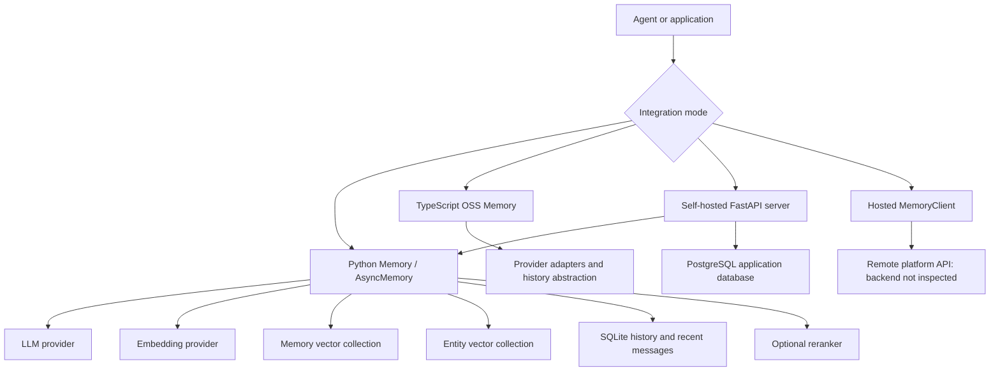
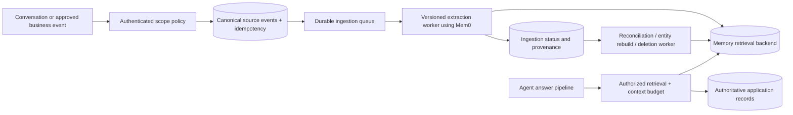

# Mem0 implementation: principal engineer technical analysis

**Analyzed repository:** `C:\ai-workspace\mem0`  
**Source revision:** `b7ad69afda6b6ed030347c66d48a13e4de9dec08`  
**Source commit date:** 2026-10-07  
**Analysis date:** 2026-10-11  
**Package versions in this checkout:** Python `mem0ai` 2.2.1; TypeScript `mem0ai` 3.3.1.

This document analyzes the implementation present in the local checkout, with emphasis on the Python OSS memory engine, the corresponding TypeScript engine, representative storage adapters, and the self-hosted REST server. Source references identify files and functions; repository links are pinned to the analyzed commit. The hosted service is covered only to the extent visible in its client code. Its backend, deployment topology, consistency guarantees, and internal algorithms are outside the evidence available here.

**Evidence classification:** “Observed” means directly supported by inspected source. “Implication” means a consequence inferred from that implementation. “Recommendation” describes an engineering proposal, not functionality already implemented. This is a static source analysis: no application runtime, provider integration tests, fault injection, or performance benchmarks were executed. Existing tests were inspected as evidence of intended behavior; their presence is not a claim that they passed during this analysis.

**Contents**

- [1. Architectural assessment](#1-architectural-assessment)
- [2. Revision-specific corrections to common descriptions](#2-revision-specific-corrections-to-common-descriptions)
- [3. System boundaries and component map](#3-system-boundaries-and-component-map)
- [4. The memory data model](#4-the-memory-data-model)
- [5. Ingestion implementation, phase by phase](#5-ingestion-implementation-phase-by-phase)
- [6. Raw and procedural memory semantics](#6-raw-and-procedural-memory-semantics)
- [7. Retrieval pipeline and scoring mathematics](#7-retrieval-pipeline-and-scoring-mathematics)
- [8. NLP dependence and language behavior](#8-nlp-dependence-and-language-behavior)
- [9. Storage adapter behavior: Qdrant and PostgreSQL](#9-storage-adapter-behavior-qdrant-and-postgresql)
- [10. CRUD, expiration, and temporal semantics](#10-crud-expiration-and-temporal-semantics)
- [11. Python versus TypeScript implementation differences](#11-python-versus-typescript-implementation-differences)
- [12. Hosted client versus self-hosted REST server](#12-hosted-client-versus-self-hosted-rest-server)
- [13. Security and tenant isolation](#13-security-and-tenant-isolation)
- [14. Consistency, failure modes, and retry semantics](#14-consistency-failure-modes-and-retry-semantics)
- [15. How Mem0 differs from traditional data stores](#15-how-mem0-differs-from-traditional-data-stores)
- [16. Capacity, latency, and cost model](#16-capacity-latency-and-cost-model)
- [17. Principal engineering concerns and suggested priorities](#17-principal-engineering-concerns-and-suggested-priorities)
- [18. Production architecture proposal](#18-production-architecture-proposal)
- [19. Verification and evaluation plan](#19-verification-and-evaluation-plan)
- [20. Practical integration example](#20-practical-integration-example)
- [21. API guarantees and consumer contracts](#21-api-guarantees-and-consumer-contracts)
- [22. Embedding, extraction, and index migration](#22-embedding-extraction-and-index-migration)
- [23. Deployment, recovery, and retention procedures](#23-deployment-recovery-and-retention-procedures)
- [24. Implementation evidence map](#24-implementation-evidence-map)
- [25. Adoption decision](#25-adoption-decision)
- [26. Source index](#26-source-index)

## 1. Architectural assessment

Mem0 implements an application-level memory processing and retrieval layer above storage engines. Its central value is converting conversations into reusable, scoped facts and returning a relevant subset for future agent interactions. It delegates vector persistence, indexing, and search primitives to providers such as Qdrant and PostgreSQL/pgvector. It does not implement its own distributed database engine.

The normal OSS write path in this revision is **additive**. It retrieves context, invokes one extraction LLM call, embeds extracted facts in batches, rejects exact textual duplicates within a limited context, persists facts, records history, and builds entity-to-memory associations. The normal search path retrieves semantic candidates and reranks them with keyword relevance and entity associations, with an optional configured reranker afterward.

For a principal engineer, the essential distinction is between **storage correctness** and **memory usefulness**. A vector row can be durably stored and retrieved while the extracted assertion is incomplete, misattributed, stale, or contradicted by another row. Database durability does not validate the meaning of a memory. Mem0 adds interpretation and relevance policies; those policies introduce model dependence, quality evaluation requirements, and application-level consistency concerns.

The resulting architecture is suitable as a derived personalization/context subsystem. Applications with exact business invariants should retain an authoritative transactional store and make memory a projection of approved source data. The code inspected here does not establish end-to-end exactly-once ingestion, transactional coordination across memory/history/entities, automatic contradiction resolution, or tenant authorization solely from identity filters.

Sources: [S1], [S2], [S3], [S4], [S5].

## 2. Revision-specific corrections to common descriptions

Several repository instructions and retained prompts describe capabilities that do not match the active implementation. Source code takes precedence for this analysis.

| Topic | Observed implementation in this revision | Engineering consequence |
|---|---|---|
| Automatic memory reconciliation | Normal `Memory.add(infer=True)` uses `ADDITIVE_EXTRACTION_PROMPT` and creates ADD records. Explicit update/delete methods remain available. | Do not assume an ingestion call rewrites or removes contradictory old facts. |
| Two LLM calls for extraction and reconciliation | Active normal ingestion makes a single extraction call. | Capacity and cost models based on two mandatory calls are inaccurate for this path. |
| Graph memory | No `mem0/graphs/` directory was present in the inspected checkout; `MemoryConfig` has no graph field. The active relationship mechanism is a secondary vector collection of entities linked to memory IDs. | Do not deploy or describe a Neo4j relationship pipeline based on stale instructions. |
| Development server topology | Current Compose defines API, PostgreSQL, and a dashboard. It does not define Neo4j. | Deployment documentation should follow the actual Compose file. |
| OSS search arguments | Python `search()`/`get_all()` require identity inside `filters`; top-level entity arguments are rejected. `add()` and `delete_all()` accept top-level scope IDs. | Surface similarity between clients does not imply identical signatures. |
| Temporal features | OSS expiration visibility exists. OSS explicit `timestamp`, search `reference_date`, and project decay requests are rejected. | Expiration is not temporal reasoning or automatic forgetting. |
| Prompt linking | The extraction prompt asks for `linked_memory_ids`. The normal Python ingestion loop does not persist those model-returned links or resolve its UUID mapping. | Entity associations built later are a separate mechanism; prompt instructions do not establish memory-to-memory graph behavior. |

Retained legacy update/extraction prompts and helper functions are not proof that the normal ingestion path calls them. Likewise, comments naming a “v3 pipeline,” the `version="v1.1"` config default, package versions, and hosted `/v3/` URLs are distinct versioning concepts.

Sources: [S1] `add`, `_add_to_vector_store`, `search`, `_OSSProject`; [S2]; [S3]; [S15].

## 3. System boundaries and component map



| Component | Responsibilities | Boundary it does not cross automatically |
|---|---|---|
| `Memory` / `AsyncMemory` | Validation, scope construction, extraction orchestration, persistence sequencing, retrieval scoring, explicit CRUD | No distributed transaction coordinator or authenticated identity policy |
| LLM providers | Generate extraction text/JSON; provider-specific request formatting | No deterministic correctness guarantee for extracted facts |
| Embedding providers | Produce vectors for add/search/update actions; optional native batching | No automatic migration of all existing vectors when a model changes |
| Vector adapters | Collection lifecycle, insertion, lookup, vector and optional keyword retrieval, filter translation | No uniform performance or filter capability guarantee across providers |
| Entity collection | Store entity text/type and arrays of linked memory IDs | No general-purpose graph traversal or referential integrity engine |
| Python `SQLiteManager` | Memory change history and bounded recent-message context | No transaction spanning a vector provider and SQLite |
| Rerankers | Reorder already retrieved results when configured and requested | No discovery of memories absent from the candidate set |
| Self-hosted REST server | Auth, endpoints, runtime config, request logging, dashboard integration | Authentication alone does not bind all supplied memory scopes to the caller |
| Hosted clients | HTTP serialization, response/error handling, org/project context and additional service surfaces | No visibility into hosted backend implementation |

Sources: [S1], [S2], [S5], [S6], [S12], [S13], [S14], [S16].

## 4. The memory data model

### 4.1 Primary memory records

A primary memory has a generated UUID, an embedding vector, and a payload. `MemoryItem` is the public formatting model; storage payloads contain more internal fields than that model.

Illustrative Python stored payload:

```json
{
  "data": "User prefers vegetarian meals and lives in Austin.",
  "text_lemmatized": "user prefer vegetarian meal live austin",
  "hash": "<MD5 of exact UTF-8 memory text>",
  "created_at": "2026-10-11T15:00:00+00:00",
  "updated_at": "2026-10-11T15:00:00+00:00",
  "user_id": "u-123",
  "agent_id": "travel-assistant",
  "run_id": "trip-planning-42",
  "attributed_to": "user",
  "expiration_date": "2026-12-31",
  "source_event_id": "evt-001"
}
```

This is an illustrative structure, not measured LLM output. Lemmatization depends on installed NLP support. `source_event_id` is example caller metadata; the core does not give it idempotency semantics.

The vector is a representation for relevance search, not a replacement for the text or an authoritative fact schema. Payload fields mix application metadata, scope identity, and internal indexing data. The explicit update path protects identity fields, but applications should also reserve internal payload keys in their own metadata contract.

Search formatting promotes scope, role, attribution, and expiration fields into the result. Other payload values become `metadata`; internal lemmatized text is excluded from the normal result presentation. IDs and timestamps support record operations and auditing; there is no typed domain schema establishing, for example, exactly one current home city per user.

Sources: [S1] `_create_memory`, `_add_to_vector_store`, `_search_vector_store`; [S2] `MemoryItem`.

### 4.2 Scope identity

Creation requires at least one of `user_id`, `agent_id`, or `run_id`. `_build_filters_and_metadata()` trims and validates them, copies caller metadata, strips metadata identity keys, then applies explicit identity arguments. This prevents metadata from silently placing a memory in an unrequested scope.

When multiple identifiers are present, they are cumulative filter conditions rather than a priority hierarchy. A memory with all three can be queried at a broader user scope if the caller intentionally omits agent/run conditions. A write scoped to a run searches for prior memories under that supplied intersection, which can omit otherwise relevant user-wide facts stored without the run.

Recent-message context uses a deterministic key composed of the supplied identifiers in sorted order. Percent, ampersand, and equals characters are escaped to avoid delimiter collisions. The buffer for `{user_id: u}` is distinct from `{user_id: u, run_id: r}`. Scope design therefore determines both retrieval visibility and conversational continuity.

`actor_id`, raw-message `role`, and inferred `attributed_to` describe attribution; they are not authorization credentials. Raw ingestion takes `actor_id` from a message `name`; inferred ingestion stores `attributed_to` when the model emits it.

Sources: [S1] `_build_filters_and_metadata`, `_build_session_scope`, `_strip_identity_keys`, `_add_to_vector_store`; [S20].

### 4.3 Entity records

The entity collection uses the same vector-store provider with a derived collection name. Python normally appends `_entities`; the S3 Vectors branch uses `-entities`. Embedded Qdrant reuses the existing client to avoid local storage lock contention.

Entity payloads hold `data`, `entity_type`, `linked_memory_ids`, and scope IDs. This is an adjacency-style materialized retrieval index: an entity points to many memory UUIDs through a payload array. It is not a normalized edge table with foreign keys, nor does it model predicates such as `WORKS_FOR` or `LOCATED_IN`.

Entity normalization is lowercasing plus whitespace normalization. Linking prefers normalized exact matches, then a semantic match with similarity at least 0.95. Matching entity records merge memory ID sets; unmatched entities receive new UUIDs. Type is not part of the normalized key, so text-level identity can collapse categories.

Sources: [S1] `entity_store`, `_existing_entities_by_text`, `_upsert_entity`, phase 7.

### 4.4 History and recent conversation state

Python history is SQLite with one connection per manager, `check_same_thread=False`, and a per-manager thread lock. History rows include event UUID, memory UUID, old/new text, event, timestamps, deletion flag, actor, and role. Message rows contain message UUID, session scope, role/content/name, and timestamp.

Message persistence trims each scope to its most recent ten rows. Prompt construction truncates each historical message content to 300 characters, with an ellipsis for longer messages. These are separate bounds: row retention limits the buffer, and prompt truncation limits its use as context. New input messages are not capped by that historical truncation rule.

History records capture text changes, not a complete immutable copy of every vector, metadata value, provider configuration, and model version. A metadata-only update can produce old/new text values that are identical. This history is useful for inspection but is not sufficient for deterministic replay or full metadata rollback.

The inspected SQLite schema creates no secondary indexes for `memory_id` history lookup or `session_scope` message selection. As volume grows, query plans and indexing require review. The lock coordinates threads using this manager, not different managers, processes, vector writes, or whole ingestion transactions.

Sources: [S4]; [S3] `_format_conversation_history`, `_truncate_content`; [S1] `_update_memory`.

## 5. Ingestion implementation, phase by phase

```mermaid
sequenceDiagram
    participant A as Application
    participant M as OSS Memory
    participant H as SQLite
    participant E as Embedder
    participant V as Memory collection
    participant L as Extraction LLM
    participant X as Entity collection
    A->>M: add(messages, scope, metadata)
    M->>H: Read last 10 scoped messages
    M->>E: Embed current conversation for search
    M->>V: Retrieve 10 existing scoped memories
    M->>L: Extract ADD-only facts with context
    L-->>M: JSON memory list
    M->>E: Batch embed extracted fact texts
    M->>M: Lemmatize, exact-hash dedup, UUIDs, payloads
    M->>V: Batch insert; individual fallback on exception
    M->>H: History for records confirmed by adapter success
    M->>E: Batch embed unique NLP entities
    M->>X: Search, merge associations, insert entities
    M->>H: Save current messages, trim buffer
    M-->>A: ADD results for successful primary records
```

The sequence is descriptive of the Python normal path. An adapter call returning successfully is the engine's evidence of persistence; provider durability and visibility semantics still apply. See section 11 for the TypeScript failure-reporting difference.

### 5.1 Input handling and path selection

`add()` accepts a string, one message dictionary, or a list of dictionaries. Strings become user messages. Identity and expiration parameters are validated before the main pipeline. Vision handling is routed through `parse_vision_messages()`; ordinary parsing turns supported conversation roles into text.

`infer=True` selects extraction. `infer=False` stores non-system message contents directly. Procedural memory is a separate branch selected by `agent_id` plus `memory_type="procedural_memory"`; it creates an LLM-generated procedure summary and embeds that summary. The source explicitly marks procedural support for future removal.

### 5.2 Context gathering and existing-memory retrieval

The inferred path reads ten recent messages for the exact constructed session key. It embeds the parsed current input using the search action and performs a scoped vector search with `top_k=10`. This lookup uses the vector adapter directly, rather than calling the full hybrid public search pipeline.

Retrieved UUIDs are replaced with short numeric-string IDs in the prompt input. A UUID mapping is constructed but not used later to persist or resolve model-returned memory links. Existing memory text supports model-level deduplication and contextual interpretation; it does not establish a database constraint on duplicate facts.

### 5.3 One additive extraction call

The system prompt explicitly asks for ADD-only, self-contained facts, with contextual richness and attribution. It can extract user facts and useful assistant-generated recommendations or plans. Agent-only scope adds an agent-context suffix when an agent ID exists without a user ID.

The user prompt contains existing memories, recent conversation context, current messages, and custom instructions. Per-call `prompt` overrides configured `custom_instructions`. The prompt builder supports summaries, recently extracted memories, language requirements, and observation-date overrides, but the normal caller does not populate all of those options. Empty headings in a prompt are not evidence of maintained profile summaries.

The LLM receives a JSON-object response-format request. Provider-specific implementations determine how that option is honored. The engine removes code fences, parses JSON, and attempts JSON extraction if direct parsing fails. It then accesses the `memory` array. The generic path does not enforce a complete Pydantic schema for every returned memory item before processing it.

Provider invocation failures become `LLMError` and propagate. Parsing failures are logged and treated as an empty extraction. Consequently, a successful result with no memories can mean either nothing useful was found or extraction output could not be parsed. Applications requiring reliable ingestion need additional quality/status observability.

### 5.4 Embedding and exact-text deduplication

All extracted nonempty texts are submitted to `embed_batch()`. The abstraction defaults to sequential embedding; native provider overrides can reduce requests. The OpenAI implementation chunks into batches of 100, restores output ordering by response index, and validates output count.

If batch embedding raises, the engine embeds individual texts and skips failures. Exact-text MD5 hashes are compared with hashes from the ten retrieved prior memories and with a set for the current batch. Hash comparison occurs after embedding, so duplicates can already have consumed embedding cost.

This is not global or exactly-once deduplication:

- Equal text outside the retrieved ten can be inserted again.
- Semantically equivalent paraphrases have different hashes.
- Concurrent writes can both pass the read-and-hash check.
- New UUIDs are generated for new attempts; an application event ID is not a core idempotency key.
- MD5 is used as a fingerprint, not an integrity signature or trusted identity primitive.

Model-level deduplication supplements these checks, but it is probabilistic and context limited.

### 5.5 Payload construction and primary persistence

Each accepted text receives a fresh UUID, raw text, lemmatized text, MD5, timestamps, copied metadata, and attribution when emitted. The inferred batch sets `updated_at` to `created_at`. All vectors, IDs, and payloads are inserted together.

On an exception, Python retries insertions individually. Only records whose insert call succeeds are included in `persisted_records`. History, entity linking, and returned ADD results use that list. If every primary insert fails, Python raises `VectorStoreError` after saving recent messages.

An important ambiguity remains: an adapter/network exception can occur after some or all rows committed. Retrying the same generated IDs may be safe with an upsert adapter, but may encounter primary-key conflicts with a plain-insert adapter. The orchestration does not read back IDs to distinguish committed-but-unacknowledged records from rejected records. “Confirmed” therefore means successful adapter return, not independent commit verification.

### 5.6 History, entities, and completion

History insertion is batched with individual fallback; final failures are logged. Entity extraction processes persisted text using NLP rather than another extraction LLM call. Unique entities across the batch are embedded and matched against the secondary collection; existing association arrays are merged, and new entities are batch inserted. Entity failures generally degrade ranking and do not abort the primary memory operation.

Finally, input messages are saved to the bounded buffer. This SQLite save can still fail after primary storage succeeded. There is no rollback of the vector records. The application can therefore receive an error even though some durable memory has already been written.

Sources: [S1] `add`, `_add_to_vector_store`; [S3]; [S4]; [S7]; [S8]; [S19].

## 6. Raw and procedural memory semantics

With `infer=False`, the normal Python loop skips system messages and invalid message dictionaries, embeds each remaining content, sets role and optional actor attribution, and calls `_create_memory()`. It produces one raw memory per accepted message.

This branch bypasses the inferred batch deduplication and entity-linking phases. `_create_memory()` itself records vector data and history but does not construct entity associations. It also does not save the recent-message context buffer. These differences matter when switching an application between inferred and raw ingestion: retrieval features and later extraction context need not remain equivalent.

Procedural memory summarizes conversation into operational instructions via the LLM and writes the summary through `_create_memory()`. It is an existing special path, not a general agent learning framework. The branch rejects empty summaries. Treat generated procedures as untrusted text if they could affect tool execution or privileged behavior.

Sources: [S1] `_add_to_vector_store`, `_create_memory`, `_create_procedural_memory`.

## 7. Retrieval pipeline and scoring mathematics

### 7.1 Candidate generation

Python public search validates nonempty query text, `top_k`, semantic threshold, and filters containing a scope identity. Defaults are `top_k=20`, `threshold=0.1`, `rerank=False`, `explain=False`, and `show_expired=False`.

The engine lemmatizes the query, extracts query entities, embeds the query, and performs semantic search. It over-fetches:

```text
candidate_limit = max(4 * requested_top_k, 60)
```

It separately calls `keyword_search()` with the same limit and filters. Unsupported providers return `None`; adapter-specific failures may also degrade keyword retrieval. Entity association lookup follows. Expired primary memories are excluded before final scoring unless requested explicitly.

Crucially, the candidate set comes **only from semantic results**. Keyword-only hits are not unioned into it, and entity-linked memories are not fetched as additional candidates. These secondary signals affect ordering of semantic hits rather than providing independent recall channels. A relevant exact identifier that semantic search misses cannot be recovered by this fusion step.

### 7.2 Keyword normalization

Positive keyword scores are normalized with a logistic function:

```text
b = 1 / (1 + exp(-a * (raw_keyword_score - m)))
```

Parameters depend on the lemmatized query term count:

| Terms | Midpoint m | Steepness a |
|---|---:|---:|
| 1–3 | 5 | 0.7 |
| 4–6 | 7 | 0.6 |
| 7–9 | 9 | 0.5 |
| 10–15 | 10 | 0.5 |
| 16+ | 12 | 0.5 |

The scorer labels this signal BM25, but not every adapter produces true BM25 values. PostgreSQL uses `ts_rank_cd()` with full-text search. Applying one calibration family across distinct relevance algorithms is a portability assumption that should be evaluated empirically.

### 7.3 Entity boost

The Python engine takes at most the first eight extracted query entities before normalized deduplication. It embeds them in a batch and searches up to 500 entity matches per entity. Sync search uses up to four worker threads; async uses concurrent tasks for the entity search portion. Matches below similarity 0.5 are ignored.

For entity match similarity `s` and linked-memory count `n`:

```text
association_weight = 1 / (1 + 0.001 * (max(n, 1) - 1)^2)
boost = s * 0.5 * association_weight
memory_entity_boost = maximum applicable boost across matches
```

The fan-out penalty reduces the influence of broadly linked entities. At `n=1`, weight is 1; at `n=101`, it is 1/11. Those are formula examples, not benchmark measurements. Max aggregation prevents many weak associations from summing into an arbitrarily strong boost.

Entity lookup retains identity filters but drops other metadata predicates. Primary candidates still honor the complete primary search filter, so this does not by itself introduce out-of-filter primary records. It can make association counts and boost statistics broader than the metadata-filtered candidate pool.

### 7.4 Final scoring and threshold semantics

Let `s` be semantic similarity, `b` normalized keyword score, and `e` entity boost. Candidates are first discarded when `s < threshold`. Surviving candidates receive:

```text
D = 1 + (1 if any keyword scores exist else 0)
      + (0.5 if any entity boosts exist else 0)
final_score = min((s + b + e) / D, 1)
```

The active-signal flags depend on whether the corresponding score dictionaries are nonempty for the query, not whether each individual candidate has that signal. Results are sorted descending and truncated to requested top-k.

Consequences:

- A high keyword score cannot rescue a candidate below the semantic threshold.
- `threshold` is not a minimum final-score guarantee. A candidate with `s=0.2` and no keyword contribution can return final score 0.1 if another record activates the keyword divisor.
- The same semantic similarity can produce different final scores as signals become active or inactive.
- These scores are relevance heuristics, not calibrated probabilities that a fact is true.
- Cross-provider score comparisons require checking adapter similarity conversions and keyword calibration.

`explain=True` exposes semantic, keyword, entity, raw, divisor, final, and threshold details. This is valuable for relevance debugging and for detecting degraded retrieval modes.

### 7.5 Optional reranking

Reranking requires both `rerank=True` and a configured reranker. It occurs after hybrid scoring and truncation. A reranker exception logs a warning and returns the original ranked results. It cannot recover candidates excluded earlier, including keyword-only hits, expired records, or memories below the semantic threshold.

The search latency measured for the slow-query notice ends before optional reranking. That notice is therefore not a complete measurement of public search request latency.

Sources: [S1] `search`, `_search_vector_store`, `_compute_entity_boosts`; [S9]; [S10]; [S21].

## 8. NLP dependence and language behavior

Python lemmatization and entity extraction load spaCy's `en_core_web_sm`. Lemmatization removes stopwords and punctuation, keeps alphanumeric lemmas, and additionally retains certain original `-ing` forms to reduce noun/verb ambiguity. Entity extraction combines NER, proper-name spans, quotations, topic phrases, and dotted technical identifiers with deduplication and overlap handling.

Missing spaCy or an unavailable model causes entity extraction to return no entities and lemmatization to return original text. The loader can attempt to download a missing model on first use and remembers loading failure for that process. Production implications include first-request cold-start variability, network dependence during initialization, and a persistent degraded mode until process restart after a failed load.

The English NLP model is distinct from the LLM's language capabilities. Successful multilingual extraction does not imply multilingual entity/lemma quality. The normal prompt caller does not enable the prompt builder's explicit input-language requirement. TypeScript uses `compromise` when available and regex heuristics otherwise, so entity equivalence across SDKs should not be assumed.

Recommendation: package NLP assets with the deployment, pin versions, warm up models deliberately, and evaluate each supported language end to end. Monitor whether entities and lexical scores are actually present rather than inferring capability from dependency declarations.

Sources: [S7], [S11].

## 9. Storage adapter behavior: Qdrant and PostgreSQL

### 9.1 Provider contract

`VectorStoreBase` defines collection operations, insert/search/update/delete/get/list/reset, optional keyword search, and batch search. Higher semantic scores must mean greater similarity; adapters using distances must convert them. The contract prefers a [0,1] range, but that is not an enforced uniform type-level guarantee.

`search_batch()` defaults to sequential searches. `EmbeddingBase.embed_batch()` similarly defaults to sequential work. “Batch” at the orchestration interface does not necessarily mean one network request or concurrent execution. Backend implementations must be examined when estimating cost and latency.

Factories lazily import provider classes through configuration mappings. Optional dependencies keep the core surface configurable, but provider availability, dimension handling, filter support, keyword indexing, and reset behavior vary. Compatibility testing is part of choosing a backend.

### 9.2 Qdrant

The Python Qdrant adapter creates a cosine dense-vector collection and a `bm25` sparse slot using an IDF modifier. It encodes lemmatized text with FastEmbed's `Qdrant/bm25` model and stores sparse vectors alongside dense vectors. Missing FastEmbed or encoder failure disables this lexical signal while preserving semantic storage.

For existing collections, it checks whether the sparse slot exists. Older collections without it continue semantic operation and emit a warning; they are not automatically transformed into the new hybrid schema. Remote mode creates keyword payload indexes for common identity/actor fields; local mode skips those indexes.

Insertion uses Qdrant upsert. This can make retries with the same generated UUID safer than plain INSERT, but retrying the application-level add operation still generates new IDs and may repeat extraction. End-to-end idempotency is a separate requirement.

The adapter accepts supplied clients, remote host/URL configuration, or embedded local paths. `on_disk` describes vector placement; a false value does not mean the configured local database is automatically erased between sessions. Explicit persistent paths and ownership of embedded clients matter operationally.

### 9.3 PostgreSQL/pgvector

The Python adapter uses a connection pool and a table shaped as `id UUID PRIMARY KEY`, `vector vector(d)`, and `payload JSONB`. Collection creation installs pgvector if needed, may create DiskANN when configured and supported, otherwise can create an HNSW cosine index, and creates a GIN full-text index on `payload->>'text_lemmatized'`.

Semantic search orders by cosine distance using `<=>` and returns `max(0, 1-distance)`. Keyword search uses `to_tsvector('simple', ...)`, `plainto_tsquery('simple', ...)`, and `ts_rank_cd()`. This lexical implementation is PostgreSQL text ranking rather than the same algorithm/scale as Qdrant sparse BM25.

Writes use parameterized SQL with quoted collection identifiers. A batch insert executes inside a backend transaction and rolls back on failure. That transaction does not include SQLite history or later entity writes, even if entities use another table in the same PostgreSQL database. The orchestration invokes separate adapter operations.

The inspected collection creation does not automatically create general JSONB identity indexes for every scope predicate. Inspect plans under representative tenant sizes and filter selectivity. ANN performance and recall depend on index settings and filtering behavior. PostgreSQL full-text keyword failures return `None` from this adapter and can silently change the ranking mode apart from logging.

Sources: [S5], [S6], [S8], [S10].

## 10. CRUD, expiration, and temporal semantics

`get(memory_id)`, `update(memory_id, ...)`, `delete(memory_id)`, and `history(memory_id)` are ID-oriented operations. The OSS engine does not receive an authenticated principal or required scope for these calls. API consumers must enforce ownership externally if IDs are exposed across trust boundaries.

Explicit update loads the old payload, merges metadata after removing identity changes, preserves creation time, changes modification time, recomputes text hash and lemmas, embeds the text, writes the vector/payload, and appends history. When text changes, it removes old entity associations and links new ones. Even a metadata-only change can invoke embedding when no precomputed new embedding is supplied; budget accordingly.

Delete removes the vector row, appends a DELETE history record retaining old text, then attempts entity cleanup. Cleanup is best effort and scans up to 10,000 scoped entity rows. It returns immediately if the entity store was never initialized in the current instance. Persisted entity rows from an earlier process can therefore retain stale links unless initialization or repair covers them.

Python `delete_all()` repeatedly lists and deletes batches for a supplied scope and stops if a repeated batch is observed. It does not promise an atomic deletion against concurrent inserts. It does not erase history or the recent-message buffer. `reset()` drops/recreates history state and resets primary storage, then resets an initialized entity store best effort; this also lacks a cross-store atomic boundary.

Expiration is normalized to `YYYY-MM-DD`. A record is expired only when its expiration date is strictly earlier than the current UTC date, so it remains visible on the expiration date itself. Search and scoped listing hide expired records unless `show_expired=True`. ID lookup remains a separate access path, and this is not physical TTL deletion. Expired text can remain in primary storage, history, and entity associations.

The inferred ingestion context lookup does not apply public search expiration filtering. An expired primary memory can still appear in the ten prior memories used for extraction/deduplication. Expiration therefore changes ordinary retrieval visibility without guaranteeing exclusion from all processing paths.

Explicit ingestion `timestamp` and search `reference_date` are rejected in OSS. The extraction prompt builder defaults its observation date to the current date in the normal call. Replaying old conversations can therefore resolve relative dates against the ingestion day unless an application handles temporal grounding separately.

Sources: [S1] `_normalize_expiration_date`, `_payload_is_expired`, `get`, `get_all`, `update`, `_update_memory`, `_delete_memory`, `delete_all`, `reset`; [S3], [S4].

## 11. Python versus TypeScript implementation differences

The SDKs implement related designs, but they are not interchangeable implementations with identical operational properties.

| Dimension | Python OSS | TypeScript OSS |
|---|---|---|
| Default vector backend | Qdrant | Provider named `memory`, implemented with SQLite persistence |
| Default history | SQLite at configured history path | SQLite by default; history abstraction includes memory, dummy, and Supabase implementations |
| Initialization | Primarily synchronous construction | Async initialization promise; probe embedding can detect dimensions when unspecified; public operations await initialization |
| Async behavior | `AsyncMemory` largely offloads synchronous provider calls with `asyncio.to_thread()` | Promise-oriented adapters; synchronous SQLite/CPU work can still execute on the Node event loop |
| NLP | spaCy English model; unavailable NLP removes entity extraction | `compromise` plus regex fallback |
| Inferred insertion failure tracking | Maintains `persisted_records`; returns only adapter-confirmed successes; raises if none succeed | Inspected insertion fallback logs individual failures but proceeds to history/entity processing and results from all prepared `records` |
| Inferred ADD result | Top-level `event: "ADD"` | Inspected loop returns `metadata: {event: "ADD"}` |
| Recent-message saving | SQLite save failure can propagate | Inspected optional save calls catch errors; absence of methods is tolerated |
| Entity store naming | Provider-aware suffix; Qdrant client reuse | Derived collection name and special file paths for SQLite provider |

The TypeScript write-reporting difference is a concrete correctness concern. If the batch insertion and some individual retries fail, `addToVectorStore()` can still produce ADD results, history records, and entity links for rows whose writes did not succeed. This observation follows the control flow inspected; it was not validated by fault injection during this analysis. It should be treated as a priority regression-test and parity-review target.

The default TypeScript `memory` provider stores vectors and JSON payloads in SQLite. Its semantic search reads rows and computes cosine similarity in JavaScript; keyword retrieval also scans rows and computes relevance locally. These paths have approximately O(Nd) vector work over loaded rows plus payload/filter processing, rather than an ANN index. For large collections they can block the event loop and consume substantial memory despite async method signatures.

Payload timestamp naming, options, and provider-specific conversion also vary. Cross-SDK migration should use a deliberate serialization contract and parity fixtures rather than copy records assuming field-level equivalence.

Sources: [S11], [S12], [S13], [S17], [S19].

## 12. Hosted client versus self-hosted REST server

Python `MemoryClient` defaults to the hosted API and calls `/v3/memories/add/` and `/v3/memories/search/`; ID CRUD/history use other versioned routes. The client also exposes service-oriented features such as profiles, exports, summaries, project settings, webhooks, and feedback. These are evidence of client contracts, not evidence of hosted implementation details or OSS feature parity.

The self-hosted server exposes routes including `/memories`, `/search`, `/configure`, and `/reset`. It wraps the synchronous Python `Memory` instance through ordinary FastAPI endpoint functions. Config is global per server process, held in `server_state.py`, with overrides saved in the application database. Configuration reads/swaps use an `RLock`, but that is not a transaction lock around all memory operations.

The development Compose command force-reinstalls the published `mem0ai` package and clears `PYTHONPATH`; it does not demonstrate that SDK changes in the local checkout are the code served by that container. The repository server's actual SDK version must be verified in a built/running image before attributing local source behavior to that deployment. This also contradicts older instructions describing a direct SDK hot-reload mount.

Current development services are API, pgvector PostgreSQL, and dashboard. Memory data and server application/auth/config data use PostgreSQL-backed paths; memory history still uses a mounted SQLite file. The server's application database is separate from the memory table's configured database. Backups must cover each relevant persistence surface.

Changing `MemoryClient.host` does not automatically make its hosted route contracts compatible with the self-hosted server. Route versioning, auth headers, request shapes, and supported options require a dedicated adapter or compatible client.

Sources: [S14], [S15], [S16].

## 13. Security and tenant isolation

### 13.1 What the inspected code provides

The server authenticates via Bearer JWT, per-user API keys, or a legacy admin API key. Auth is enabled by default; startup requires a JWT secret unless authentication is explicitly disabled. Passwords/API keys are hashed, refresh-token reuse is controlled through a conditional database update, and some destructive/configuration routes require admin access. Configuration reads redact sensitive keys. Request logging records request metadata rather than being a complete audit of memory content.

The core strips identity keys from arbitrary metadata on add and update, preventing some accidental cross-scope writes. Query identity validation requires scalar IDs for the recognized top-level identity filters.

### 13.2 What must be enforced by an application

The inspected server memory routes accept caller-supplied memory scope identifiers. The `_auth` result is used for authentication and selected admin checks, but ordinary add/search/scoped listing and ID-based access do not generally derive allowed scopes from the authenticated user. Thus, auth credentials identify an operator; they do not automatically make every `user_id` in a request that operator's exclusive data.

This can be appropriate for a trusted shared-instance administration model, but it is insufficient evidence for adversarial multi-tenant isolation. An application exposing these routes to mutually untrusted users needs a server-side ownership policy that binds principal, tenant, scope, and ID lookup. UUID unpredictability is not authorization.

LLM extraction sends current messages, existing memory context, and historical snippets to the selected model provider. Embedding calls send text to the embedder unless using a local provider. Telemetry is enabled by default in the Python code and can be disabled through `MEM0_TELEMETRY=false`; event data includes operational/provider context and encoded identifiers, and clients have optional account-alias behavior. Inspect actual event payloads for a deployment's privacy requirements.

Deletion also requires a broader policy. Primary-memory delete retains old text in history, can leave recent messages, and only cleans entity associations best effort. Expiration does not erase data. A complete erasure workflow must address primary memories, entities, history, recent messages, provider retention, logs, and backups as applicable.

Prompt injection and memory poisoning are application threats: inferred facts can contain instructions or misleading assertions from untrusted input, and retrieval can carry them into future prompts. Treat retrieved memories as contextual data with provenance rather than privileged instructions. Model output attribution is an assertion to verify, not a trusted audit identity.

Sources: [S1], [S4], [S14], [S16], [S18].

## 14. Consistency, failure modes, and retry semantics

### 14.1 Atomicity boundary

One logical ingestion spans primary vector rows, history, entity rows, and recent messages. The code sequences writes without a common transaction, transactional outbox, durable workflow record, or compensation protocol. Backend ACID applies inside individual backend operations; it does not make the whole memory operation ACID.

History/entity work is partly best effort. This is application-level partial consistency, not a documented eventual-consistency convergence guarantee: a logged failure is not automatically scheduled for repair.

### 14.2 Failure matrix

| Failure point | Python observed behavior | Possible durable state / application implication |
|---|---|---|
| Context/query embedding or prior retrieval fails | Exception can abort before extraction | New facts not written; provider-specific side effects still possible |
| LLM provider call fails | Raises `LLMError` | Retry/fallback possible; no normal primary writes yet |
| LLM output cannot be parsed | Logs and treats as empty extraction; saves messages | Application can see an empty success without a usable fact |
| Batch fact embedding fails | Individual fallback; failed texts skipped | Successful facts may form an incomplete projection |
| Every individual embedding fails | No records; saves messages; empty result | Inferred useful facts can be lost without a primary-store error |
| Batch primary insertion fails | Individual fallback with fixed generated IDs | Partial writes or uncertain committed-but-unacknowledged state |
| All primary insert attempts fail | Saves messages, then raises `VectorStoreError` | Some backend commits can remain ambiguous after network failure |
| History batch and retries fail | Logs and continues | Searchable records without complete history |
| Entity processing fails | Logs and continues | Reduced ranking signals, missing or stale association rows |
| Final recent-message save fails | Can propagate after prior writes | Caller sees failure despite stored memory |
| Update/delete history write fails | Failure after primary mutation | Error response with already changed/deleted primary state; later cleanup may not run |
| Reranker fails | Falls back to original ranking | Successful search with different quality/latency profile |

The TypeScript inferred-path reporting issue in section 11 adds another possibility: a successful-looking ADD result for a record whose writes failed.

### 14.3 Concurrency hazards inferred from control flow

Concurrent ingestions for the same scope can read the same old context, independently extract equal facts, and insert different UUIDs. Entity association updates perform read-modify-write of an ID array without compare-and-swap, so concurrent updates can lose links. Scope buffer writes are SQLite-serialized per manager, but the entire read/extract/write workflow is not serialized.

Explicit updates similarly read and replace payload/vector state without an exposed version precondition. Concurrent updates can overwrite each other's metadata or text. List-and-delete operations race with insertion and changing backend visibility. None of these outcomes is repaired automatically by the presence of an audit table.

### 14.4 Recommendations for stronger correctness

1. Persist source events and an idempotency key in an authoritative database before extraction.
2. Record ingestion status, generated memory IDs, and per-stage outcomes so uncertain writes can be reconciled by read-back.
3. Use deterministic IDs or backend-supported idempotent writes where appropriate; scope the idempotency key by tenant and source.
4. Move critical history/state into a shared transaction when using one database, or use a durable outbox and repair worker across databases.
5. Make entity links a rebuildable projection; prefer atomic set operations or a normalized edge relation with uniqueness constraints for high concurrency.
6. Serialize per-subject extraction only where required for consistent context, or use explicit versions and conflict handling.
7. Expose partial-success and degraded-mode information as first-class operation status.

These are proposed additions, not capabilities supplied by the inspected engine.

Sources: [S1], [S4], [S10], [S12], [S19].

## 15. How Mem0 differs from traditional data stores

### 15.1 The abstraction is different

A conventional data store primarily stores caller-defined records and executes specified data operations. Mem0's inferred ingestion transforms a conversation into selected assertions, and its retrieval policy chooses context useful for an agent. This is a semantic projection implemented using conventional storage infrastructure.

Modern databases already support vectors, full-text search, flexible schemas, and sophisticated ranking. PostgreSQL/pgvector supplies exact/approximate vector search and indexes; Elasticsearch provides lexical, vector, and hybrid retrievers. The distinctive layer here is conversation extraction, scope/context management, and an opinionated memory lifecycle. It is not exclusive ownership of semantic search. See the official [pgvector repository](https://github.com/pgvector/pgvector) and [Elasticsearch retriever documentation](https://www.elastic.co/docs/solutions/search/retrievers-overview).

### 15.2 Comparison matrix

The conventional-store columns describe typical usage. Applications can build equivalent higher-level pipelines on these stores; actual transactions, indexing, and durability depend on the chosen product and configuration.

| Dimension | Relational database | Document / key-value store | Search / vector engine | Mem0 OSS in this revision |
|---|---|---|---|---|
| Write input | Explicit rows and mutations | Explicit documents or key/value mutations | Indexed documents or vectors | Conversations/raw messages transformed into scoped facts when inference is enabled |
| Source of truth | Application-defined transactional state | Application-defined state | Commonly a retrieval index/projection | Best treated as derived memory/context |
| Schema | Typed records and constraints | Flexible structures and keys | Search/index mappings and vector dimensions | Text assertions plus vectors and flexible metadata |
| Semantic interpretation | Application logic outside normal writes | Application logic outside normal writes | Usually outside indexing; optional pipelines vary | LLM extraction is part of normal inferred ingestion |
| Query intent | Predicates, joins, aggregates, ordering | Key lookup/document predicates | Relevance ranking and similarity | Natural-language memory retrieval with scope and hybrid ordering |
| Exactness | Logical query semantics over committed data | Defined key/document operations | Ranking/ANN behavior depends on engine | Facts and relevance depend on model, candidate selection, and scoring |
| Mutation policy | Caller decides insert/update/delete | Caller decides mutation | Caller updates indexed representation | Normal inferred path adds; explicit CRUD is separate |
| Transaction boundary | Can span related records in one database transaction | Product-specific | Product-specific | No shared transaction across vectors/history/entities/messages |
| Duplication control | Keys/unique constraints where configured | Product-specific keys/constraints | IDs and ingestion contract | Limited contextual exact-hash dedup plus model-level avoidance |
| Retrieval completeness | Subject to query and isolation contract | Subject to query and indexing contract | Subject to recall/index design | Limited semantic candidate pool; extra signals do not expand it |
| Temporal meaning | Explicit modelable valid time/event time | Application-defined | Usually indexed timestamps | Basic expiry visibility; full OSS reference-date behavior absent |
| Audit / replay | Can be designed around logs/change capture | Product-specific logs/change streams | Usually source-dependent | Text-change history with gaps possible; not complete event sourcing |
| Cost profile | Storage, compute, indexing, network | Storage, throughput, compute | Indexing and search compute | Adds LLM tokens, embeddings, NLP, entities, and cross-stage work |
| Primary operational metric | Correctness, latency, throughput, durability | Same, product-dependent | Relevance/recall plus availability | Both infrastructure SLOs and memory/answer quality |

Relational transaction isolation is a selectable database guarantee; PostgreSQL's default Read Committed still allows anomalies that stricter levels address. Mem0's cross-component sequence is outside that single transaction contract. See [PostgreSQL transaction isolation](https://www.postgresql.org/docs/current/transaction-iso.html).

Key-value stores should not be equated with ephemeral caches: Redis can be used as a broader data-structure store, with persistence and search capabilities depending on configuration. The issue is which higher-level semantics the application adds. See [Redis data-store documentation](https://redis.io/docs/latest/develop/get-started/data-store/).

### 15.3 Compared with conventional RAG

Typical document RAG preserves/chunks source documents, embeds/indexes those chunks, retrieves relevant passages, and lets a generation model answer from them. Mem0 instead prioritizes extracted subject facts, preferences, plans, and prior recommendations, with recent conversation context and per-subject scopes.

This can reduce the amount of conversational text needed for personalization, but extraction can discard source detail. The default payload does not preserve a complete source-message ID, source offsets, extraction model/prompt version, confidence, or typed validity interval. Applications that need evidence-backed answers should keep raw sources and attach explicit provenance metadata.

The two patterns are complementary: document retrieval provides external evidence; memory provides user/agent context. An answer pipeline can retrieve both, label their provenance, and give authoritative source records priority when they conflict.

### 15.4 Compared with caching and event sourcing

A response cache reuses an output for a key or equivalent request. Mem0 stores reusable assertions and retrieves them for different future questions; it does not replace inference for the final answer. Cache invalidation and memory relevance are separate policies.

An event-sourced system preserves canonical events and derives state through replay. Mem0's history stores changes to extracted text and retains only a small recent-message window. Extraction is model dependent and can lose information. Without an independent raw event log, replay is neither complete nor guaranteed to reproduce the same memory IDs/text.

### 15.5 Concrete example: a preference change

Suppose the user first says “I live in Austin,” then later “I moved to Seattle.” A relational profile can explicitly update one authoritative `current_city` field and retain the move event separately. A document store can replace a profile field. A search engine can index the supplied representations of both events.

In this Mem0 revision, inferred add can append a Seattle fact while retaining the Austin fact. The model may phrase the move correctly, but the write path does not automatically update/delete the Austin row. Retrieval can surface either or both depending on query and ranking. Creation time alone is not a general current-truth resolver.

For “where does this person live now?”, use an authoritative structured profile, an explicit supersession/validity policy, or verified explicit update/delete operations. For “what did we discuss about their move?”, additive memory can preserve useful narrative context. These are different application requirements and should have distinct policies.

## 16. Capacity, latency, and cost model

Let `F` be accepted extracted fact texts, `E` unique entities, `d` vector dimension, `N` primary-memory count, `K` requested results, and `q` processed query entities (at most eight in the Python path).

### 16.1 Ingestion work

The normal inferred path includes one current-conversation embedding, one scoped prior-memory search, one extraction LLM call, fact embedding, primary insertion, history, entity extraction/embedding/search/write, and message-buffer persistence. With native OpenAI batches, fact embedding requires approximately `ceil(F/100)` requests and entity embedding `ceil(E/100)`, before fallback overhead. Default abstract batches can instead make one call per text.

Python entity matching also lists up to 10,000 scoped entity records for normalized exact matching, then batch-searches valid entity vectors. The abstract search-batch implementation loops sequentially unless overridden. Exact entity scanning and growing association arrays can become dominant even when primary insertion is batched.

A useful unmeasured latency model is:

```text
T_add ≈ T_context + T_query_embedding + T_prior_search + T_extraction
      + T_fact_embeddings + T_primary_write + T_history
      + T_entity_NLP + T_entity_embeddings + T_entity_matching/writes
      + T_message_write
```

This is a dependency model, not a measured sum; fallbacks, queueing, provider batching, and partial failures change it. There is no implemented queue/backpressure controller inside the main engine.

### 16.2 Search work

The primary semantic and keyword calls are sequential in the inspected Python pipeline. Entity searches are concurrent within their stage. Over-fetch is `max(4K,60)`, so the default K=20 requests up to 80 primary candidates per retrieval channel. Entity search can examine up to `500q` match rows before linked-ID expansion.

```text
T_search ≈ T_query_NLP + T_embedding + T_semantic + T_keyword
         + T_entity_embedding + T_entity_search_wave
         + T_scoring + T_optional_rerank
```

Thread-based async keeps blocking I/O off the event loop but still consumes threads/connections, and many stages remain sequential. It is not equivalent to a fully native async driver stack or unlimited concurrency. The default Python pgvector pool has bounded connections; entity concurrency and request concurrency compete for those pools.

### 16.3 Storage amplification

Raw float32 vectors require roughly `4Nd` bytes, excluding index/payload overhead. At d=1536, that is 6,144 bytes per vector before indexes, text, sparse vectors, entity vectors, history, and backups. One million such raw vectors are roughly 6.144 GB in decimal units; actual backend memory/disk usage differs substantially with representation, indexes, and compression.

The entity collection adds vectors plus association arrays. History accumulates old/new text across updates/deletes. Recent messages are bounded per scope, but the number of scopes is not bounded by that per-scope retention rule. Additive ingestion can continually increase fact count without automatic compaction or decay.

Sources: [S1], [S4], [S5], [S8], [S10], [S17]. All quantitative values above are code constants or arithmetic illustrations, not measured throughput or latency.

## 17. Principal engineering concerns and suggested priorities

| Priority | Concern observed or inferred | Why it matters | Proposed response |
|---|---|---|---|
| P0 for untrusted tenancy | Caller identity is not generally bound to memory scopes/ID operations in REST handlers | Cross-scope access can violate the intended isolation model | Enforce ownership in every operation; test principal/scope/ID matrices |
| P0 for correctness-sensitive TS use | Inferred TS results/history can include failed insertions | A success response can misrepresent durable state | Track successful rows; parity regression tests with partial/all failure |
| P1 | Separate primary/history/entity/message commits | Partial writes and ambiguous retries | Durable ingestion record, outbox, reconciliation, explicit status |
| P1 | Context-limited dedup and no first-class idempotency | Retries and concurrency can duplicate facts | Source-event idempotency and database uniqueness/deterministic IDs |
| P1 | Additive facts without current-truth resolution | Contradictions can surface as stale personalization | Structured authority and explicit supersession/validity policy |
| P1 | Source provenance/model version absent by default | Hard to explain, audit, or safely re-extract memory | Store source references and extraction configuration versions |
| P1 | Best-effort entity cleanup and process-initialization guard | Stale links and privacy residue | Durable cleanup/repair jobs and completeness monitoring |
| P1 | Default TS SQLite scans/event-loop work | Tail latency and throughput degrade with data size | Use indexed backend for scale; benchmark realistic scope distributions |
| P2 | Lexical/entity signals cannot add candidates | Exact-name retrieval remains semantic-recall constrained | Evaluate candidate union or separate retrieval channels before fusion |
| P2 | Keyword score calibration varies by backend | Relevance thresholds shift on migration | Backend-specific calibration and held-out retrieval evaluation |
| P2 | English NLP dependency and cold downloads | Quality/cold-start/degraded-mode variability | Prepack models, warm up, language-specific evaluation |
| P2 | Local SQLite history in multi-replica deployments | Fragmented context/history and incomplete recovery | Shared durable state or explicit subject routing and backup design |
| P2 | Runtime SDK differs from checkout in dev Compose | Wrong version can be tested or deployed | Pin/verify image dependencies and source/version provenance |

Priority labels describe application-dependent risk, not verified incidents or an upstream vulnerability assessment.

## 18. Production architecture proposal

The following architecture adds stronger operational guarantees around the inspected library. It is a recommendation, not a description of existing Mem0 behavior.



Maintain raw source data only under an explicit retention policy. Track source event, subject scope, consent/visibility, extraction version, and completion status. Bound worker concurrency and use circuit breakers/rate limits for provider outages. Decide whether users require read-your-write behavior, and make the queue/retrieval contract explicit.

Treat primary memory and entity indexing as projections that can be rebuilt from approved events. If a PostgreSQL deployment needs atomic history and primary facts, place those writes behind an explicit shared database transaction; the default adapter calls do not provide that automatically. If providers differ, use durable stage state rather than promising atomicity.

At retrieval time, enforce principal-to-scope authorization, select a context token budget, attach provenance, and distinguish source facts from inferred statements. Mem0 returns memories; the inspected `chat()` methods are unimplemented. The consuming agent is responsible for assembling a prompt, resolving conflicts, and producing an answer.

## 19. Verification and evaluation plan

### 19.1 Existing test evidence inspected

The repository includes tests for extraction parsing/provider errors, immutable identity metadata, UTC timestamps, update expiration, entity boost concurrency/failure isolation, entity embedding cardinality, and rejected-write reporting in Python. Scoring tests encode the semantic threshold gate and adaptive divisor. Storage/session-scope tests cover local state and scope construction. TypeScript includes ingestion, CRUD, initialization, entity, scoring, and provider tests.

These files support the interpretation of intended behavior. They were not run for this document, and they do not establish end-to-end behavior of every provider or deployment.

### 19.2 Recommended implementation-level verification

1. Inject batch and individual insertion failures, including committed-but-unacknowledged writes; verify returned IDs by read-back.
2. Crash after each persistence stage and evaluate recovery/retry behavior.
3. Run concurrent same-scope extraction and entity linking; check duplicate facts and lost associations.
4. Test explicit update/delete with failed history writes and cold entity-store initialization.
5. Verify expiration-day boundaries, expired context in extraction, and physical erasure completeness.
6. Exercise every supported filter/operator on the chosen backend; distinguish unsupported behavior from empty results.
7. Build Python/TypeScript parity fixtures for payloads, event placement, extraction failures, and retrieval scores.
8. Verify the actual server image's imported SDK version and route/client compatibility.
9. Test tenant ownership independently of metadata-scope validation and UUID lookup.

### 19.3 Memory-quality evaluation

Infrastructure tests should be paired with a labeled corpus of conversations and expected reusable facts. Evaluate extraction precision/recall, unsupported assertions, attribution accuracy, contradiction handling, temporal interpretation, and sensitivity to custom instructions. Measure retrieval Recall@K, MRR/nDCG where relevant, exact-identifier cases, and language-specific results.

Ablate semantic-only, semantic+keyword, semantic+entity, all signals, and optional reranking. Compare memory-assisted answers with a raw-history baseline and authoritative-profile baseline using the same answer model and token budget. Include stale preference changes, adversarial input, long sessions, run-scope fragmentation, and missing NLP dependencies.

### 19.4 Operational observability

Capture total request latency plus per-stage timings, provider token/request use, batch/fallback counts, prepared versus confirmed record counts, parse failures, empty extraction rates, entity-link failures, active score signals, and history/message failures. Track drift across model/prompt/backend versions. Telemetry/slow-query notices in the SDK are not substitutes for a deployment's operational metrics and traces.

Back up primary and entity collections, history/recent-message state, and server app/config databases together with version/config provenance. Define which state can be rebuilt and which is authoritative before testing restore procedures.

Sources: [S19], [S20], [S21], [S22].

## 20. Practical integration example

This example shows the Python API shape verified in source. It is illustrative and was not executed. Provider credentials/configuration and persistent paths must be supplied for the deployment.

```python
from mem0 import Memory

memory = Memory.from_config({
    "vector_store": {
        "provider": "qdrant",
        "config": {
            "collection_name": "assistant_memories",
            "path": "./data/qdrant",
            "embedding_model_dims": 1536,
        },
    },
    "llm": {"provider": "openai", "config": {"model": "gpt-5-mini"}},
    "embedder": {
        "provider": "openai",
        "config": {"model": "text-embedding-3-small"},
    },
    "history_db_path": "./data/history.db",
    "custom_instructions": "Remember stable preferences and explicit travel plans.",
})

# The application must authorize this subject before invoking the SDK.
try:
    additions = memory.add(
        [{"role": "user", "content": "I prefer vegetarian meals."}],
        user_id="u-123",
        metadata={"source_event_id": "evt-001"},
    )

    context = memory.search(
        "What meals should I suggest?",
        filters={"user_id": "u-123"},
        top_k=5,
        threshold=0.1,
        explain=True,
    )

    # Preserve the canonical source event separately. ADD output is a projection.
    # Build a bounded prompt from authorized context and authoritative records.
finally:
    memory.close()
```

Create the history directory before construction. `close()` explicitly closes the history manager in the inspected Python class; it is not a blanket proof that every provider client has been deterministically closed. Scope identity should come from trusted application state, not arbitrary end-user metadata. A source-event metadata field helps traceability but does not implement deduplication/idempotency.

## 21. API guarantees and consumer contracts

The table below makes the distinction between an SDK operation and the contract a production application must expose. It summarizes the inspected Python OSS implementation; TypeScript differences remain as described in section 11.

| Operation | Observable behavior in the code | Additional contract needed from the application |
|---|---|---|
| Inferred add | Returns adapter-confirmed ADD records; empty extraction and parsing failure can both return no records | A durable ingestion ID, completion state, partial-success reporting, and quality checks |
| Raw add | Stores each accepted non-system message through separate create/history calls | Duplicate policy and handling of partial completion across messages |
| Search | Scoped semantic candidates, expiry visibility, hybrid scoring, bounded results | Authorization, quality/recall target, token budget, and conflict policy |
| Get by ID | Returns the formatted record or `None`; does not check expiry visibility | Ownership check and a policy for expired/deleted/not-found data |
| Update | Replaces vector/payload before writing history; preserves identity fields | Optimistic version control and reconciliation if later stages fail |
| Delete | Removes primary row, retains old text in history, attempts entity cleanup | Complete erasure semantics and a durable cleanup status |
| Delete scope | Repeated batch listing/deletion; no whole-scope transaction | Behavior under concurrent ingestion and verification of remaining rows |
| History | Returns recorded text changes ordered by stored timestamps | Metadata/provenance audit, retention, and full replay if required |
| Reset | Separately resets history, primary data, and initialized entity state | Coordinated maintenance, failure recovery, and explicit blast radius |

Three contracts deserve explicit product decisions:

1. **Acknowledgment:** Is a request successful when facts are stored, when every projection is complete, or when later searches can observe them? The code cannot supply one universal guarantee across all vector providers.
2. **Identity:** Does `user_id` name an application subject, an authenticated operator, or a tenant-local record? Resolve this before defining API authorization. A trusted administrator can legitimately manage many subjects; an ordinary tenant should not get that authority by supplying another ID.
3. **Truth:** Are memories historical observations, current profile facts, or instructions? Use a typed application policy rather than allowing retrieval rank to decide which category is authoritative.

Recommendation: define a response envelope containing an application operation ID, accepted/persisted/failed IDs, projection status, and extraction version. Keep this envelope outside the SDK if the library must remain unchanged. Polling or a callback can complete asynchronous workflows, but do not label incomplete work as durable completion without defining its persistence boundary.

Sources: [S1], [S4], [S5], [S12], [S16].

## 22. Embedding, extraction, and index migration

### 22.1 Treat configuration changes as data changes

Embedding model identity, dimension, normalization, and provider action semantics define the vector space. Equal dimensions do not imply compatible spaces. Querying old vectors with a different model can degrade or invalidate relevance even when the backend accepts the numeric shape. The primary and entity collections both depend on compatible embeddings.

The Python `MemoryConfig` stores embedder and vector-store configurations separately. The inspected normal initialization does not run a general migration/re-embedding process. TypeScript can probe a dimension during initialization, but probing only establishes vector length; it does not prove an existing collection was produced by the same embedding model. The actual backend still controls how existing schema/dimension mismatches fail.

Extraction changes have different effects. A new prompt/model can change granularity, attribution, language, deduplication, and retained facts. Re-embedding existing fact text changes retrieval representation, while re-extracting canonical conversations can change the fact set itself. These should be planned and evaluated as separate migrations.

### 22.2 Recommended migration procedure

1. Record source SDK revision, extraction model/prompt version, embedder identity/dimension, NLP version, backend schema, and scope conventions.
2. Create a new primary collection and its corresponding entity collection; preserve the old collections until acceptance criteria are met.
3. Decide whether to re-embed stored fact text or re-extract from canonical source events. Re-extraction requires sources that the bounded recent-message table does not retain.
4. Backfill with stable source references and explicit ingestion IDs. Preserve original record timestamps/IDs only through a supported migration contract; ordinary inferred add generates fresh UUIDs.
5. Rebuild entity associations with the same target embedding/NLP configuration, rather than copying entity vectors blindly.
6. Replay changes since the backfill snapshot, or use a controlled dual-write window with independently reconciled statuses.
7. Compare labeled retrieval quality, exact identifiers, filters, expiry, and representative language behavior. Shadow queries should preserve authorization and avoid exposing old/new duplicate context to users.
8. Switch collection routing as one application-controlled configuration change. Keep a rollback path and retain the old state according to policy.

Do not mix old and new embeddings in one collection without a deliberate model-selection/index strategy. If only keyword support changes, the migration can be narrower: Qdrant collections without the `bm25` sparse slot need explicit schema/backfill planning. PostgreSQL `_ensure_collection()` checks existence and skips collection creation for an existing table; merely upgrading the SDK does not demonstrate that an older table gained the new lexical index. Verify both index definition and populated lexical payloads.

### 22.3 Runtime server configuration failure

`server_state.update_config()` assigns `_current_config = next_config` before constructing the replacement `Memory` instance. If construction fails, the reported configuration can describe the requested settings while the old instance remains active. `_save_overrides()` also catches persistence failures and logs them, so a live change can appear effective but not survive restart. Configuration state, instantiated resources, and persisted override state are separate transitions.

There is also no inspected close/drain of the previous instance during a successful swap. In-flight handlers can already hold the old instance while later handlers receive the new one. Multi-process workers maintain separate globals; one process-local swap is not proof of coordinated rollout.

Recommendation: validate/build the candidate instance first, atomically publish a versioned instance/config pair, persist the accepted version with explicit error handling, drain/close old resources, and coordinate versions across replicas. Changes to embedding/index identity should invoke the migration procedure above rather than being treated as ordinary live settings edits.

Sources: [S1] constructor and entity-store creation; [S2]; [S10] collection creation; [S12] `_autoInitialize`; [S16] `update_config` and `_save_overrides`.

## 23. Deployment, recovery, and retention procedures

### 23.1 Deployment acceptance

Before promoting an image, verify its installed SDK version and actual imported module path, vector schema/dimension, primary/entity collection names, persistent history path, and effective NLP assets. The development Compose command can install the published SDK instead of serving the analyzed checkout, as noted in section 12. Build provenance should identify both server source and runtime package versions.

Run readiness checks against the selected backing stores and warm up expensive NLP/embedding initialization under controlled conditions. A responding HTTP endpoint alone does not prove extraction, entity linking, keyword scoring, history writes, and scope authorization work. A representative synthetic subject can exercise the ingestion/search/delete workflow without using production user data.

For multiple replicas, deliberately choose shared history/context storage or route each subject to the owner of its local history. Independent SQLite files produce different conversation context and fragmented history despite shared vectors. A shared filesystem path should not be assumed to solve concurrency and recovery requirements; validate its deployment behavior separately.

### 23.2 Recovery scenarios

| Scenario | Operational response proposed for an application |
|---|---|
| LLM outage | Preserve canonical events, bound retries, distinguish deferred extraction from no-fact success |
| Embedding outage | Queue/retry unprocessed facts and avoid querying with an incompatible replacement model |
| Primary write acknowledgment lost | Read back generated IDs and reconcile before creating a new operation |
| History lost but primary intact | Declare audit/context degradation; rebuild only the parts supported by canonical sources |
| Entity collection lost/stale | Rebuild from current primary facts; semantic retrieval can remain available with measured degradation |
| NLP model unavailable | Surface disabled entity/lemma signals and fix packaging; process-cached loading failure may require restart |
| Reconfiguration fails | Compare active instance/version, current config, and persisted overrides; restore a consistent version |
| Restore from backup | Restore compatible primary/entity/history/app state and replay a defined source-event interval |

Document the difference between reconstructible indexes and irreplaceable audit/source state. A snapshot of vectors alone cannot recreate historical raw conversations or explain why a model extracted an assertion.

### 23.3 Ordering and audit limitations

`SQLiteManager.save_messages()` assigns one timestamp to all messages saved in a call. Retention and read queries order by `created_at` without an explicit sequence tie-breaker. Messages sharing that timestamp do not have a guaranteed application-level order from this query alone, and a batch larger than the ten-row retention limit can have ambiguous survivors at the boundary. The intended chronological behavior should be verified with tied timestamps; a monotonic message sequence would make the contract explicit.

History ordering similarly relies on timestamps and has no universal event-sequence contract across all stages. Do not use this audit output as the sole ordering authority for replay or distributed ingestion reconciliation.

### 23.4 Retention and erasure verification

Define independent retention policies for canonical events, primary facts, entity associations, history, recent messages, request logs, and backups. An expiration date hides memories in selected retrieval paths; it is not a deletion job. A DELETE history event retains the removed text by design.

A complete erasure operation needs a subject identifier that can locate every relevant surface, a durable cleanup workflow, and verification that subsequent lookup/retrieval/history paths meet policy. Historical logs and backups may follow different retention windows; document those windows rather than equating a successful SDK `delete_all()` response with erasure from every persistence surface.

Sources: [S1], [S4], [S15], [S16], [S18]. These procedures are recommendations derived from observed boundaries; they were not executed.

## 24. Implementation evidence map

These links point to the entry lines of the main control-flow sections in the analyzed revision. They support focused design reviews without requiring a reader to search a multi-thousand-line module.

| Question | Source entry point |
|---|---|
| How are creation scope and metadata constrained? | [Python scope construction, line 314](https://github.com/mem0ai/mem0/blob/b7ad69afda6b6ed030347c66d48a13e4de9dec08/mem0/memory/main.py#L314) |
| How does the ADD-only pipeline run? | [Python ingestion, line 881](https://github.com/mem0ai/mem0/blob/b7ad69afda6b6ed030347c66d48a13e4de9dec08/mem0/memory/main.py#L881) |
| What instructs the extraction model? | [Additive prompt, line 468](https://github.com/mem0ai/mem0/blob/b7ad69afda6b6ed030347c66d48a13e4de9dec08/mem0/configs/prompts.py#L468) |
| Where are retrieval candidates selected? | [Python retrieval, line 1642](https://github.com/mem0ai/mem0/blob/b7ad69afda6b6ed030347c66d48a13e4de9dec08/mem0/memory/main.py#L1642) |
| How do entity matches boost memories? | [Python entity boosting, line 1747](https://github.com/mem0ai/mem0/blob/b7ad69afda6b6ed030347c66d48a13e4de9dec08/mem0/memory/main.py#L1747) |
| What exactly is the final score/threshold? | [Score and rank, line 60](https://github.com/mem0ai/mem0/blob/b7ad69afda6b6ed030347c66d48a13e4de9dec08/mem0/utils/scoring.py#L60) |
| Where do explicit update/delete commit stages diverge? | [Update, line 2052](https://github.com/mem0ai/mem0/blob/b7ad69afda6b6ed030347c66d48a13e4de9dec08/mem0/memory/main.py#L2052), [delete, line 2114](https://github.com/mem0ai/mem0/blob/b7ad69afda6b6ed030347c66d48a13e4de9dec08/mem0/memory/main.py#L2114) |
| How is recent context retained and ordered? | [SQLite message save, line 257](https://github.com/mem0ai/mem0/blob/b7ad69afda6b6ed030347c66d48a13e4de9dec08/mem0/memory/storage.py#L257) |
| What SQL/index schema backs pgvector? | [Collection creation, line 262](https://github.com/mem0ai/mem0/blob/b7ad69afda6b6ed030347c66d48a13e4de9dec08/mem0/vector_stores/pgvector.py#L262) |
| Does PostgreSQL keyword search use true BM25? | [Full-text retrieval, line 369](https://github.com/mem0ai/mem0/blob/b7ad69afda6b6ed030347c66d48a13e4de9dec08/mem0/vector_stores/pgvector.py#L369) |
| Where does TypeScript retry writes without filtering results? | [Batch persist, line 1068](https://github.com/mem0ai/mem0/blob/b7ad69afda6b6ed030347c66d48a13e4de9dec08/mem0-ts/src/oss/src/memory/index.ts#L1068), [prepared-record return, line 1285](https://github.com/mem0ai/mem0/blob/b7ad69afda6b6ed030347c66d48a13e4de9dec08/mem0-ts/src/oss/src/memory/index.ts#L1285) |

## 25. Adoption decision

Use this implementation when the primary requirement is reusable conversational context and personalization, and the application can tolerate or explicitly manage model-derived facts. It is especially useful when the team wants configurable extraction, embedding, retrieval, and storage providers behind a compact SDK surface.

Keep transactional business state, exact uniqueness constraints, source evidence, and authorization in explicit application/database contracts. For large or sensitive deployments, choose the backend deliberately, make ingestion replayable, instrument partial/degraded behavior, and define current-truth and erasure policies. The principal engineering work is making the semantic projection reliable enough for the intended product, while preserving the guarantees of its underlying systems.

## 26. Source index

All repository links below are pinned to `b7ad69afda6b6ed030347c66d48a13e4de9dec08`. Function names in the document identify the relevant implementation within each file. Local files were the primary evidence; external documentation supports the traditional-store comparisons only.

| ID | Source | Relevant responsibilities |
|---|---|---|
| S1 | [mem0/memory/main.py](https://github.com/mem0ai/mem0/blob/b7ad69afda6b6ed030347c66d48a13e4de9dec08/mem0/memory/main.py) | Memory/AsyncMemory, scope, additive ingestion, entities, CRUD, expiry, hybrid search |
| S2 | [mem0/configs/base.py](https://github.com/mem0ai/mem0/blob/b7ad69afda6b6ed030347c66d48a13e4de9dec08/mem0/configs/base.py) | MemoryConfig, MemoryItem, history path |
| S3 | [mem0/configs/prompts.py](https://github.com/mem0ai/mem0/blob/b7ad69afda6b6ed030347c66d48a13e4de9dec08/mem0/configs/prompts.py) | Additive extraction instructions, agent suffix, prompt builder, temporal defaults |
| S4 | [mem0/memory/storage.py](https://github.com/mem0ai/mem0/blob/b7ad69afda6b6ed030347c66d48a13e4de9dec08/mem0/memory/storage.py) | SQLite history/messages, locking, transactions, migrations, retention |
| S5 | [mem0/vector_stores/base.py](https://github.com/mem0ai/mem0/blob/b7ad69afda6b6ed030347c66d48a13e4de9dec08/mem0/vector_stores/base.py) | Adapter contract, score direction, optional keyword and batch search |
| S6 | [mem0/utils/factory.py](https://github.com/mem0ai/mem0/blob/b7ad69afda6b6ed030347c66d48a13e4de9dec08/mem0/utils/factory.py) | Provider construction and dynamic imports |
| S7 | [entity_extraction.py](https://github.com/mem0ai/mem0/blob/b7ad69afda6b6ed030347c66d48a13e4de9dec08/mem0/utils/entity_extraction.py), [lemmatization.py](https://github.com/mem0ai/mem0/blob/b7ad69afda6b6ed030347c66d48a13e4de9dec08/mem0/utils/lemmatization.py), [spacy_models.py](https://github.com/mem0ai/mem0/blob/b7ad69afda6b6ed030347c66d48a13e4de9dec08/mem0/utils/spacy_models.py) | NLP extraction, preprocessing, loading/fallback |
| S8 | [mem0/embeddings/base.py](https://github.com/mem0ai/mem0/blob/b7ad69afda6b6ed030347c66d48a13e4de9dec08/mem0/embeddings/base.py), [openai.py](https://github.com/mem0ai/mem0/blob/b7ad69afda6b6ed030347c66d48a13e4de9dec08/mem0/embeddings/openai.py) | Action-aware embedding contract and native batches |
| S9 | [mem0/utils/scoring.py](https://github.com/mem0ai/mem0/blob/b7ad69afda6b6ed030347c66d48a13e4de9dec08/mem0/utils/scoring.py) | Sigmoid normalization, divisor, threshold, explanations |
| S10 | [qdrant.py](https://github.com/mem0ai/mem0/blob/b7ad69afda6b6ed030347c66d48a13e4de9dec08/mem0/vector_stores/qdrant.py), [pgvector.py](https://github.com/mem0ai/mem0/blob/b7ad69afda6b6ed030347c66d48a13e4de9dec08/mem0/vector_stores/pgvector.py) | Representative physical persistence/retrieval adapters |
| S11 | [TS entity_extraction.ts](https://github.com/mem0ai/mem0/blob/b7ad69afda6b6ed030347c66d48a13e4de9dec08/mem0-ts/src/oss/src/utils/entity_extraction.ts) | TypeScript NLP/regex entity behavior |
| S12 | [TS memory/index.ts](https://github.com/mem0ai/mem0/blob/b7ad69afda6b6ed030347c66d48a13e4de9dec08/mem0-ts/src/oss/src/memory/index.ts) | TypeScript initialization, ingestion, entity handling, retrieval, CRUD |
| S13 | [TS config/defaults.ts](https://github.com/mem0ai/mem0/blob/b7ad69afda6b6ed030347c66d48a13e4de9dec08/mem0-ts/src/oss/src/config/defaults.ts), [manager.ts](https://github.com/mem0ai/mem0/blob/b7ad69afda6b6ed030347c66d48a13e4de9dec08/mem0-ts/src/oss/src/config/manager.ts), [storage/base.ts](https://github.com/mem0ai/mem0/blob/b7ad69afda6b6ed030347c66d48a13e4de9dec08/mem0-ts/src/oss/src/storage/base.ts) | Config merging/defaults and optional history interfaces |
| S14 | [mem0/client/main.py](https://github.com/mem0ai/mem0/blob/b7ad69afda6b6ed030347c66d48a13e4de9dec08/mem0/client/main.py) | Hosted routes/client-only platform surfaces |
| S15 | [server/docker-compose.yaml](https://github.com/mem0ai/mem0/blob/b7ad69afda6b6ed030347c66d48a13e4de9dec08/server/docker-compose.yaml) | Development services, mounts, runtime SDK install |
| S16 | [server/main.py](https://github.com/mem0ai/mem0/blob/b7ad69afda6b6ed030347c66d48a13e4de9dec08/server/main.py), [auth.py](https://github.com/mem0ai/mem0/blob/b7ad69afda6b6ed030347c66d48a13e4de9dec08/server/auth.py), [server_state.py](https://github.com/mem0ai/mem0/blob/b7ad69afda6b6ed030347c66d48a13e4de9dec08/server/server_state.py), [db.py](https://github.com/mem0ai/mem0/blob/b7ad69afda6b6ed030347c66d48a13e4de9dec08/server/db.py) | REST auth, scope use, global config, application DB |
| S17 | [TS vector_stores/memory.ts](https://github.com/mem0ai/mem0/blob/b7ad69afda6b6ed030347c66d48a13e4de9dec08/mem0-ts/src/oss/src/vector_stores/memory.ts) | SQLite-backed default vectors, scan-based similarity/keyword scoring |
| S18 | [mem0/memory/telemetry.py](https://github.com/mem0ai/mem0/blob/b7ad69afda6b6ed030347c66d48a13e4de9dec08/mem0/memory/telemetry.py) | Telemetry defaults, sampling, event capture |
| S19 | [tests/memory/test_main.py](https://github.com/mem0ai/mem0/blob/b7ad69afda6b6ed030347c66d48a13e4de9dec08/tests/memory/test_main.py) | Provider/parsing errors, scope immutability, entity concurrency, rejected-write tests |
| S20 | [tests/memory/test_storage.py](https://github.com/mem0ai/mem0/blob/b7ad69afda6b6ed030347c66d48a13e4de9dec08/tests/memory/test_storage.py), [test_session_scope.py](https://github.com/mem0ai/mem0/blob/b7ad69afda6b6ed030347c66d48a13e4de9dec08/tests/memory/test_session_scope.py) | History/message and scope tests |
| S21 | [tests/utils/test_scoring.py](https://github.com/mem0ai/mem0/blob/b7ad69afda6b6ed030347c66d48a13e4de9dec08/tests/utils/test_scoring.py) | Scoring examples and threshold/divisor invariants |
| S22 | [TS OSS tests](https://github.com/mem0ai/mem0/tree/b7ad69afda6b6ed030347c66d48a13e4de9dec08/mem0-ts/src/oss/tests) | TypeScript implementation and provider test inventory |

External comparison references: [PostgreSQL transaction isolation](https://www.postgresql.org/docs/current/transaction-iso.html), [pgvector](https://github.com/pgvector/pgvector), [Elasticsearch retrievers](https://www.elastic.co/docs/solutions/search/retrievers-overview), and [Redis as a data store](https://redis.io/docs/latest/develop/get-started/data-store/). These were consulted on 2026-10-11; they describe storage capabilities, not guarantees of the analyzed Mem0 deployment.

[S1]: https://github.com/mem0ai/mem0/blob/b7ad69afda6b6ed030347c66d48a13e4de9dec08/mem0/memory/main.py
[S2]: https://github.com/mem0ai/mem0/blob/b7ad69afda6b6ed030347c66d48a13e4de9dec08/mem0/configs/base.py
[S3]: https://github.com/mem0ai/mem0/blob/b7ad69afda6b6ed030347c66d48a13e4de9dec08/mem0/configs/prompts.py
[S4]: https://github.com/mem0ai/mem0/blob/b7ad69afda6b6ed030347c66d48a13e4de9dec08/mem0/memory/storage.py
[S5]: https://github.com/mem0ai/mem0/blob/b7ad69afda6b6ed030347c66d48a13e4de9dec08/mem0/vector_stores/base.py
[S6]: https://github.com/mem0ai/mem0/blob/b7ad69afda6b6ed030347c66d48a13e4de9dec08/mem0/utils/factory.py
[S7]: https://github.com/mem0ai/mem0/blob/b7ad69afda6b6ed030347c66d48a13e4de9dec08/mem0/utils/entity_extraction.py
[S8]: https://github.com/mem0ai/mem0/blob/b7ad69afda6b6ed030347c66d48a13e4de9dec08/mem0/embeddings/base.py
[S9]: https://github.com/mem0ai/mem0/blob/b7ad69afda6b6ed030347c66d48a13e4de9dec08/mem0/utils/scoring.py
[S10]: https://github.com/mem0ai/mem0/blob/b7ad69afda6b6ed030347c66d48a13e4de9dec08/mem0/vector_stores/qdrant.py
[S11]: https://github.com/mem0ai/mem0/blob/b7ad69afda6b6ed030347c66d48a13e4de9dec08/mem0-ts/src/oss/src/utils/entity_extraction.ts
[S12]: https://github.com/mem0ai/mem0/blob/b7ad69afda6b6ed030347c66d48a13e4de9dec08/mem0-ts/src/oss/src/memory/index.ts
[S13]: https://github.com/mem0ai/mem0/blob/b7ad69afda6b6ed030347c66d48a13e4de9dec08/mem0-ts/src/oss/src/config/defaults.ts
[S14]: https://github.com/mem0ai/mem0/blob/b7ad69afda6b6ed030347c66d48a13e4de9dec08/mem0/client/main.py
[S15]: https://github.com/mem0ai/mem0/blob/b7ad69afda6b6ed030347c66d48a13e4de9dec08/server/docker-compose.yaml
[S16]: https://github.com/mem0ai/mem0/blob/b7ad69afda6b6ed030347c66d48a13e4de9dec08/server/main.py
[S17]: https://github.com/mem0ai/mem0/blob/b7ad69afda6b6ed030347c66d48a13e4de9dec08/mem0-ts/src/oss/src/vector_stores/memory.ts
[S18]: https://github.com/mem0ai/mem0/blob/b7ad69afda6b6ed030347c66d48a13e4de9dec08/mem0/memory/telemetry.py
[S19]: https://github.com/mem0ai/mem0/blob/b7ad69afda6b6ed030347c66d48a13e4de9dec08/tests/memory/test_main.py
[S20]: https://github.com/mem0ai/mem0/blob/b7ad69afda6b6ed030347c66d48a13e4de9dec08/tests/memory/test_storage.py
[S21]: https://github.com/mem0ai/mem0/blob/b7ad69afda6b6ed030347c66d48a13e4de9dec08/tests/utils/test_scoring.py
[S22]: https://github.com/mem0ai/mem0/tree/b7ad69afda6b6ed030347c66d48a13e4de9dec08/mem0-ts/src/oss/tests
