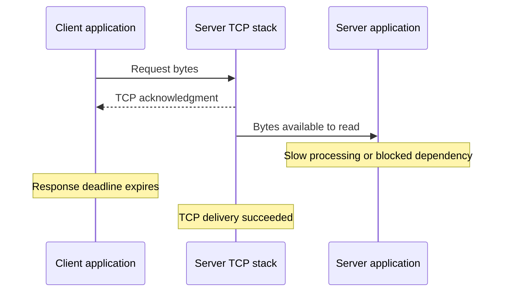
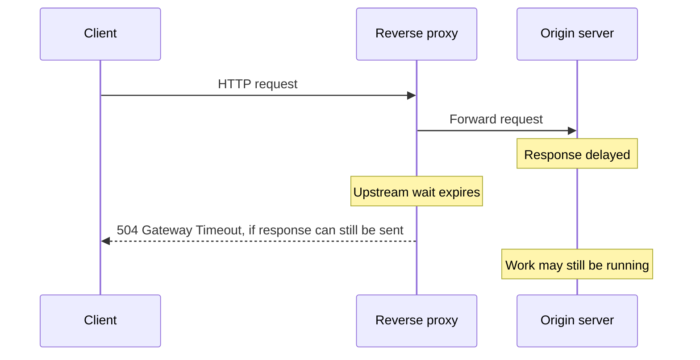

# HTTP and TCP timeouts: what expires, why, and what happens next

Sources checked: November 12, 2026.

This guide covers the common timeouts involved in connecting a client to a server and exchanging requests. It separates protocol timers from limits imposed by an operating system, client library, server, or intermediary. Implementation-specific behavior is labeled, and example durations are illustrative, not recommended defaults.

## Quick reference

These rows summarize the sourced explanations below. “Controls it” identifies the component whose policy expires; the underlying cause can be elsewhere. A local timeout does not automatically produce an HTTP status code.

| Timeout / timer | Who controls it? | What can cause expiry? | What happens on expiry? |
|---|---|---|---|
| DNS resolution | Resolver, OS, or client library | DNS answers do not arrive in time. | Resolution/request fails; a broader connection budget may expire first. |
| Connection-pool acquisition | Client library and application configuration | All permitted connections are busy. | Local failure acquiring capacity; this request may not have reached the server. |
| TCP connect / SYN retry limit | Client connection deadline and OS TCP retry policy | SYN/replies are dropped, host/path unavailable, listener overloaded. | Connection attempt fails when its applicable limit is exhausted. |
| TLS handshake | Client/server TLS implementation and configuration | Handshake peer or traffic stalls. | Negotiation fails; no usable HTTPS connection is established. |
| Socket read / receive | Application/library I/O policy; OS socket API | No incoming data while the application waits. | Read returns a timeout error or partial progress, depending on API. |
| Socket send / HTTP request upload | Application/library I/O policy | Peer stops reading; outgoing buffering fills. | Write fails or returns partial progress; library may cancel the request. |
| `Expect: 100-continue` wait | HTTP client | Interim response is delayed or absent. | Client may proceed with the body; not necessarily a failed request. |
| HTTP response-header wait | HTTP client | Server queues work, processes slowly, or waits on a dependency. | Client stops waiting and reports a local timeout. |
| HTTP response-body inactivity | HTTP client | No next body data within the permitted gap. | Body read fails; the response may be incomplete. |
| Overall operation deadline | Application or client library | Combined phases consume the total budget. | Operation is canceled/failed according to the API. Remote work may continue. |
| Low-speed timeout | Client library | Transfer remains below a configured rate for too long. | Transfer is aborted even if some data keeps arriving. |
| Server request-header timeout | HTTP server | Client does not complete its headers in time. | Server may return 408 and close/reject the request. |
| Server request-body timeout | HTTP server | Upload stalls or exceeds the server's body-reading policy. | Server terminates the request; may return 408. |
| Server handler/processing deadline | Application framework or handler | Slow dependency, lock contention, or long computation. | Framework-specific error/cancellation; work stops only if cancellation is honored. |
| Server response-write timeout | HTTP server | Client stops consuming the response; writes stall. | Server stops transmission and may close the connection. |
| HTTP persistent-connection idle timeout | Client pool or HTTP server | No next request uses an idle connection. | Connection closes normally; a later request needs another usable connection. |
| Maximum connection lifetime / keepalive duration | Client pool, server, or load balancer | Connection reaches its permitted age. | Connection is retired according to policy; not a per-request deadline. |
| Proxy upstream connect timeout | Reverse proxy | Connection to the origin cannot be established in time. | Upstream attempt fails; proxy error/retry behavior depends on configuration. |
| Proxy upstream send timeout | Reverse proxy | Sending the request to the origin stalls. | Upstream exchange is terminated; client-visible outcome depends on proxy state. |
| Proxy upstream read timeout | Reverse proxy | Origin response is late or stops progressing. | Often 504 before response headers are sent; otherwise a truncated/failed response is possible. |
| Infrastructure idle / flow-state timeout | Load balancer, stateful firewall, or NAT | Flow is inactive according to that device's rules. | Connection/state expires; reset or later traffic failure depends on the device. |
| TCP retransmission timer, RTO | Sending endpoint's OS TCP stack | Sent bytes are not acknowledged in time. | Retransmission and backoff; one expiry need not fail the request. |
| TCP user timeout | OS TCP stack; application where supported | Unacknowledged data persists; Linux also covers unsent data blocked by a zero window. | TCP aborts the connection; Linux reports `ETIMEDOUT`. |
| TCP keepalive probe policy | OS TCP stack; application socket settings | Idle peer does not answer the configured probes. | Connection can be declared broken after the failure policy is exhausted. |
| TCP zero-window / persist timer | Sending endpoint's OS TCP stack | Receiver advertises no receive-buffer space. | Sender probes the window; not automatically a connection failure. |
| `TIME-WAIT` timer | Endpoint's OS TCP stack | Normal post-close retention interval elapses. | Retained TCP state is released; no new request need have failed. |
| `FIN-WAIT-2` cleanup | OS policy; Linux scope described below | Orphaned connection waits too long for the peer's FIN. | OS discards/aborts the remaining connection state. |
| Socket linger interval | Application socket configuration and OS | Closing waits on queued outgoing data. | Close stops waiting when its configured interval expires; details vary by OS. |

See [TCP/socket details](#2-tcp-and-socket-timeouts), [HTTP client details](#3-http-client-timeouts), [server details](#4-http-server-timeouts), and [proxy/infrastructure details](#5-proxies-load-balancers-firewalls-and-nat). For Java configuration and exceptions, go to [RestTemplate and HttpClient examples](#10-mapping-these-timeouts-to-resttemplate-and-httpclient).

For the cause of each common Java exception, who raises it, and where to investigate, see [the exception responsibility table](#104-what-java-exceptions-will-you-see). It includes connection resets and refused connections, which are distinct from timeouts.

## 1. Start with the layers

**TCP moves bytes. HTTP gives those bytes request and response meaning.** A TCP timer does not generally know whether an HTTP response is late. HTTP/1.1 commonly uses TCP; HTTP/2 uses TCP; HTTPS adds TLS security. HTTP/3 uses QUIC rather than TCP, so the TCP-specific timers below do not apply to its transport. [HTTP/1.1 connection management](https://www.rfc-editor.org/rfc/rfc9112.html#section-9), [HTTP/2](https://www.rfc-editor.org/rfc/rfc9113.html#section-2), [HTTP/3](https://www.rfc-editor.org/rfc/rfc9114.html#section-2).

```text
HTTP/1.1 or HTTP/2                     HTTP/3
         |                               |
   TLS for HTTPS                 QUIC, including TLS security
         |                               |
        TCP                             UDP
         |                               |
         +--------------- IP ------------+
```

A timeout means that a particular component's waiting rule expired. It is a symptom, not a complete diagnosis: a quiet network path, busy server, slow database, or exhausted local connection pool can produce different timeouts.

For every timeout, ask:

1. **Who owns it?** Client, server, operating system, proxy, or load balancer?
2. **What is it waiting for?** A connection, bytes, complete headers, or a finished operation?
3. **When does its clock start?** At the overall request, a phase boundary, or an individual I/O operation?
4. **Does progress reset it?** An inactivity timer may reset; an absolute deadline does not.
5. **What happens on expiry?** Retransmission, a local error, stream cancellation, or connection closure?

Names alone are insufficient. For example, libcurl's connection timeout includes DNS and protocol negotiation; another API may expose separate timers. There is no single portable value called “the HTTP timeout.” [libcurl connection timeout](https://curl.se/libcurl/c/CURLOPT_CONNECTTIMEOUT.html).

### A simplified request lifecycle

```text
Client                                                  Server
  |                                                       |
  | Wait for a connection-pool slot                        |  local wait
  | Resolve hostname using DNS                            |  before TCP
  |-------------------- SYN ----------------------------->|
  |<---------------- SYN + ACK ---------------------------|  TCP setup
  |-------------------- ACK ----------------------------->|
  |<================ TLS handshake ======================>|  HTTPS only
  |---------------- request headers --------------------->|
  |---------------- request body ------------------------>|
  |                                                       |  application work
  |<--------------- response headers ---------------------|
  |<--------------- response body ------------------------|
  |                                                       |
  |        Connection may remain open for reuse            |

  [----------- optional overall request deadline ---------]
```

This shows a straightforward exchange. Cached DNS and reused connections can skip setup stages; uploads, server work, and response transmission can overlap. A proxy adds another independently timed connection.

## 2. TCP and socket timeouts

These also matter to HTTP when its transport is TCP. They apply in either direction: a server sending a large response can encounter the same delivery problems as a client uploading a request.

### 2.1 Connection establishment timeout and SYN retries

**Waiting for:** TCP connection establishment. In the usual handshake, the client sends SYN, receives SYN+ACK, and sends ACK. [TCP connection establishment](https://www.rfc-editor.org/rfc/rfc9293.html#section-3.5).

**Possible causes:** packets silently dropped by filtering, an unavailable host, a broken return path, heavy packet loss, or an overloaded listener. A black hole is a path that discards traffic without returning a useful error.

**On expiry:** an application connection deadline can stop the attempt before the operating system finishes its SYN retry policy. Linux exposes separate settings for active SYN and passive SYN+ACK retries; these are not a universal fixed timeout. [Linux TCP retry settings](https://docs.kernel.org/networking/ip-sysctl.html).

```text
Successful setup                       Silent drop / black hole

Client              Server             Client       Network      Server
  |----- SYN -------->|                   |--- SYN ----X            |
  |<-- SYN + ACK -----|                   |                         |
  |----- ACK -------->|                   |--- SYN retry X           |
  |                   |                   |                         |
  | connection ready  |                   | connection deadline     |
  |                   |                   | or retry policy expires |
```

**Different failure:** if the destination rejects the connection, the client can receive an immediate refusal instead of waiting for a timeout. On Linux, `ECONNREFUSED` and `ETIMEDOUT` are different outcomes. [Linux connect errors](https://man7.org/linux/man-pages/man2/connect.2.html).

### 2.2 Retransmission timeout: RTO

**Waiting for:** acknowledgment of transmitted TCP data.

**Possible causes:** a lost data segment, lost acknowledgment, excessive delay, congestion, or a disrupted path. Expiry does not identify which occurred.

**On expiry:** TCP retransmits outstanding data. One RTO expiry normally triggers recovery rather than immediately failing the application's request. The RTO adapts to measured round-trip delay and its variation; repeated timer expiries back off the retransmission interval. Eventual abandonment depends on the stack's retry policy and applicable limits. [RTO algorithm](https://www.rfc-editor.org/rfc/rfc6298.html#section-2), [RTO timer management](https://www.rfc-editor.org/rfc/rfc6298.html#section-5), [Linux retry policy](https://docs.kernel.org/networking/ip-sysctl.html).

```text
Sender                                                 Receiver
  |---------------- data segment -----X                    |
  |                                                        |
  | RTO expires                                            |
  |---------------- retransmission ----------------------->|
  |<-------------------- ACK -------------------------------|
  |                                                        |
  |                 transfer continues                     |
```

The drawing illustrates timer-based recovery. TCP can also detect some losses and retransmit before the RTO expires.

### 2.3 TCP user timeout

**Waiting for:** transmitted data to be acknowledged within an allowed bound. This is a local transport policy; “user” means the application using TCP, not a person clicking a button. The TCP User Timeout Option described by RFC 5482 is a related mechanism for advertising a timeout preference to a peer. [TCP user timeout](https://www.rfc-editor.org/rfc/rfc5482.html#section-1).

**Possible causes:** prolonged loss of connectivity or a peer that stops making transport progress.

**Linux example:** `TCP_USER_TIMEOUT` bounds how long data may remain unacknowledged, or buffered but unsent because the peer advertises a zero receive window. Expiry closes the connection and reports `ETIMEDOUT`. It does not set the retransmission interval, and it is not a substitute for a SYN connection deadline. [Linux TCP_USER_TIMEOUT](https://man7.org/linux/man-pages/man7/tcp.7.html).

**Important limitation:** if the request has already been acknowledged and the server is merely slow to produce a response, this is not an application response deadline. The client still needs an appropriate request/read deadline.

### 2.4 Socket read and write timeouts

These limit application I/O waits. They are distinct from TCP's internal retransmission timer.

| Timeout | What is waiting? | Example cause |
|---|---|---|
| Read / receive timeout | The application waits for incoming data. | The server has not responded, is blocked on another service, or response data is delayed. |
| Write / send timeout | The application waits to submit more outgoing data. | The peer reads slowly or stops reading; buffering and flow control eventually prevent further progress. |

Linux's `SO_RCVTIMEO` and `SO_SNDTIMEO` affect blocking socket I/O calls. A call can return partial progress, or an error if it made none. These settings do not set the timeout for `select`, `poll`, or `epoll_wait`. A socket I/O timeout does not itself mean TCP aborted the connection; libraries may additionally cancel or close it. [Linux socket timeouts](https://man7.org/linux/man-pages/man7/socket.7.html).

Successful `send()` does not prove delivery or application completion: data can have been accepted into local buffering. A blocked send can occur when that buffering fills. [Linux send behavior](https://man7.org/linux/man-pages/man2/send.2.html).

### Why TCP success can coexist with an HTTP timeout



**A TCP acknowledgment confirms receipt at the peer's TCP layer; it does not confirm that business logic completed.** A raw TCP application therefore also needs its own rules for response framing and how long to wait. TCP supplies a byte stream, not an application request deadline. [TCP service model](https://www.rfc-editor.org/rfc/rfc9293.html#section-2.2), [Linux TCP stream behavior](https://man7.org/linux/man-pages/man7/tcp.7.html).

### 2.5 TCP keepalive failure detection

**Waiting for:** responses to probes on an otherwise idle connection, when keepalive is enabled.

**Possible causes:** a peer disappears, loses connectivity, or becomes unreachable without delivering a normal close/reset.

**On expiry:** after the configured probe policy is exhausted, the stack can declare the connection broken. Linux separates the idle period before probing, probe interval, and probe count. Keepalive settings and application overrides affect detection time. [Linux keepalive controls](https://docs.kernel.org/networking/ip-sysctl.html).

```text
Last activity       Idle period        Repeated unanswered probes
     |------------------|------------------|--------|--------|
                        probe 1            probe 2  ...      failure
```

Keepalive is optional, and TCP specifies that it be off by default; applications may enable it. It tests transport reachability, not whether the server's application or database is healthy. [TCP keepalives](https://www.rfc-editor.org/rfc/rfc9293.html#section-3.8.4).

### 2.6 Zero-window / persist probing

**Waiting for:** the receiver to advertise space for more data.

**Possible cause:** its receive buffer fills, often because the receiving application is not draining it. The sender periodically probes so that a lost window-update message does not leave the connection stuck permanently.

**On probe-timer expiry:** probing is a recovery action, not automatically a failed request. A persist condition can continue while the peer acknowledges probes, subject to application or operating-system resource policies. A write deadline or supported user-timeout setting can bound the application's wait. [Persist behavior and resource limits, RFC 6429](https://datatracker.ietf.org/doc/html/rfc6429#section-4), [Linux user timeout](https://man7.org/linux/man-pages/man7/tcp.7.html).

RFC 6429 is historical background incorporated into the current TCP specification, RFC 9293.

### 2.7 Closing-related timers

These are useful when diagnosing socket states, but they do not mean a new HTTP request is waiting for a response.

| Timer / setting | Purpose |
|---|---|
| `TIME-WAIT` timer | Retains TCP state after closing to handle old segments and retransmitted FINs, then releases it on expiry. The protocol describes a `2 × MSL` interval; MSL means maximum segment lifetime. |
| `FIN-WAIT-2` cleanup | Linux's `tcp_fin_timeout` bounds this state for orphaned connections: sockets no longer owned by an application, waiting for the peer to close its sending direction. It does not control `TIME-WAIT`. |
| Socket linger | With Linux `SO_LINGER` enabled, closing can wait for queued outgoing data to be sent or the linger interval to expire. A stalled peer/path can delay completion. |

Sources: [TCP closing sequence](https://www.rfc-editor.org/rfc/rfc9293.html#section-3.6), [Linux FIN-WAIT-2 setting](https://docs.kernel.org/networking/ip-sysctl.html), [Linux SO_LINGER](https://man7.org/linux/man-pages/man7/socket.7.html).

## 3. HTTP client timeouts

HTTP libraries add timers around transport setup and HTTP message exchange. The categories below describe common concepts, not a mandatory set of HTTP protocol settings.

### 3.1 Before the request is sent

| Timeout | What it limits | Possible causes and consequences |
|---|---|---|
| Connection-pool acquisition | Waiting to obtain an available pooled connection or capacity. | Busy connections, concurrency beyond the pool limit, or responses not released. The request may fail before any bytes for it reach the server. [HTTPX pool timeout](https://www.python-httpx.org/advanced/timeouts/#fine-tuning-the-configuration). |
| DNS resolution | Waiting for hostname resolution. It may be included in a broader connection budget. | Resolver unreachability, dropped queries, or slow resolution. A definite negative DNS answer is different from a timeout. [libcurl connection phase](https://curl.se/libcurl/c/CURLOPT_CONNECTTIMEOUT.html). |
| TCP connect | Waiting for TCP setup. | The connection problems described in section 2.1. Check whether the library's setting also covers DNS or TLS. [libcurl connection phase](https://curl.se/libcurl/c/CURLOPT_CONNECTTIMEOUT.html). |
| TLS handshake | Waiting for HTTPS security negotiation. | An unresponsive TLS endpoint or delayed handshake traffic. TCP can already be connected. A certificate rejection is a different failure. Go exposes `TLSHandshakeTimeout`. [Go HTTP transport](https://pkg.go.dev/net/http#Transport). |

Pool acquisition and DNS are not themselves TCP protocol timers. Plain HTTP does not perform a TLS handshake.

### 3.2 During the exchange

| Timeout | What it limits | Possible causes and consequences |
|---|---|---|
| Request write / upload | Waiting to send request data. Often measured per chunk or I/O operation. | A stalled upload or a peer that stops reading. HTTPX has a separate write timeout. [HTTPX write timeout](https://www.python-httpx.org/advanced/timeouts/#fine-tuning-the-configuration). |
| `Expect: 100-continue` wait | Waiting for an initial response before sending the body. | The server/proxy delays its interim response. Expiry can allow sending the body instead of failing the request; Go exposes this separately. [Go ExpectContinueTimeout](https://pkg.go.dev/net/http#Transport). |
| Response-header timeout | Waiting for response headers; exact start and completion criteria vary. | Server queuing, slow processing, or a blocked dependency. Go's timer starts after the request is fully written and excludes reading the response body. [Go ResponseHeaderTimeout](https://pkg.go.dev/net/http#Transport). |
| Response read / body inactivity | Waiting for the next response data. | The server stalls mid-response or data is delayed. A per-chunk limit need not cap the complete download duration. [HTTPX read timeout](https://www.python-httpx.org/advanced/timeouts/#fine-tuning-the-configuration). |
| Total operation deadline | Bounding the overall operation. | Any combination of phases consumes the budget. libcurl's total timeout includes its connection phase. Verify retry, redirect, queue, and body coverage in the API used. [libcurl total timeout](https://curl.se/libcurl/c/CURLOPT_TIMEOUT.html). |
| Low-speed timeout | Requiring a minimum transfer rate over a configured interval. | A transfer trickles data too slowly, even though it never becomes completely idle. libcurl exposes a speed threshold plus duration. [libcurl low-speed timeout](https://curl.se/libcurl/c/CURLOPT_LOW_SPEED_TIME.html). |

**Time to first byte (TTFB) is a measurement, not a universally defined timeout setting.** Receiving one byte and receiving complete response headers are different milestones. Check which one the client actually limits.

### 3.3 Inactivity timeout versus absolute deadline

Assume a response is still incomplete, a read timeout permits a 3-second wait for each next chunk, and an independent absolute deadline expires at 10 seconds:

```text
Seconds:          0    2    4    6    8    10
Response chunks:  *----*----*----*----*-----|
                                          X absolute deadline

Each gap is shorter than 3 seconds:
    The per-chunk read timeout has not expired.

The operation reaches its 10-second deadline:
    The overall deadline expires despite continuing progress.
```

In another exchange, if a chunk arrives at 2 seconds and no more data arrives, the same 3-second inactivity policy can expire around 5 seconds. Actual scheduling and buffering affect observations.

This is why an option named `read_timeout=3` must not be assumed to mean “finish the entire response within three seconds.” [HTTPX read semantics](https://www.python-httpx.org/advanced/timeouts/#fine-tuning-the-configuration), [libcurl overall timeout](https://curl.se/libcurl/c/CURLOPT_TIMEOUT.html).

## 4. HTTP server timeouts

The server has its own clocks, independent of the client's.

| Timeout | What the server waits for | Possible cause |
|---|---|---|
| Request-header timeout | Complete request headers. NGINX's `client_header_timeout` limits this wait. | A slow or stalled client, packet delay, or deliberately slow header transmission. |
| Request-body timeout | More upload data, or a complete body, according to the server's policy. NGINX's `client_body_timeout` limits gaps between reads. | An interrupted/stalled upload. |
| Response-write timeout | Progress writing a response. NGINX's `send_timeout` limits gaps between writes. | The client stops consuming data and outgoing buffers eventually fill. |

These NGINX examples illustrate why a header limit, body inactivity limit, and whole-operation deadline have different meanings. [NGINX header timeout](https://nginx.org/en/docs/http/ngx_http_core_module.html#client_header_timeout), [body timeout](https://nginx.org/en/docs/http/ngx_http_core_module.html#client_body_timeout), [response send timeout](https://nginx.org/en/docs/http/ngx_http_core_module.html#send_timeout).

**Application/handler deadline:** a framework or application may additionally bound processing after receiving a request. Causes include slow database calls, dependency waits, lock contention, or CPU-heavy work. Response behavior varies: Go's `TimeoutHandler`, for example, produces a 503 when its handler limit is exceeded. It is separate from reading an incoming request. [Go TimeoutHandler](https://pkg.go.dev/net/http#TimeoutHandler).

**HTTP persistent-connection idle timeout:** after a response finishes, either endpoint may close an unused connection rather than reserve resources indefinitely. This is a normal reuse policy. HTTP/1.1 specifies no required idle duration; closure can race with a new request that tries to reuse the connection. [HTTP/1.1 failures and timeouts](https://www.rfc-editor.org/rfc/rfc9112.html#section-9.5).

## 5. Proxies, load balancers, firewalls, and NAT

### 5.1 A reverse proxy adds another timed exchange

```text
Client                    Reverse proxy                 Origin server
  |                            |                            |
  +--- connection A ---------->+--- connection B ---------->+
       client-side timers          upstream-side timers
```

“Upstream” means the next server the proxy contacts. A healthy connection A does not prove connection B is healthy.

| Proxy timeout | What the proxy waits for | Possible cause |
|---|---|---|
| Upstream connect | Establishing a connection to the origin. | Origin/path unavailable or filtered. |
| Upstream send | Sending request data to the origin. | Origin stops reading; upstream writes stall. |
| Upstream read | Receiving response data from the origin. | Slow processing or a response that stalls. |

NGINX exposes `proxy_connect_timeout`, `proxy_send_timeout`, and `proxy_read_timeout`. Its read and send timeouts limit gaps between successive operations, rather than the total response/request duration. [NGINX proxy connection timeout](https://nginx.org/en/docs/http/ngx_http_proxy_module.html#proxy_connect_timeout), [send timeout](https://nginx.org/en/docs/http/ngx_http_proxy_module.html#proxy_send_timeout), [read timeout](https://nginx.org/en/docs/http/ngx_http_proxy_module.html#proxy_read_timeout).



If the client's own deadline expires first, the client can report a local timeout without receiving the proxy's later error. If response headers were already forwarded, the proxy cannot replace that response's status with a new 504; the client may instead observe an incomplete body or stream/connection failure. [504 semantics](https://www.rfc-editor.org/rfc/rfc9110.html#section-15.6.5), [incomplete HTTP/1.1 responses](https://www.rfc-editor.org/rfc/rfc9112.html#section-8).

### 5.2 Infrastructure idle and connection-state timeouts

A load balancer can close an inactive connection even while the server is computing a response. AWS Application Load Balancer documents an idle limit based on the absence of data. Its HTTP/2 PING frames do not reset that limit. It also has a separate maximum HTTP client keepalive duration. [AWS connection attributes](https://docs.aws.amazon.com/elasticloadbalancing/latest/application/edit-load-balancer-attributes.html).

Stateful firewalls and NAT devices also maintain timed connection-tracking state. For example, Linux conntrack has separate timers for established, SYN, FIN, and other states; these are distinct from an endpoint's TCP timers. [Linux connection-tracking timers](https://docs.kernel.org/networking/nf_conntrack-sysctl.html).

When infrastructure expires a flow, the endpoint may see a reset or discover the break on later traffic. Exact behavior depends on the device and configuration; Azure Load Balancer, for example, exposes TCP reset behavior alongside its idle timeout. [Azure load balancer idle/reset settings](https://learn.microsoft.com/en-us/azure/load-balancer/load-balancer-tcp-idle-timeout).

### Three different meanings of “keepalive”

| Mechanism | Purpose | What it does not establish |
|---|---|---|
| HTTP persistent connection / keep-alive | Reuse a connection for additional requests. | It does not inherently send health probes. |
| TCP keepalive | Probe an idle transport connection. | It does not prove application readiness or request completion. |
| Application heartbeat / HTTP/2 PING | Check activity at that protocol layer. | It does not automatically refresh every intermediary's idle policy. |

Sources: [HTTP persistence](https://www.rfc-editor.org/rfc/rfc9112.html#section-9.3), [TCP keepalive](https://www.rfc-editor.org/rfc/rfc9293.html#section-3.8.4), [HTTP/2 PING](https://www.rfc-editor.org/rfc/rfc9113.html#section-6.7), [AWS PING limitation](https://docs.aws.amazon.com/elasticloadbalancing/latest/application/edit-load-balancer-attributes.html#connection-idle-timeout).

## 6. HTTP/2 and HTTP/3 considerations

HTTP/2 multiplexes multiple request/response streams over one connection. A connection can carry traffic for one stream while another request stalls. Therefore, a connection inactivity timer cannot replace a per-request deadline. A stream can be canceled with `RST_STREAM`; TCP failure can affect every stream on that connection. Flow control also operates at stream and connection levels. [HTTP/2 streams](https://www.rfc-editor.org/rfc/rfc9113.html#section-5), [stream cancellation](https://www.rfc-editor.org/rfc/rfc9113.html#section-6.4).

HTTP/3 retains HTTP request/response concepts but uses QUIC. Request deadlines and infrastructure policies still matter, but TCP SYN retries, TCP RTO, TCP keepalive, and TCP `TIME-WAIT` are not its transport mechanisms. QUIC has its own recovery and connection rules; this guide does not enumerate them. [HTTP/3 transport](https://www.rfc-editor.org/rfc/rfc9114.html#section-2).

## 7. Local timeout versus an HTTP error response

| Observation | Meaning |
|---|---|
| Client reports “connect timeout” or “read timeout” | A local waiting rule expired. There may be no HTTP response or status code. |
| HTTP **408 Request Timeout** | The server's allowed time to receive a complete request expired. This is not the generic status for slow response processing. |
| HTTP **504 Gateway Timeout** | A gateway/proxy waited too long for an upstream response needed to fulfill the request. |
| HTTP **503 Service Unavailable** | The server is temporarily unable to handle the request. It is not synonymous with a network timeout. |
| Connection refused, reset, or end-of-stream | An explicit failure/closure signal, not itself a timer expiry at the observing endpoint. A timeout elsewhere may have caused a closure. |

Status definitions: [408](https://www.rfc-editor.org/rfc/rfc9110.html#section-15.5.9), [504](https://www.rfc-editor.org/rfc/rfc9110.html#section-15.6.5), [503](https://www.rfc-editor.org/rfc/rfc9110.html#section-15.6.4). Socket distinctions: [connect errors](https://man7.org/linux/man-pages/man2/connect.2.html), [TCP close/reset behavior](https://www.rfc-editor.org/rfc/rfc9293.html#section-3.6).

## 8. How several timers interact

For a given observer, the first applicable deadline that aborts its wait determines its timeout outcome. Recovery timers such as RTO can expire earlier without ending the request. Compare actual expiry times, not just configured durations: timers can start at different stages and can reset on different events.

Illustrative exchange:

```text
Time from start      0 s       1 s             6 s               10 s
                     |---------|---------------|------------------|
Client total budget  [...........................................] 10 s
Connection setup     [ done ]                                      within 2 s limit
Proxy upstream wait            [...............X]                  5 s from its start
                                               |
                                     proxy can return 504 first
```

If the proxy's upstream limit were longer, the client could give up at 10 seconds first. Neither result alone proves whether the origin processed the request.

**A timeout is not evidence that an operation did not happen.** For example, a server might commit an order and then fail to deliver the response. Retrying can repeat a side effect. HTTP permits automatic retries under specific idempotency conditions; application-specific deduplication can provide additional guarantees. [HTTP idempotency and retries](https://www.rfc-editor.org/rfc/rfc9110.html#section-9.2.2).

Cancellation must also reach the work being performed to stop it. A client ceasing to wait does not, by itself, guarantee that a remote handler, database query, or downstream operation has stopped.

## 9. A practical diagnosis checklist

Treat these as investigation clues, not proof of a single cause.

| Evidence | Investigate first |
|---|---|
| Failure while waiting for pool capacity | Connection limits, concurrency, response consumption/release. |
| DNS does not complete | Resolver access, query timing, resolver logs. |
| Repeated SYNs without a reply | Packet filtering, target address, listener health, return path. |
| TCP connects; TLS does not finish | TLS endpoint and handshake traffic. |
| Upload stalls; peer advertises zero window | Whether the receiving application is reading. |
| Request bytes acknowledged; no response headers | Server queuing, handler/dependency timing, proxy upstream limits. |
| Headers arrive; response body stops | Body read/inactivity limits, server streaming, packet loss. |
| First use after a long idle period fails | Server/pool/load-balancer idle policies and stale connection reuse. |
| A received 504 | The responding gateway's upstream timing and origin logs. |

Record the timeout owner and exact error, elapsed time, DNS/connect/TLS/header/body timing, request identifier, and relevant proxy/server logs. Where available, a packet capture can distinguish missing SYN replies, retransmissions, zero-window advertisements, FINs, and resets. Correlate observations at both ends: the client and server can have different views of the same failure.

For configuration, define the acceptable total wait, then verify which phase and inactivity limits the chosen implementation supplies. For streaming, decide separately how long a stream may remain open and how long a gap is acceptable. Keep retries within the intended overall budget, and confirm their safety for operations with side effects. These are design choices, not universal HTTP/TCP defaults.

## 10. Mapping these timeouts to RestTemplate and HttpClient

### 10.1 RestTemplate delegates to a transport

`RestTemplate` uses a `ClientHttpRequestFactory`. The selected factory determines which client implementation executes the request. For example, `HttpComponentsClientHttpRequestFactory` uses Apache HttpClient; `SimpleClientHttpRequestFactory` uses JDK `HttpURLConnection`. Configuring one does not configure the other. [Spring Apache factory](https://docs.spring.io/spring-framework/docs/6.2.x/javadoc-api/org/springframework/http/client/HttpComponentsClientHttpRequestFactory.html), [Spring simple factory](https://docs.spring.io/spring-framework/docs/6.2.x/javadoc-api/org/springframework/http/client/SimpleClientHttpRequestFactory.html).

```text
Your application
      |
      v
RestTemplate
      |
ClientHttpRequestFactory
      |
Apache HttpClient, or another selected transport
      |
Java sockets / TLS
      |
OS TCP stack  --> network --> server / proxy

Library settings: pool wait, connect, response/read, TLS configuration
OS mechanisms:   SYN retry policy, RTO, TCP keepalive, persist, TIME-WAIT
```

The examples below distinguish **Apache HttpClient** (`org.apache.hc...`) from the **JDK HttpClient** (`java.net.http...`). They are different APIs. Spring examples target Framework 6.2.x; Apache examples use the 5.3.x classic/blocking APIs, checked against the 5.3.1 documentation and source. These are API examples, with illustrative values.

### 10.2 Mapping to Apache HttpClient 5 classic

| Concept in this guide | Apache configuration | Meaning / limitation |
|---|---|---|
| Pool acquisition | `RequestConfig.setConnectionRequestTimeout(...)` through its builder | Time allowed to lease pool capacity. “Connection request” here does not mean the complete HTTP request. |
| Establish a new connection | `ConnectionConfig.setConnectTimeout(...)` through its builder | Connection setup limit. Reusing a connection skips a new TCP handshake. DNS and multiple candidate addresses need separate consideration. |
| TLS negotiation | `TlsConfig.setHandshakeTimeout(...)` through its builder | TLS handshake I/O timeout. In the checked classic implementation it sets a socket read timeout during negotiation, not an independent wall-clock deadline over all work. |
| Baseline socket read timeout | `ConnectionConfig.setSocketTimeout(...)` through its builder | Default socket I/O setting; for the blocking socket path this limits waiting on reads. It is not a dedicated upload/write deadline. |
| Response/read wait | `RequestConfig.setResponseTimeout(...)` through its builder | In this classic implementation, a non-null value replaces the endpoint's socket timeout for the exchange. It is not a total elapsed-time deadline. |
| Whole operation, including all body consumption | Additional application deadline with effective cancellation | The pool/connect/response settings above do not create one combined operation deadline. |
| DNS, RTO, TCP user timeout, TCP keepalive failure, server/proxy timers | Resolver, OS/socket, server, or proxy configuration as applicable | Ordinary pool/connect/response setters do not reconfigure these mechanisms. |

API references: [RequestConfig.Builder](https://hc.apache.org/components/httpcomponents-client-5.3.x/5.3.1/httpclient5/apidocs/org/apache/hc/client5/http/config/RequestConfig.Builder.html), [ConnectionConfig.Builder](https://hc.apache.org/components/httpcomponents-client-5.3.x/5.3.1/httpclient5/apidocs/org/apache/hc/client5/http/config/ConnectionConfig.Builder.html), [TlsConfig.Builder](https://hc.apache.org/components/httpcomponents-client-5.3.x/5.3.1/httpclient5/apidocs/org/apache/hc/client5/http/config/TlsConfig.Builder.html). The response-to-socket and TLS-to-socket mappings are verified in Apache's [classic execution source](https://raw.githubusercontent.com/apache/httpcomponents-client/rel/v5.3.1/httpclient5/src/main/java/org/apache/hc/client5/http/impl/classic/InternalExecRuntime.java) and [TLS socket source](https://raw.githubusercontent.com/apache/httpcomponents-client/rel/v5.3.1/httpclient5/src/main/java/org/apache/hc/client5/http/ssl/SSLConnectionSocketFactory.java).

### 10.3 Example: RestTemplate backed by Apache HttpClient

Requires Java 17+ for Spring 6, with `spring-web` 6.2.x and `httpclient5` 5.3.x available through your project's dependency management.

```java
import org.apache.hc.client5.http.config.ConnectionConfig;
import org.apache.hc.client5.http.config.RequestConfig;
import org.apache.hc.client5.http.config.TlsConfig;
import org.apache.hc.client5.http.impl.classic.CloseableHttpClient;
import org.apache.hc.client5.http.impl.classic.HttpClients;
import org.apache.hc.client5.http.impl.io.PoolingHttpClientConnectionManagerBuilder;
import org.apache.hc.core5.util.Timeout;
import org.springframework.http.client.HttpComponentsClientHttpRequestFactory;
import org.springframework.web.client.ResourceAccessException;
import org.springframework.web.client.RestTemplate;

public class RestTemplateTimeoutExample {
    public static void main(String[] args) throws Exception {
        var connectionConfig = ConnectionConfig.custom()
                .setConnectTimeout(Timeout.ofSeconds(2))
                .setSocketTimeout(Timeout.ofSeconds(5))
                .build();

        var tlsConfig = TlsConfig.custom()
                .setHandshakeTimeout(Timeout.ofSeconds(3))
                .build();

        var pool = PoolingHttpClientConnectionManagerBuilder.create()
                .setMaxConnTotal(20)
                .setMaxConnPerRoute(20)
                .setDefaultConnectionConfig(connectionConfig)
                .setDefaultTlsConfig(tlsConfig)
                .build();

        var requestConfig = RequestConfig.custom()
                .setConnectionRequestTimeout(Timeout.ofSeconds(1))
                .setResponseTimeout(Timeout.ofSeconds(5))
                .build();

        try (CloseableHttpClient client = HttpClients.custom()
                .setConnectionManager(pool)
                .setDefaultRequestConfig(requestConfig)
                .disableAutomaticRetries()
                .disableRedirectHandling()
                .build()) {
            var factory = new HttpComponentsClientHttpRequestFactory(client);
            var restTemplate = new RestTemplate(factory);

            String body = restTemplate.getForObject(
                    "https://example.com", String.class);
            System.out.println(body);
        } catch (ResourceAccessException ex) {
            System.err.println(ex.getMostSpecificCause());
            throw ex;
        }
    }
}
```

The pool builder supports the separate connection and TLS configurations shown here. The client is closed after this standalone demonstration; in a service, reuse the configured client/RestTemplate and close its resources at application shutdown. [Apache pool builder](https://hc.apache.org/components/httpcomponents-client-5.3.x/5.3.1/httpclient5/apidocs/org/apache/hc/client5/http/impl/io/PoolingHttpClientConnectionManagerBuilder.html), [Spring factory lifecycle](https://docs.spring.io/spring-framework/docs/6.2.x/javadoc-api/org/springframework/http/client/HttpComponentsClientHttpRequestFactory.html).

**How the values behave:**

| Scenario | Setting that matters | Expected observation |
|---|---|---|
| All 20 route connections remain occupied. | Pool lease: 1 second | Failure acquiring a connection, before sending this request. |
| A resolved destination silently drops connection traffic. | Connect: 2 seconds | That connection attempt times out. |
| TCP connects, but the TLS peer stops sending handshake data. | TLS handshake read wait: 3 seconds | TLS negotiation fails on the applicable I/O timeout. |
| Request is sent; server produces no response data. | Response/socket read wait: 5 seconds | Read/response timeout while waiting for data. |
| Server keeps supplying body data within each permitted read wait. | Response/socket read wait: 5 seconds | Download can last longer than 5 seconds. |
| Proxy sends a complete HTTP 504 response before a local timeout. | Proxy's upstream timer | An HTTP status error is received, rather than a local I/O timeout. |

**These do not add up to a guaranteed `1 + 2 + 3 + 5 = 11` second maximum.** Read waits can repeat, DNS can take time, and a hostname can resolve to multiple addresses. In the checked Apache connection operator, resolution precedes connection attempts, and the configured connect value is passed separately to candidate-address attempts. Automatic retries and redirects are disabled in this demonstration to keep those additional exchanges out of the example. [Apache connection operator source](https://raw.githubusercontent.com/apache/httpcomponents-client/rel/v5.3.1/httpclient5/src/main/java/org/apache/hc/client5/http/impl/io/DefaultHttpClientConnectionOperator.java).

For Spring 6.2's Apache factory, `factory.setConnectionRequestTimeout(...)` maps to the pool wait, and `factory.setReadTimeout(...)` maps to Apache's response timeout. They are alternative configuration entry points; the example sets the Apache client directly. Configure connect timeout on `ConnectionConfig`, as shown. Older Spring/Apache combinations have different APIs, including Apache 4.x's `setSocketTimeout`; do not mix their imports or assume identical setter availability. [Spring factory setters](https://docs.spring.io/spring-framework/docs/6.2.x/javadoc-api/org/springframework/http/client/HttpComponentsClientHttpRequestFactory.html), [Apache 4.5 settings](https://hc.apache.org/httpcomponents-client-4.5.x/current/httpclient/apidocs/org/apache/http/client/config/RequestConfig.html).

To use **Apache HttpClient directly**, use the same configured `client` in place of the RestTemplate call. For example, inside its `try` block:

```java
int status = client.execute(
        new org.apache.hc.client5.http.classic.methods.HttpGet("https://example.com"),
        response -> response.getCode());
```

The response-handler overload manages response resources. Its timeout configuration is unchanged; receiving a 504 here returns a status unless your handler chooses to throw. [Apache response-handler execution](https://hc.apache.org/components/httpcomponents-client-5.3.x/5.3.1/httpclient5/apidocs/org/apache/hc/client5/http/impl/classic/CloseableHttpClient.html).

### 10.4 What Java exceptions will you see?

**Who raises an exception and who caused the problem are separate questions.** A client can raise a read-timeout exception because a server is slow, because packets are delayed, or because the client's configured wait is shorter than the service's expected response time. The exception identifies what the observer experienced; it does not assign fault to a team.

The table below assumes the exception is observed by your HTTP client. A server calling another service becomes the client of that downstream service and can observe the same errors.

| Error / exception | What causes it? | Who raises/detects it? | Who controls the relevant limit? | Where to investigate first? |
|---|---|---|---|---|
| **Connection timeout:** Apache `ConnectTimeoutException`; JDK `HttpConnectTimeoutException` | A new connection is not established before its applicable deadline. Possible reasons include silent filtering, an unavailable host/path, or delayed setup. | Local HTTP client/JDK networking implementation. | Client application configures the connection limit; OS has its own TCP retry policy. | Client destination/configuration, network path, target listener and capacity. The exception alone cannot choose among them. |
| **Pool-acquisition timeout:** Apache 5 `org.apache.hc.core5.http.ConnectionRequestTimeoutException` | No pool capacity becomes available in time. Connections may be busy, held too long, or not released. | Local Apache connection-leasing code. | Client application's pool and lease-wait configuration. | Client concurrency, pool limits, and response release; slow upstream work can keep connections occupied. |
| **Socket timeout:** `java.net.SocketTimeoutException` | A timed socket operation expires. Depending on the call, this can be a read, accept, or connect wait. | Local JDK socket API or a library translating its failure. | Application/library settings for that operation. | Identify the operation in the stack trace before deciding whether this is connection setup, TLS, or response reading. |
| **Read timeout:** often `SocketTimeoutException` in the Apache classic example; Netty has `io.netty.handler.timeout.ReadTimeoutException` | No incoming data is read within the permitted wait. Server processing, a blocked dependency, a stalled body, or a disrupted path can explain the silence. | Local socket reader or library read-timeout handler. | The reading endpoint's read/response timeout configuration. | Server/dependency timing, network evidence, and the client's chosen wait. A TCP ACK is not a response body. |
| **Connection reset:** often `java.net.SocketException` with message `Connection reset` | Transport reports an abrupt reset, commonly after a TCP RST from the peer or an intermediary. A peer abort or an infrastructure policy can cause it. | Local OS detects the transport condition; the Java/client layer reports an exception. | No client timer has to expire. The reset issuer's TCP behavior or policy matters. | Actual TCP peer, proxy/load-balancer logs, and packet evidence. A reset does not by itself identify the origin application as the cause. |
| **Connection refused:** commonly `java.net.ConnectException` | Connection setup is explicitly rejected, often because no process listens at the destination address/port. | Local OS/JDK reports the rejected attempt. | No timeout expiry is required. Listener availability and rejection policies matter. | Host/port, service binding/startup, and rejecting firewall/proxy policies. |
| **JDK request timeout:** `java.net.http.HttpTimeoutException` | The JDK request's response timer expires; body coverage has the implementation limits described in section 10.6. | Local JDK HTTP client. | Caller sets `HttpRequest.timeout(...)`. | Which response phase was reached, server/proxy timings, and request budget. Its subclass `HttpConnectTimeoutException` identifies a connection timeout. |
| **DNS failure:** `java.net.UnknownHostException` | The hostname's IP address cannot be determined. This may be a negative DNS answer or resolution failure, not necessarily elapsed time. | Local JDK/resolver path. | Resolver configuration and any encompassing client deadline. | Hostname correctness, DNS records, resolver access/configuration. |
| **TLS negotiation failure:** `javax.net.ssl.SSLHandshakeException` | Client and server cannot complete the required security negotiation. Not every handshake failure is a timeout. | The TLS implementation detecting the failure. | TLS settings on both peers; a configured handshake wait applies only to timing failures. | Exception cause, TLS endpoint configuration, trust/identity checks, and protocol negotiation. |
| **RestTemplate wrapper:** `ResourceAccessException` | An underlying I/O failure occurs, such as a timeout, DNS failure, refusal, or reset. | Spring RestTemplate. | This wrapper has no separate timeout of its own. | Inspect the nested cause and stack trace; the wrapper alone does not identify the failing phase. |
| **Received HTTP 504:** Spring commonly raises `HttpServerErrorException` with its default error handler | A gateway reports that its upstream response wait expired. | Gateway creates the HTTP response; Spring's client-side handler turns the status into an exception. | Gateway/upstream policy, independent of the client's timer. | Responding gateway's logs and the upstream service it contacted. |
| **Caller wait timeout:** `java.util.concurrent.TimeoutException` from timed `Future.get(...)` | The asynchronous result is not available within the caller's wait. | Local future/wait API. | Application's `get(timeout, unit)` call. | Underlying operation's progress and cancellation; this does not identify a particular network phase. |

Sources for the timeout mappings: [Apache lease/response implementation](https://raw.githubusercontent.com/apache/httpcomponents-client/rel/v5.3.1/httpclient5/src/main/java/org/apache/hc/client5/http/impl/classic/InternalExecRuntime.java), [Apache ConnectTimeoutException](https://hc.apache.org/components/httpcomponents-client-5.3.x/5.3.1/httpclient5/apidocs/org/apache/hc/client5/http/ConnectTimeoutException.html), [JDK HttpConnectTimeoutException](https://docs.oracle.com/en/java/javase/21/docs/api/java.net.http/java/net/http/HttpConnectTimeoutException.html), [JDK HttpTimeoutException](https://docs.oracle.com/en/java/javase/21/docs/api/java.net.http/java/net/http/HttpTimeoutException.html), [SocketTimeoutException](https://docs.oracle.com/en/java/javase/21/docs/api/java.base/java/net/SocketTimeoutException.html), and [Netty ReadTimeoutException](https://netty.io/4.1/api/io/netty/handler/timeout/ReadTimeoutException.html).

Sources for other failures and wrappers: [JDK ConnectException](https://docs.oracle.com/en/java/javase/21/docs/api/java.base/java/net/ConnectException.html), [UnknownHostException](https://docs.oracle.com/en/java/javase/21/docs/api/java.base/java/net/UnknownHostException.html), [SSLHandshakeException](https://docs.oracle.com/en/java/javase/21/docs/api/java.base/javax/net/ssl/SSLHandshakeException.html), [Spring ResourceAccessException](https://docs.spring.io/spring-framework/docs/6.2.x/javadoc-api/org/springframework/web/client/ResourceAccessException.html), [Spring default HTTP error handling](https://docs.spring.io/spring-framework/docs/6.2.x/javadoc-api/org/springframework/web/client/DefaultResponseErrorHandler.html), and [timed Future.get](https://docs.oracle.com/en/java/javase/21/docs/api/java.base/java/util/concurrent/Future.html#get(long,java.util.concurrent.TimeUnit)).

#### Socket timeout versus read timeout

“Read timeout” names the operation that timed out. `SocketTimeoutException` names a Java exception class. They can describe the **same failure**: a response read can produce `SocketTimeoutException: Read timed out`. Do not expect a distinct `ReadTimeoutException` from the Apache classic example; that class name belongs to other libraries, such as Netty. [Netty read-timeout handler](https://netty.io/4.1/api/io/netty/handler/timeout/ReadTimeoutHandler.html).

Conversely, Java's timed `Socket.connect(...)` can also throw `SocketTimeoutException`. The class name alone therefore does not prove that TCP connected successfully and response reading began. For an ordinary timed socket read, the JDK documents that expiry leaves the socket valid; a higher-level HTTP library may still discard it. [JDK connect/read timeout behavior](https://docs.oracle.com/en/java/javase/21/docs/api/java.base/java/net/Socket.html).

#### Connection reset is an abrupt failure, not a timeout category

A reset can arrive immediately. The application does not need to wait until its read deadline. An infrastructure timeout can nevertheless cause a reset: Azure Load Balancer can be configured to send TCP RST packets when its flow idle timer expires. The client then observes a reset, while the timer that triggered it belonged to the load balancer. [Azure TCP reset on idle](https://learn.microsoft.com/en-us/azure/load-balancer/load-balancer-tcp-reset).

Other examples include a peer aborting a connection or rejecting traffic for connection state it no longer has. TCP specifies reset generation and handling separately from its timers. [TCP reset rules](https://www.rfc-editor.org/rfc/rfc9293.html#section-3.5.2). Java documents that a remote host or network software can break a socket connection and surface an I/O error. [JDK broken-connection behavior](https://docs.oracle.com/en/java/javase/21/docs/api/java.base/java/net/Socket.html#getInputStream()).

```text
A. Connection timeout             B. Read timeout                 C. Connection reset

Client          Peer              Client          Peer            Client          Peer/LB
  |--- SYN ---X   |                 |-- request --->|                |-- request --->|
  |               |                 |<-- TCP ACK ---|                |<---- RST ------|
  | no setup reply|                 | no HTTP data  |                | transport fails|
  X connect limit |                 X read limit   |                X reset reported|

Local clock expires.              Local clock expires.            No local clock need expire.
Root cause still needs evidence.  Server/path/budget need checks.  Identify reset source/policy.
```

#### Example: the client raises it, but a server dependency explains it

Suppose the client's response read wait is five seconds. TCP setup and request delivery succeed, but the server spends eight seconds waiting on a database and sends no response data during that wait. The client can raise a read-timeout exception at its five-second limit. **The client owns that timer; the server/database delay explains the lack of response in this example.** If the agreed service response time permits eight seconds, the client budget may instead need adjustment. Actual responsibility depends on the agreed behavior and evidence, not the exception name.

For a real incident, retain the full exception/cause chain, stack trace, elapsed time, configured limits, destination, and request identifier. Correlate these with server/proxy logs and packet evidence. A Java exception object is raised locally; the remote side ordinarily sends protocol bytes or transport signals, rather than transmitting that Java exception object.

### 10.5 A simpler RestTemplate transport

If you choose `SimpleClientHttpRequestFactory`, its setters configure `HttpURLConnection`'s connect and read timeouts. This is a different transport from the pooled Apache example:

```java
var factory = new org.springframework.http.client.SimpleClientHttpRequestFactory();
factory.setConnectTimeout(2_000); // milliseconds
factory.setReadTimeout(5_000);    // milliseconds
var restTemplate = new org.springframework.web.client.RestTemplate(factory);
```

The JDK read timeout limits a read wait after connection establishment; it is not a five-second budget for every stage combined. This factory does not expose Apache's connection-pool lease setting. [Spring simple factory](https://docs.spring.io/spring-framework/docs/6.2.x/javadoc-api/org/springframework/http/client/SimpleClientHttpRequestFactory.html), [URLConnection read timeout](https://docs.oracle.com/en/java/javase/21/docs/api/java.base/java/net/URLConnection.html#setReadTimeout(int)).

### 10.6 Example: JDK java.net.http.HttpClient

The JDK client exposes a client-level `connectTimeout` and a request-level `timeout`. The connection limit applies when a new connection is required, and has no effect when an existing connection is reused. These builder APIs do not expose Apache-style pool-lease, separate socket-read, or separate socket-write timeout setters. [JDK HttpClient.Builder](https://docs.oracle.com/en/java/javase/21/docs/api/java.net.http/java/net/http/HttpClient.Builder.html), [JDK HttpRequest.Builder](https://docs.oracle.com/en/java/javase/21/docs/api/java.net.http/java/net/http/HttpRequest.Builder.html).

**Body-coverage detail:** in the checked OpenJDK 21 implementation, the request response timer is canceled after response headers are obtained, before full body consumption. Therefore, do not treat `HttpRequest.timeout(...)` as a guaranteed complete-body deadline on that implementation. This is verified from the response/header and body stages in [OpenJDK 21 MultiExchange](https://raw.githubusercontent.com/openjdk/jdk21u/master/src/java.net.http/share/classes/jdk/internal/net/http/MultiExchange.java). Check the behavior of your JDK version and body handler.

The example adds a separate ten-second caller wait on the asynchronous operation using `BodyHandlers.ofString()`, whose result requires the body to be accumulated. If that wait expires, it explicitly requests cancellation of the original future. [JDK string body handler](https://docs.oracle.com/en/java/javase/21/docs/api/java.net.http/java/net/http/HttpResponse.BodyHandlers.html#ofString()), [timed Future.get](https://docs.oracle.com/en/java/javase/21/docs/api/java.base/java/util/concurrent/Future.html#get(long,java.util.concurrent.TimeUnit)).

```java
import java.net.URI;
import java.net.http.HttpClient;
import java.net.http.HttpRequest;
import java.net.http.HttpResponse;
import java.time.Duration;
import java.util.concurrent.TimeUnit;
import java.util.concurrent.TimeoutException;

public class JdkTimeoutExample {
    public static void main(String[] args) throws Exception {
        var client = HttpClient.newBuilder()
                .connectTimeout(Duration.ofSeconds(2))
                .build();
        var request = HttpRequest.newBuilder(URI.create("https://example.com"))
                .timeout(Duration.ofSeconds(5))
                .GET()
                .build();

        var pending = client.sendAsync(request, HttpResponse.BodyHandlers.ofString());
        try {
            var response = pending.get(10, TimeUnit.SECONDS);
            System.out.println(response.statusCode());
        } catch (TimeoutException ex) {
            pending.cancel(true);
            throw ex;
        } catch (InterruptedException ex) {
            pending.cancel(true);
            Thread.currentThread().interrupt();
            throw ex;
        }
    }
}
```

Here `HttpConnectTimeoutException` identifies connection expiry, and `HttpTimeoutException` identifies the JDK request timeout. Because the example uses asynchronous execution, such request failures are reported through the future and `get()` wraps them in `ExecutionException`. The caller's separate ten-second wait instead throws `java.util.concurrent.TimeoutException`. Cancellation is an attempt to stop the exchange, not proof that the server rolled back its work. [JDK connect timeout](https://docs.oracle.com/en/java/javase/21/docs/api/java.net.http/java/net/http/HttpClient.Builder.html#connectTimeout(java.time.Duration)), [request timeout](https://docs.oracle.com/en/java/javase/21/docs/api/java.net.http/java/net/http/HttpRequest.Builder.html#timeout(java.time.Duration)), [future result/exception rules](https://docs.oracle.com/en/java/javase/21/docs/api/java.base/java/util/concurrent/Future.html#get(long,java.util.concurrent.TimeUnit)), [JDK HTTP cancellation](https://docs.oracle.com/en/java/javase/21/docs/api/java.net.http/java/net/http/HttpClient.html#sendAsync(java.net.http.HttpRequest,java.net.http.HttpResponse.BodyHandler)).

This caller wait begins at `get()`, not before `sendAsync()` or earlier application work. For a strict budget shared by setup, retries, and other work, record an absolute deadline at the operation's start and pass the remaining budget to each stage. A timeout on a future alone does not imply underlying I/O cancellation; this example calls `cancel(true)` explicitly.

## Primary references

The links beside each explanation identify its supporting specification or implementation documentation. These are the main starting points:

- [RFC 9293: current TCP specification](https://www.rfc-editor.org/rfc/rfc9293.html).
- [RFC 6298: TCP retransmission timer](https://www.rfc-editor.org/rfc/rfc6298.html).
- [RFC 5482: TCP User Timeout Option](https://www.rfc-editor.org/rfc/rfc5482.html).
- [RFC 9110: HTTP semantics and status codes](https://www.rfc-editor.org/rfc/rfc9110.html).
- [RFC 9112: HTTP/1.1 connection management](https://www.rfc-editor.org/rfc/rfc9112.html).
- [RFC 9113: HTTP/2](https://www.rfc-editor.org/rfc/rfc9113.html) and [RFC 9114: HTTP/3](https://www.rfc-editor.org/rfc/rfc9114.html).
- [Linux TCP API](https://man7.org/linux/man-pages/man7/tcp.7.html), [socket API](https://man7.org/linux/man-pages/man7/socket.7.html), and [kernel TCP settings](https://docs.kernel.org/networking/ip-sysctl.html).
- [HTTPX timeout categories](https://www.python-httpx.org/advanced/timeouts/), [Go HTTP API](https://pkg.go.dev/net/http), [libcurl timeout options](https://curl.se/libcurl/c/CURLOPT_TIMEOUT.html), and [NGINX proxy timeouts](https://nginx.org/en/docs/http/ngx_http_proxy_module.html#proxy_read_timeout).
