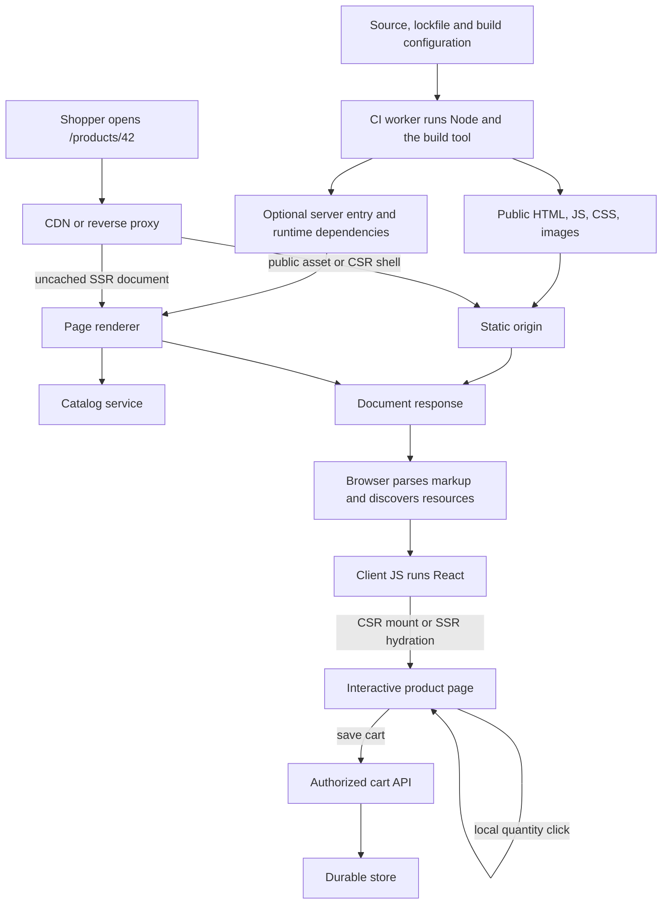
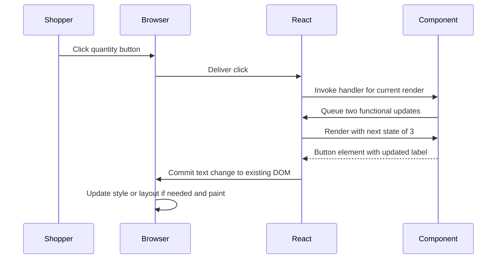
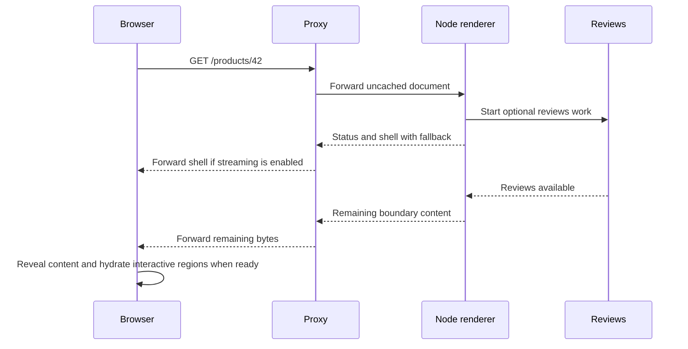
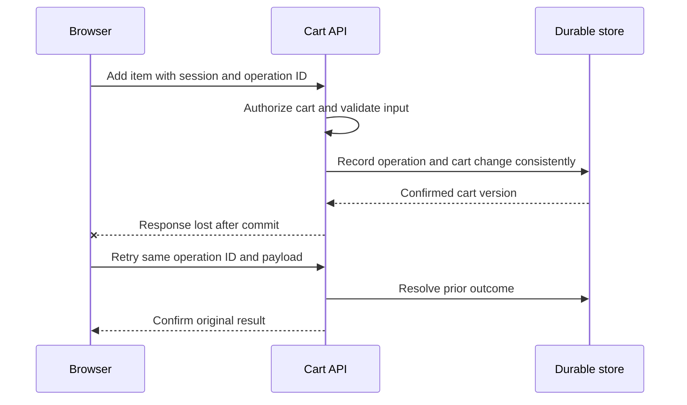
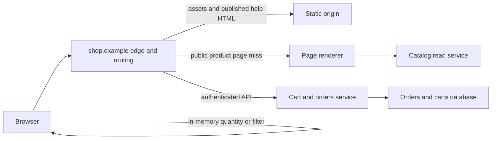

# React in production — from a source commit to an interactive page

A shopper opens `https://shop.example/products/42` in a fresh tab. The page shows a Trail Mug. She changes the quantity to two, adds it to her cart and opens another product. Meanwhile, an engineer deploys a new release. Which machine executed each line of code? Which bytes crossed the network? Which copy of the price did the shopper see? What happens if her next click needs a file from yesterday's release?

**A React frontend can be a directory of public files.** In that design Node.js runs the build, a web host serves the output, the shopper's browser runs React, and a separate service owns the cart. **A React frontend can also have a production server.** That server may execute React on a request to generate HTML. Express is one possible HTTP framework for a Node process. Choosing React does not require choosing Express. [Vite static deployment](https://vite.dev/guide/static-deploy) · [React client APIs](https://react.dev/reference/react-dom/client) · [Express routing](https://expressjs.com/en/starter/basic-routing/)

This trace assumes an ordinary browser navigation over HTTPS, an optional CDN and an existing catalog service. The shop, cache budgets and capacity calculations are worked examples. Measurements from the local lab are identified separately. The companion networking note explains how a request reaches the edge and how response bytes get back. This guide follows the application above that transport. [What happens when you type a URL](../computer-networking/what-happens-when-you-type-a-url.md)

## Contents

| Chapter | Topic |
| ---: | --- |
| 0 | [The journey on one page](#0-the-journey-on-one-page) |
| 1 | [From a component to a browser artifact](#1-from-a-component-to-a-browser-artifact) |
| 2 | [Shipping a release and starting the right process](#2-shipping-a-release-and-starting-the-right-process) |
| 3 | [The first HTTP request and its possible owners](#3-the-first-http-request-and-its-possible-owners) |
| 4 | [The client-rendered cold visit](#4-the-client-rendered-cold-visit) |
| 5 | [React execution from state update to DOM commit](#5-react-execution-from-state-update-to-dom-commit) |
| 6 | [From the DOM to visible pixels](#6-from-the-dom-to-visible-pixels) |
| 7 | [Request-time SSR and the initial data contract](#7-request-time-ssr-and-the-initial-data-contract) |
| 8 | [Hydration and streaming under load](#8-hydration-and-streaming-under-load) |
| 9 | [Selecting CSR, SSR, SSG and Server Components](#9-selecting-csr-ssr-ssg-and-server-components) |
| 10 | [Inside Node and Express during a request](#10-inside-node-and-express-during-a-request) |
| 11 | [Navigation, reads, writes and the trust boundary](#11-navigation-reads-writes-and-the-trust-boundary) |
| 12 | [Caching, variants and release consistency](#12-caching-variants-and-release-consistency) |
| 13 | [Release failures, observability and rollback](#13-release-failures-observability-and-rollback) |
| 14 | [Worked timelines, capacity and performance budgets](#14-worked-timelines-capacity-and-performance-budgets) |
| 15 | [Architecture review of the shop, route by route](#15-architecture-review-of-the-shop-route-by-route) |
| 16 | [Failure atlas and incident walkthroughs](#16-failure-atlas-and-incident-walkthroughs) |
| 17 | [Browser lab with identical CSR and SSR components](#17-browser-lab-with-identical-csr-and-ssr-components) |
| 18 | [Streaming lab with Node and no Express](#18-streaming-lab-with-node-and-no-express) |
| 19 | [Design exercises and further reading](#19-design-exercises-and-further-reading) |

## 0. The journey on one page



**CI** (continuous integration) is where a job can build a release. **Node.js** executes JavaScript outside the browser. **npm** installs packages and runs scripts declared in `package.json`. **Vite** is the build tool in this example. **React** describes the UI, and **React DOM** provides APIs for rendering it in the browser or on the server. **Express** dispatches HTTP requests in a Node service. A **CDN** (content delivery network) can serve or cache responses near visitors. [Node.js introduction](https://nodejs.org/learn/getting-started/introduction-to-nodejs) · [Vite builds](https://vite.dev/guide/build) · [React client APIs](https://react.dev/reference/react-dom/client) · [Express middleware](https://expressjs.com/en/guide/using-middleware/)

Follow three objects through the picture. A **JavaScript file** can be built once, cached by millions of browsers and executed independently in each tab. An **HTML document** might be read from storage, computed for a request, or served from an earlier cached render. A **cart row** belongs to the server-side data system. The fact that all three contribute to the same visible screen does not give them the same lifetime, permissions or owner.

| Hand-off | Output you can inspect | What it proves |
| --- | --- | --- |
| Source → build worker | Built entry document, asset files, optional server artifact | Which bytes are eligible for deployment |
| Release → host | Active release ID and deployed paths | Which version a fresh request can reach |
| Edge → origin or cache | Route match, cache outcome, upstream status | Whether application code ran for this request |
| Host → browser | HTTP status, headers and original document body | Whether meaningful markup arrived in this response |
| Browser → React | Entry module, data snapshot and mount or hydration call | How the app assumes ownership of the page |
| React → browser | Committed DOM, performance trace, presented frame | When a component's output became visible |
| Click → API → store | Network request, authorized operation, durable result | Whether the user's action survived the tab |

A useful test when reviewing a diagram is to turn off one box. If the build worker stops **after publication**, the release can keep serving. If the static host stops, a new visitor cannot load its files. If the catalog service stops, the cached public description might still appear while fresh availability fails. If JavaScript is disabled, HTML already in the response can still be read. The answer depends on the route and the particular operation.

---

## 1. From a component to a browser artifact

A **build** transforms source into artifacts. A **deployment** makes a particular release available to visitors. The **page request** we are tracing happens later, when someone visits the deployed URL. One machine can perform all three jobs in a small project. They can also happen at different times, on different machines owned by different teams.

```text
 Developer commits components, styles, images, package.json and lockfile
                                |
                                v
 Build machine (often CI) uses Node.js to run the build tool
                                |
             +------------------+--------------------+
             |                                       |
             v                                       v
 Browser files                             Server code, when needed
 HTML, JS, CSS, images                     request handler + its dependencies
             |                                       |
             v                                       v
 Static host / content delivery            Application service or function
 network (CDN) serves file bytes           runs code when a request arrives
             |                                       |
             +--------------- HTTP ------------------+
                                |
                                v
 Browser parses HTML, runs client JS, lays out the page and paints
```

A CDN caches responses near users. Its **origin** is the upstream system it contacts when it needs a response. An origin could be object storage containing built files or a service executing application code. A host can route different URL paths to different origins behind the same domain.

### A static release with Vite

Consider a project with `src/Product.jsx`, `index.html`, `package.json` and `package-lock.json`. During development a Vite dev server transforms modules as you work. In this example the production build script runs `vite build`. If the project uses npm and has a matching lockfile, a build machine can run the following from the project directory. [Vite production builds](https://vite.dev/guide/build) · [npm clean install](https://docs.npmjs.com/cli/v11/commands/npm-ci/)

```sh
npm ci
npm run build
```

1. The build tool follows imports. With React's JSX tooling, a source expression such as `<Product />` becomes JavaScript that describes a React element. The browser entry and its dependencies are bundled for the browser. Producing JavaScript for `Product` and rendering the product heading into HTML are separate operations. A plain Vite client build does the former. [Vite production builds](https://vite.dev/guide/build) · [React on creating a root](https://react.dev/reference/react-dom/client/createRoot)
2. Vite's default output directory is `dist/`. A representative build contains `index.html`, `assets/index-a1b2.js` and an optional CSS file. Names vary. The built HTML references the emitted asset URLs. Public assets can also be copied with their original names. [Vite static deployment](https://vite.dev/guide/static-deploy) · [Vite assets](https://vite.dev/guide/assets)
3. Publish the **contents** of that output directory at the site's intended base path. Point the domain at the host, configure HTTPS, and configure its route rules. If the site lives at `/shop/`, align the Vite base, host rules and client router with that prefix. A browser visiting the page asks the host for files by URL. Nobody installs npm on the visitor's machine. [Vite public base path](https://vite.dev/guide/build#public-base-path)
4. Smoke-test the deployed URL directly, including a nested route, a real asset and a missing asset. Vite's `preview` command is for local inspection. In this static design the production host only has to return file bytes and appropriate HTTP headers. [Vite static deployment](https://vite.dev/guide/static-deploy)

### Follow one import through the build

Suppose the app entry imports `Product.jsx`, which imports a stylesheet and a product photograph. The compiler sees JSX nested inside JavaScript. In an automatic JSX runtime, a simple expression such as `<h1>{product.name}</h1>` can become a call resembling `jsx("h1", { children: product.name })`. That call constructs a description of an element when the program executes. The compiler can perform this transformation in a build with no product database and no browser window. It has compiled a recipe for any product the component might receive. [Babel JSX transform](https://babeljs.io/docs/babel-plugin-transform-react-jsx)

The bundler follows the graph outward from the entry. A static import gives it a dependency it can process ahead of time. A dynamic `import()` can split code so it is requested when needed. The tool can eliminate unused code when it can prove doing so preserves behavior. An imported module that registers a handler as a side effect still matters even if no caller uses its exports. CSS and image imports may yield separate emitted resources with rewritten URLs. Minification reduces source size. Transfer compression is a separate step performed by the host or during asset preparation. [Vite features](https://vite.dev/guide/features) · [Vite asset handling](https://vite.dev/guide/assets) · [MDN JavaScript modules](https://developer.mozilla.org/en-US/docs/Web/JavaScript/Guide/Modules)

```text
src/main.jsx
  ├── imports react-dom/client      ┐
  ├── imports Product.jsx           ├── reachable client code → entry/chunks
  │     └── imports product.css     ┘                         → stylesheet
  └── import("./reviews.jsx") ───── potential later chunk → requested on use

server/entry.mjs
  ├── imports product service       → trusted server code or external dependency
  └── imports Product               → code may also appear in the client graph
```

A SSR build can compile some source for two environments. The browser copy of `Product` runs with a DOM and browser event system. The server copy can produce markup without a DOM. A top-level import that touches `window` can fail as soon as Node evaluates the module, before any component renders. Conversely, a client import that reaches a module containing a privileged service credential has crossed a security boundary. Draw the *import graph* alongside the request diagram when investigating either problem. [Vite SSR](https://vite.dev/guide/ssr) · [React client module boundary](https://react.dev/reference/rsc/use-client)

### What the build does and does not establish

A successful TypeScript transformation shows that the tool could emit JavaScript. Vite handles TypeScript transpilation separately from type checking. A team that wants the build to reject type errors needs a type-checking step such as the project's configured `tsc --noEmit` check. Type annotations also disappear from runtime JavaScript. An API returning `{"price":null}` can violate a declared type. Validate external data where it enters the application and decide how the page handles missing values. [Vite TypeScript support](https://vite.dev/guide/features#typescript) · [TypeScript handbook](https://www.typescriptlang.org/docs/handbook/2/basic-types.html)

A lockfile records the resolved package tree. `npm ci` requires a compatible lockfile and installs from it. Build output can also depend on the Node version, build configuration, target browsers, public base path, environment and content read during a build. Record those inputs alongside the commit. If two deployments require identical assets, build once and promote that artifact, provided its public configuration works in both environments. An app that bakes the staging API address into its bundle will keep calling staging after promotion. A relative same-origin `/api` path is one way to make the same artifact portable. [npm ci](https://docs.npmjs.com/cli/v11/commands/npm-ci/) · [Vite environment variables](https://vite.dev/guide/env-and-mode)

### Read a release as a set of addresses

```text
dist/
  index.html                         publicly reachable entry document
  assets/index-<hash>.js             client entry mentioned by HTML
  assets/reviews-<hash>.js           module imported later, if split this way
  assets/product-<hash>.css          stylesheet, when emitted separately

server release, for an SSR design
  server entry + runtime dependencies + reference to the matching client build
```

An asset manifest can map source entry names to emitted filenames and their imports. For a server that generates its own HTML, that is how a stable source-level name becomes today's hashed URL. Without a version-consistent manifest, a healthy server can generate valid HTML pointing to a nonexistent script. Check the deployed document and fetch its exact script URL. Listing files on the CI worker only establishes what the worker produced. [Vite backend integration and manifest](https://vite.dev/guide/backend-integration)

**What to measure.** Record initial compressed transfer bytes, decoded JS bytes, lazy chunks needed for the first route, and the time to evaluate them on a representative device. A 200 KB bundle in build output and a 65 KB transfer can refer to the same resource. The browser still has to process the decoded program. Code splitting helps when it removes work from a critical path. Splitting one critical operation across successively discovered modules can add waits. Inspect initiators in Network before changing chunk boundaries. [Vite features](https://vite.dev/guide/features) · [Resource Timing](https://developer.mozilla.org/en-US/docs/Web/API/PerformanceResourceTiming)

---

## 2. Shipping a release and starting the right process

For request-time server-side rendering (SSR), deploy browser assets **and** executable server output. For example, a Vite SSR integration can build a browser entry for hydration and a separate entry for rendering on the server. A Node service or compatible hosting adapter loads the server entry, matches a URL, gets data and returns HTML. A managed function packages that request handler for the provider. A long-running service usually starts a process that listens on a port. Uploading browser assets alone leaves the request handler undeployed. [Vite SSR guide](https://vite.dev/guide/ssr) · [Next.js deployment options](https://nextjs.org/docs/app/getting-started/deploying)

A deployment review should answer three concrete questions. Which public file does the HTML reference? Which executable handles a page that needs fresh HTML? Which service owns the data? The three answers can name three different systems.

### Three deployment contracts

| Shape | What the pipeline publishes | What serves a visitor | How you prove the release works |
| --- | --- | --- | --- |
| Static frontend with a separate API | Built public files and routing configuration | Static host returns HTML/assets. Existing API handles data. | Fetch the deep link and its assets. Make an authorized data request through the deployed domain. |
| SSR in a long-running service | Executable server release, runtime dependencies, matching public assets and configuration | Load balancer forwards to healthy service instances. Each loads the handler and listens for requests. | Request a route whose HTML requires the renderer. Check response content, release ID and origin trace. |
| SSR in a managed function | Handler in the platform's contract plus matching assets | Platform supplies an invocation and may reuse an initialized instance. Asset host serves public files. | Invoke the deployed route. Compare first and subsequent invocations, timeout limits, runtime APIs and streaming support. |

A container packages a process and its dependencies. You can run a file server in a container, or a Node process rendering pages, or a Java API. A static host can also be managed without exposing a container to the frontend team. “Deployed in Docker” tells you little about who renders the page. Ask what command starts, what it reads from disk, what socket or invocation it accepts, and which URLs reach it. [Next.js deployment options](https://nextjs.org/docs/app/getting-started/deploying) · [Vite static deployment](https://vite.dev/guide/static-deploy)

### Walk a static release into service

1. **Select an input.** The pipeline checks out a specific commit. It installs from the lockfile, runs the project's checks and builds. It archives the output with a release identifier.
2. **Stage the bytes.** Upload the files under their final public URLs or in an immutable release directory. Verify content types and content encoding from the serving layer. An object named `app.js` served as HTML cannot be evaluated as a JavaScript module.
3. **Activate the entry.** Switch the host to the new release or publish the new HTML after all referenced assets are available. A visitor may open the page at that instant. Activation order is part of correctness.
4. **Prove the public route.** Request a product URL directly. Fetch a script URL copied from that HTML, then try a nonexistent script. Verify that the valid script returns JavaScript and the missing one fails as an asset. Exercise the API separately. The host may return the correct shell at `/` yet mishandle the product deep link.
5. **Retain the previous release.** An open tab has already executed the old entry. It might request its reviews chunk an hour later. Changing where new HTML points cannot change that old tab's imports. [Vite deployment load errors](https://vite.dev/guide/build#load-error-handling) · [MDN JavaScript module MIME requirements](https://developer.mozilla.org/en-US/docs/Web/JavaScript/Guide/Modules)

### Walk a rendering service into service

Dependencies needed only to compile JSX can stay on the build machine. Dependencies imported by a server entry at runtime must be bundled or installed in the runtime image. The runtime needs compatible Node APIs or a platform adapter that supplies the expected interfaces. Place database credentials and service configuration in the trusted runtime. Treat any environment value shipped into the browser bundle as public. [Vite SSR externals](https://vite.dev/guide/ssr) · [Vite environment variables](https://vite.dev/guide/env-and-mode)

On startup, an instance typically loads code, creates service clients and exposes a readiness check. A ready instance receives traffic. When retiring one, stop routing new requests to it, allow bounded time for in-flight requests and streams, then release resources. A health endpoint that succeeds even when the renderer cannot find its client manifest can hide a broken rollout. Choose a readiness signal that reflects what this instance must have to serve pages. A temporary outage in optional reviews need not take all product pages out of service. [Express health checks and graceful shutdown](https://expressjs.com/en/advanced/healthcheck-graceful-shutdown.html)

**Cost and failure.** If initialization takes 800 ms in a hypothetical function and that initialization is on a visitor's request path, it adds 800 ms to that invocation before useful handler work. It may disappear from warm traces. If a release contains ten instances each with a connection pool capped at 20, it permits up to 200 connections from that fleet alone. During a rolling deployment, old and new instances can coexist. Inspect actual pool use and database capacity before increasing instance count. These are capacity calculations for a proposed design, not platform defaults.


### Deployment choices for a static build

**Deploy to an existing Java service.** For a Spring Boot servlet application with its default static resource locations, a build can copy the contents of `dist/` into `src/main/resources/static/` before packaging the Java application. The packaged release then contains the HTML and assets on the classpath. The JVM serves those bytes over HTTP and also handles API controllers. Java does not execute the browser's React bundle. If the product URL is a client route, configure an appropriate page mapping to the entry document, leaving API and asset errors intact. The production machines need Java for this application. A Node process was needed for the frontend build and can finish before the Java deployment starts. This single release couples frontend and backend rollouts, which can be convenient for one team and restrictive for independent teams. [Spring Boot static content](https://docs.spring.io/spring-boot/reference/web/servlet.html#web.servlet.spring-mvc.static-content) · [React Router SPA routing](https://reactrouter.com/how-to/spa)

**Deploy to static storage plus an existing API.** A pipeline publishes `dist/` to the static origin. An edge routes `/api/*` to the Java service and product document requests to the static entry. Frontend and backend releases are independent. You now have to maintain route configuration and API compatibility in two deployment systems. A request to `/assets/index-a1b2.js` should succeed while the Java service is unavailable. Adding an item to the cart must still fail or show a defined degraded state during that outage. This is a useful fault-injection test for whether the separation exists in production.

**Deploy a framework with a static export.** Some full-stack React frameworks offer both a static export and a runtime server deployment. Check the features each target supports. A route that must examine a private request-time cookie needs a runtime somewhere, or needs to move that work into a later authorized API request. Generating public files on a build machine cannot know which user will request them next week. Be explicit about which feature requires the runtime before selecting a hosting target. [Next.js deployment options](https://nextjs.org/docs/app/getting-started/deploying)

---

## 3. The first HTTP request and its possible owners

A shopper pasting a URL starts a **document navigation**. The browser asks the origin associated with the URL for a document. DNS, transport and TLS establish how to reach it. The CDN or proxy might terminate that connection and start another to an upstream. The path still needs application meaning. In a client-routed app, `/products/42` may never have existed as a file. [Companion networking trace](../computer-networking/what-happens-when-you-type-a-url.md) · [React Router SPA deployment](https://reactrouter.com/how-to/spa)

### Make the routing contract explicit

| Incoming request | Responsible component in this example | Successful response | Missing or invalid case |
| --- | --- | --- | --- |
| `GET /assets/index-a1b2.js` | Static asset host | JS with an appropriate MIME type | Asset 404 |
| `GET /products/42` | CSR fallback, prebuilt route, or SSR router | HTML document | Unknown product gets a designed missing-page experience. SSR/SSG can supply a real document 404 when known. |
| `GET /api/products/42` | Product API behind the proxy | JSON product representation | API returns an appropriate HTTP error and machine-readable body |
| `POST /api/cart/items` | Cart service | Confirmed cart state or an operation result | Auth, validation, conflict or service error |
| `GET /assets/gone.js` | Asset host | No successful response expected | 404, never the SPA shell |

A reverse proxy can make different processes appear under one browser origin. It matches a request by host and path and forwards it. On a static host, a **rewrite** can serve the bytes of `/index.html` while preserving `/products/42` as the browser URL. A **redirect** returns a new URL for the browser to request. Redirecting all product URLs to `/index.html` discards the address the client router needed. Define asset and API rules before the general page fallback. [React Router SPA fallback](https://reactrouter.com/how-to/spa) · [NGINX request processing](https://nginx.org/en/docs/http/request_processing.html)

### What crosses the wire?

These are shortened HTTP representations. The deployment may use HTTP/2 or HTTP/3 framing, compression and different headers. An SSR and a CSR request can have the same method and URL. The design determines the body.

```http
GET /products/42 HTTP/1.1
Host: shop.example
Accept: text/html

HTTP/1.1 200 OK
Content-Type: text/html; charset=utf-8
Cache-Control: no-cache

<div id="root"></div><script type="module" src="/assets/app-a1b2.js"></script>
```

For one hydrated SSR implementation, the HTML at the same point could instead contain `<div id="root"><main><h1>Trail Mug</h1>…</main></div>`, a matching bootstrap script and the initial data needed by the client. A private page might return a redirect to sign-in before starting its body. A client-only fallback often returns `200` because the static host cannot know whether product 42 exists. An HTTP client or crawler sees that original status even when the client later shows “Product not found.” Give important public routes meaningful status codes at a layer that knows the resource. [React hydration](https://react.dev/reference/react-dom/client/hydrateRoot) · [Google on JavaScript SEO](https://developers.google.com/search/docs/crawling-indexing/javascript/javascript-seo-basics)

**Debug from the outside in.** Start with the exact production URL in the Network panel. Read status, MIME type, body, cache indicators and request initiator. Move to edge logs only when the response points upstream. A `200 text/html` response to a module request and a `404` for the same module have different causes. A cache hit can avoid the renderer entirely, so the absence of a Node log entry alone cannot establish whether a user reached the site. [Chrome Network reference](https://developer.chrome.com/docs/devtools/network/reference)


### A concrete reverse proxy configuration

This NGINX example illustrates a deliberately small static shop. It assumes the files are under `/srv/shop/current`, a service named `cart-api` is reachable on port 8080, and TLS terminates in front of this listener. The only browser routes are `/` and numeric product IDs. Expand the page allowlist when adding routes. It is a routing example, not a complete internet-facing deployment.

```nginx
server {
    listen 8080;
    root /srv/shop/current;
    include /etc/nginx/mime.types;

    location ^~ /assets/ {
        try_files $uri =404;
        add_header Cache-Control "public, max-age=31536000, immutable";
    }

    location ^~ /api/ {
        proxy_pass http://cart-api:8080;
    }

    location = / {
        try_files /index.html =404;
        add_header Cache-Control "no-cache";
    }

    location ~ ^/products/[0-9]+$ {
        try_files /index.html =404;
        add_header Cache-Control "no-cache";
    }

    location / {
        try_files $uri =404;
    }
}
```

There are four tests for this configuration. Request `/products/42` and check that the address stays the same while the body is the entry HTML. Request an actual hashed asset and check the JS MIME type. Request `/assets/missing.js` and expect a 404. Request `/api/products/42` and verify in backend logs that the API receives the `/api/` prefix. The `proxy_pass` form here has no replacement URI. Adding a trailing slash to its upstream URL can change the forwarded path. The example grants a long immutable lifetime only to the `/assets/` namespace and assumes *everything* there changes URL when its bytes change. [NGINX try_files](https://nginx.org/en/docs/http/ngx_http_core_module.html#try_files) · [NGINX proxy_pass](https://nginx.org/en/docs/http/ngx_http_proxy_module.html#proxy_pass)

---

## 4. The client-rendered cold visit

```text
Browser                         Static host / CDN                  Product API
   | GET /products/42 ----------------->|                               |
   |<------------- index.html shell ----|                               |
   | GET /assets/app-a1b2.js ---------->|                               |
   |<------------------ JavaScript -----|                               |
   | run route code, optionally show loading state                      |
   | GET /api/products/42 --------------------------------------------->|
   |<---------------------- JSON with name, description and price ------|
   | React commits the product heading into the DOM                     |
   | browser lays out and paints the heading                            |
```

The initial document in this design has a mount point such as `<div id="root"></div>` and a script reference. The site's host maps the product URL to that document. Once the script executes, the router reads the URL, the app obtains product data and React can display it. A site might preload data or embed an initial snapshot to shorten this path. A loading screen can appear before the product. [React createRoot](https://react.dev/reference/react-dom/client/createRoot) · [React Router SPA deployment](https://reactrouter.com/how-to/spa)

**Inside the browser.** A component is commonly a function. Its props are inputs from its parent. Its state stores values React should remember between renders. Calling a state setter requests an update. During **render**, React calls components to compute their output. During **commit**, React DOM changes the relevant browser nodes where needed. The DOM is the browser's in-memory representation of the document. The browser applies styles, computes layout, paints and composites the result. A React render can produce the same output and require no DOM change. [React render and commit](https://react.dev/learn/render-and-commit) · [React state](https://react.dev/reference/react/useState) · [MDN browser rendering](https://developer.mozilla.org/en-US/docs/Web/Performance/Guides/How_browsers_work)

**What happens on a click?** A quantity button that calls `setQuantity(n => n + 1)` can change “Quantity: 1” to “Quantity: 2” entirely in the open tab. Reloading starts that in-memory state again. An “Add to cart” action that should survive a reload or appear on another device needs a persistence design. For an account-backed cart, send a request to a service that authorizes the user and saves the change. React alone does neither that network request nor that storage. [React state](https://react.dev/reference/react/useState) · [OWASP authorization guidance](https://cheatsheetseries.owasp.org/cheatsheets/Authorization_Cheat_Sheet.html)

**What happens on navigation?** A client router can intercept an in-app link, update browser history, fetch code or data and render the next view. Pasting the same URL into a new tab makes a document request to the host. Configure a single-page app (SPA) host to serve the entry document for recognized page paths. Keep `/api/*` and asset paths out of the fallback. Otherwise a missing script or API route can receive HTML with a misleading success status. [React Router SPA deployment](https://reactrouter.com/how-to/spa)

### Zoom into startup

1. The HTML parser creates the root element and discovers the module script. Resource discovery can overlap HTML parsing. Stylesheets, fonts, images and scripts compete for network and device time. If the hero image only appears in markup that React later inserts, the initial HTML parser has no such `img` URL to discover.
2. The browser obtains the JS entry, resolves its module dependencies and evaluates them. Module scripts normally defer execution until the document has been parsed. A dependency can initiate another fetch. A browser can have the JS bytes in its HTTP cache and still need to evaluate code in this new document.
3. The entry finds `document.getElementById("root")` and calls `createRoot(root).render(<App />)`. The client router matches the current location. The app may render a loading view, trigger a route loader or consume data already supplied.
4. In the simple waterfall shown above, a fetch to `/api/products/42` starts after the client code is ready. The browser reads the response and parses JSON. Check the HTTP status before treating data as a product. Fetch can fulfill its promise with an HTTP error response, such as a 404.
5. When the application supplies the product as props or state, React computes the heading, price and image elements. The commit creates or updates DOM nodes. The browser discovers the image URL if it did not know it earlier, obtains it, calculates style and geometry, and presents it when ready. [MDN browser processing](https://developer.mozilla.org/en-US/docs/Web/Performance/Guides/How_browsers_work) · [MDN JavaScript modules](https://developer.mozilla.org/en-US/docs/Web/JavaScript/Guide/Modules) · [React createRoot](https://react.dev/reference/react-dom/client/createRoot) · [MDN Fetch](https://developer.mozilla.org/en-US/docs/Web/API/Fetch_API/Using_Fetch)

### Draw the dependency before optimizing the request

```text
HTML ──> entry JS ──> route code ──> product JSON ──> image URL ──> hero pixels
  └──────────────────> shell CSS ───────────────────────────────────┘
```

If an entry module has to run before the route code is discovered, and the route code has to run before product data is requested, caching the CSS cannot remove either wait. A route loader that knows the URL can start independent data work earlier. A public product page whose initial HTML already contains the hero image URL can bring image discovery forward. A preload is appropriate when the URL is known, important and likely to be used. Preloading every potential product image can compete with the one that matters. Measure the LCP resource's discovery time and its render delay separately. [React Router data loading](https://reactrouter.com/start/framework/data-loading) · [Optimizing LCP](https://web.dev/articles/optimize-lcp)

### The repeat visit and the in-app visit

A reload starts a new document and new in-memory React state, even when the browser reuses asset bytes. An in-app navigation can keep the document, React root, shared layout, loaded modules and some cached data. A back navigation can have yet another path if the browser restores a previously captured page. Record which path you tested. “The second page load was fast” could describe three different mechanisms. [React Router rendering strategies](https://reactrouter.com/start/framework/rendering) · [MDN browser processing](https://developer.mozilla.org/en-US/docs/Web/Performance/Guides/How_browsers_work)

**Probe.** In the Network panel, preserve the log. Click a product link, then reload at the same URL. Look for a request with type **document**. An in-app link can request only a chunk, data or a framework payload. The refresh must locate the page at the host. If only the refresh fails, inspect host routing before debugging the React component. [Chrome Network reference](https://developer.chrome.com/docs/devtools/network/reference)

---

## 5. React execution from state update to DOM commit

The product has a quantity button. The component receives `product` from its parent and owns a local `quantity`. Each invocation reads one snapshot of props and state. It returns elements describing the UI for that snapshot. The DOM element currently visible on the screen can outlive many invocations of the function.

### Trace one click through the queue

```jsx
function Quantity() {
  const [quantity, setQuantity] = useState(1);
  function addTwo() {
    setQuantity(n => n + 1);
    setQuantity(n => n + 1);
  }
  return <button onClick={addTwo}>Quantity: {quantity}</button>;
}
```

The handler associated with the current render sees `quantity === 1`. Each setter queues an updater. When React processes that queue, the first updater receives 1 and yields 2. The second receives 2 and yields 3. React can batch these updates and commit the button label once. If both calls instead said `setQuantity(quantity + 1)`, each would request replacement with 2 because both read the same snapshot. A log of the captured variable during the handler still reads 1. The variable in the running handler keeps its original value until that invocation ends. [State as a snapshot](https://react.dev/learn/state-as-a-snapshot) · [React update queues](https://react.dev/learn/queueing-a-series-of-state-updates)



### Why a list key changes behavior

React associates state with a component's place in the rendered tree, accounting for element type and keys. Imagine cart rows keyed by array index. Row 0 contains a mug and has a locally edited quantity. Remove the mug. A water bottle now occupies row 0 with the same component type and key. React can preserve state at that position and display the mug's edit on the bottle. Use a stable line-item identity, especially when a product can appear twice with different options. If switching from one product to another should intentionally reset a form, give the form an identity that changes with the product. Do not generate a random key on every render. It forces needless remounting and loses input state. [React preserving and resetting state](https://react.dev/learn/preserving-and-resetting-state)

### Scheduling, purity and interruption

React can prioritize urgent work such as a keystroke and allow lower-priority transition work, such as displaying expensive filtered results, to be interrupted and restarted. React waits to commit the chosen result. Code performing an irreversible action during render might run for an attempt that never becomes visible. Keep rendering pure. Put a purchase request in an explicit user action and make the trusted service handle retry semantics. Marking a state change as a transition does not move a long synchronous JavaScript calculation onto another CPU thread. The browser still has to execute it. [React concurrent rendering](https://react.dev/blog/2022/03/29/react-v18) · [useTransition](https://react.dev/reference/react/useTransition)

A React render, a DOM mutation and a browser paint are three different events. A parent can render its children and produce identical output. A changed text node can be committed without replacing its button. The browser may present several updates together on the next frame. Counting component function calls alone cannot tell you how many DOM nodes changed or why interaction was slow. Record a React profile to locate expensive commits, and a browser performance trace to identify script, layout, paint and other work. [React render and commit](https://react.dev/learn/render-and-commit) · [React Profiler](https://react.dev/reference/react/Profiler) · [Chrome performance reference](https://developer.chrome.com/docs/devtools/performance/reference)

### Effects and resource lifetime

An effect synchronizes the committed component with an external system such as a subscription, timer or connection. React runs the cleanup for the previous dependencies before running setup for changed dependencies, and runs cleanup on unmount. An effect runs on the client. In development, Strict Mode can perform extra render and effect checks to expose impure code and missing cleanup. A duplicate connection observed only in development can reveal a real cleanup defect. Count active subscriptions after mount, navigation and unmount. The browser's navigation lifetime, a component's lifetime and an API operation's lifetime can differ. [React useEffect](https://react.dev/reference/react/useEffect) · [React Strict Mode](https://react.dev/reference/react/StrictMode)

**Where to put state.** Put transient UI state such as “open details panel” near the component that needs it. Put a filter that must survive sharing or back navigation in the URL. Put durable order ownership in a trusted data store. A client data cache can retain an order snapshot across components, but its copy needs invalidation or revalidation after writes. This distinction answers a common design question: closing and reopening the tab can reset the panel while the order itself must still exist.


### Reconciliation on three successive renders

Consider a product view with a heading, a photo and a quantity control. On the initial CSR render, React needs new host nodes inside the empty root. After a quantity click, the component can return a new description mentioning the same heading, image and button. React can preserve the existing host nodes and update the quantity text. On a route change from product 42 to 43, the same component type in the same position can preserve the quantity state as it receives new props. That might be correct for a shared cart widget and incorrect for a product-specific order form. Decide whether a product change resets the form, then express that identity in the tree. [React state identity](https://react.dev/learn/preserving-and-resetting-state) · [React render and commit](https://react.dev/learn/render-and-commit)

React's internal renderer maintains bookkeeping for component identity, state and pending work. You may hear its internal work units called *fibers*. The observable contracts for an application are element identity, state snapshots, render purity and committed updates. Scheduler internals can change between React versions. A diagram that says “React diffs the whole page and redraws it after each click” predicts the wrong DOM behavior. Test it by focusing a text input, changing unrelated state and observing whether focus and the existing input node survive. Then change its key and observe remounting. [React reconciler source](https://github.com/facebook/react/blob/main/packages/react-reconciler/src/ReactFiber.js) · [React concurrent rendering](https://react.dev/blog/2022/03/29/react-v18) · [React state identity](https://react.dev/learn/preserving-and-resetting-state)

### Derived data versus synchronized data

Suppose the cart already holds line items and quantities. A display total can be derived from them during render. Putting a second “display total” in state, then recomputing it in an effect, introduces another render and an opportunity for the two values to disagree. An externally supplied authoritative total with tax and discounts is a different piece of data and deserves an explicit server contract. Separate what the UI can derive synchronously from what must be synchronized with something outside React. [Thinking in React](https://react.dev/learn/thinking-in-react) · [React useEffect](https://react.dev/reference/react/useEffect)

---

## 6. From the DOM to visible pixels

The browser can parse server HTML before React is available and can render DOM later inserted by client React. Both paths converge on the browser rendering pipeline. For our page, the critical event might be the product photo becoming visible, even if the heading was readable earlier.

```text
HTML bytes → tokens → DOM ────────┐
CSS bytes  → rules → CSSOM ───────┼→ style → layout → paint → composite → frame
React commit → DOM change ────────┘              ↑
                             image size, font metrics or a resized viewport
```

The DOM records elements and text. The CSS object model represents parsed style rules. Style calculation determines which rules apply. Layout calculates positions and sizes. Paint records what should be drawn. Rasterization turns drawing work into pixels, and compositing assembles layers into a frame. Browsers can skip stages whose input has not changed. For example, changing a width can require layout. Some transform animations can use compositing without laying out the page again. The precise pipeline depends on the browser and change. [MDN on browser rendering](https://developer.mozilla.org/en-US/docs/Web/Performance/Guides/How_browsers_work) · [Rendering performance](https://web.dev/articles/rendering-performance)

### A visible heading and an unresponsive button

Consider a quantity click that arrives while the browser is evaluating a route bundle. Input can wait for the main thread. The event handler may run quickly but trigger an expensive component render and layout. The next frame still has to be presented. INP investigates interaction latency through input delay, processing and presentation delay. An alert saying “the click handler took 2 ms” explains only one piece. Capture the interaction and inspect all three. [Optimizing INP](https://web.dev/articles/optimize-inp)

At a 60 Hz display rate, frames are about 16.7 ms apart. That is an interval for *all* work needed before the next presentation, not a promise that JavaScript gets 16.7 ms. A 120 ms synchronous task spans roughly seven such intervals. Faster network transfers cannot give that main thread back to an input event already waiting behind the task. Reduce startup work, split expensive work appropriately or change when it runs. Repeat on a representative device. [Rendering performance](https://web.dev/articles/rendering-performance)

### Why the product image can still be late with SSR

Decompose image LCP into document response time, resource load delay, resource load duration and element render delay. A large delay **before** the image request suggests late discovery or poor prioritization. A large delay **during** the request suggests transfer or origin work. If the image is downloaded early but appears late, inspect render-blocking styles, script, visibility conditions and main-thread work. If the page changes position as the image arrives, reserve its intended dimensions. Converting a route to SSR changes the first HTML and resource discovery. It cannot by itself fix oversized image bytes or a slow main thread. [Optimizing LCP](https://web.dev/articles/optimize-lcp)

**How to see it.** Record a page load with screenshots. Locate the heading in the first meaningful frame, identify the LCP element, then compare the network row for that asset with the main-thread activity. Elements shows the final DOM. Network → document → Response shows what arrived initially. A screenshot shows what actually got painted. Each is evidence for a different step. [Chrome performance reference](https://developer.chrome.com/docs/devtools/performance/reference) · [Chrome Network reference](https://developer.chrome.com/docs/devtools/network/reference)

---

## 7. Request-time SSR and the initial data contract

```text
Browser                       Page renderer                       Product service
   | GET /products/42 ------------>|                                      |
   |                               | read product 42 -------------------->|
   |                               |<------------------- product data ----|
   |                               | render components using that data    |
   |<-------- HTML containing <h1>Trail Mug</h1> and script reference ----|
   | parse HTML and display available content                             |
   | load client JS from the asset host                                   |
   | hydrate interactive components with matching initial data            |
   | user clicks quantity button -> local state update                    |
```

On an uncached request, the page renderer can read from a service or an authorized data store before sending the relevant HTML. The browser can display text and use ordinary links from that HTML. A React `onClick` handler is executable behavior supplied by client JavaScript. **Hydration** connects client logic to the React-generated DOM already in the document. Afterwards, local state updates and client-router navigations can work much like CSR. A fresh document request starts the server path again, subject to caching. [React hydration](https://react.dev/reference/react-dom/client/hydrateRoot) · [React Router rendering strategies](https://reactrouter.com/start/framework/rendering)

### Follow one origin request

On a cache miss the proxy forwards `GET /products/42` to a compatible renderer. The renderer matches the route, validates the ID and establishes request context. For a private page, establish identity and permissions before reading or returning private data. For a public product, fetch the public fields the route needs. Decide redirect or missing-product status early enough to put the correct HTTP status in the response. Keep per-request identity, locale and data in the request context. A process-global mutable “current user” can be overwritten while another request is waiting for I/O. [React Router data loading](https://reactrouter.com/start/framework/data-loading) · [OWASP authorization](https://cheatsheetseries.owasp.org/cheatsheets/Authorization_Cheat_Sheet.html)

Suppose product details take 90 ms and public reviews take 150 ms, and neither requires the other's result. Starting them in series makes both waits part of a 240 ms dependency. Starting them together can reduce that part of the critical path to about 150 ms, plus overhead, if downstream capacity allows. If reviews require a product lookup first, only the independent portion can overlap. If the product does not exist, speculative review work may be wasted. Dependency, load and failure handling determine whether parallelism helps.

The renderer calls the server React API with route data. React produces HTML bytes. It does not open a browser, run layout, measure viewport width or paint the product photo. It can emit an `img` with a URL and dimensions for the browser to use. The host sends the HTML, headers and a reference to matching client assets. The build must also give the server a way to serialize the public data or framework payload that lets the client reconstruct the same initial view. [React server streaming](https://react.dev/reference/react-dom/server/renderToPipeableStream) · [Vite SSR](https://vite.dev/guide/ssr)

### Inventory of a page response

| Payload | Example | Who needs it? | What to review |
| --- | --- | --- | --- |
| Markup | `<h1>Trail Mug</h1>` and product image URL | Browser parser, user, crawler | Correct status, semantic content, useful resource discovery |
| Initial data or framework payload | Product ID, displayed price, currency and version | Client logic matching the first render | Match the server snapshot and expose only fields the browser may see |
| Bootstrap code references | A script URL or module preload for the current release | Browser module loader | Correct base path, MIME type and availability across rollouts |
| Private upstream values | Supplier cost, service token, session details | Trusted server only | Explicitly project a public model before serializing anything |

Serializing a complete database row simply because the page shows two columns exposes the rest to anyone who can inspect the response. Text inside a script has a different escaping context from text inside a heading. Use the framework's documented serializer for embedded data. An untrusted string containing a closing script tag can end the element if raw JSON is interpolated into HTML carelessly. Test a product name containing quotes, angle brackets and `</script>`. It should display as text and leave the page structure intact. [OWASP XSS prevention](https://cheatsheetseries.owasp.org/cheatsheets/Cross_Site_Scripting_Prevention_Cheat_Sheet.html)

### Failure changes with the location of work

On a CSR page, the shell can arrive while the product API is down. The UI can show a product-specific error and offer a retry. On a blocking SSR page, that same service outage can delay or fail the entire document. Decide whether a stale public description is acceptable, how long the renderer should wait, what happens to an optional reviews failure, and what status is appropriate for a missing product. If product content is indispensable and the backend is unavailable, returning a cacheable `200` with an empty body may conceal the failure and spread it. Carry request IDs from renderer to upstream so a slow document can be decomposed into queue, catalog and render work.


### Request-scoped data across a server and a browser

Consider an upstream product record with `id`, `name`, `description`, `publicPrice`, `supplierCost` and `internalNotes`. Authorize the route, then project the upstream record into a public view such as `{id, name, description, publicPrice, currency, version}`. Use that projection for the server render and for the framework's initial client data. The browser may read every field of that projection even if a component happens to hide one. A TypeScript annotation narrowing the type of the original object does not remove fields from the runtime object. Construct the public object explicitly. [TypeScript basics](https://www.typescriptlang.org/docs/handbook/2/basic-types.html) · [Next.js server and client data boundaries](https://nextjs.org/docs/app/getting-started/server-and-client-components)

At the server boundary, distinguish a missing product from an unavailable catalog. A missing product can be a 404 with a designed page. A dependency timeout is inconclusive about product existence. Turning the timeout into a cached “missing product” can keep a real item unavailable after the catalog recovers. Capture the upstream status, response deadline, page status and cache policy. Decide whether a last-known-good public description is permitted. Do not derive current stock or final checkout price from that fallback.

### What still works before hydration

An HTML document can include a real `<a href="/help/shipping">` and a `<form method="post" action="/cart/items">`. The browser knows how to navigate and submit without React. The server must implement the target action, authentication, CSRF controls, validation and response, and the form fields must be sufficient for that path. React can enhance it when loaded. A `<button type="button">` with only a React `onClick` has different behavior before hydration. Select the native interaction when the core task must work before JS or under failure. The identical-looking buttons in chapter 17 intentionally use client-only behavior so you can observe that boundary. [MDN form element](https://developer.mozilla.org/en-US/docs/Web/HTML/Reference/Elements/form) · [React hydration](https://react.dev/reference/react-dom/client/hydrateRoot)

---

## 8. Hydration and streaming under load

### The same product must be recognizable twice

The browser constructs DOM from the original HTML. Interactive client code then calls `hydrateRoot` (often through the framework). React tries to reuse those nodes and associate them with its component logic. A native link can already navigate. A button whose only behavior is a React handler depends on the relevant code and hydration. Different regions can become usable at different times. “HTML received,” “text visible,” “JS loaded” and “first action succeeded” deserve separate marks. [React hydrateRoot](https://react.dev/reference/react-dom/client/hydrateRoot) · [React Suspense](https://react.dev/reference/react/Suspense)

| Server output | First client output | Likely cause | Correction |
| --- | --- | --- | --- |
| `$29.00` | `$31.00` | Client fetched a newer price before its first render | Hydrate the version displayed in HTML. Revalidate after the initial match. |
| `Nov 8` | `Nov 9` | Different time zone or locale | Serialize the chosen locale and instant, or render stable initial text and localize after hydration. |
| A sign-in link | An account menu | Client checked local storage during initial rendering | Establish identity on the server when appropriate or render a common initial state and update afterward. |
| Nodes in one order | Browser DOM in another order | Markup that the HTML parser repairs, such as invalid nesting | Inspect parsed DOM with JS disabled. Fix the markup that produced it. |
| Old shell | New component expects a different tree | Server/client releases or feature flags disagree | Correlate release IDs and pass identical initial flag decisions to both sides. |

Use the documented recovery/error hooks when available in your integration and collect release and route information with hydration reports. Do not rely on React repairing every attribute or on hiding the warning. Compare the actual HTML, the parser-created DOM and the first client inputs. A different output after a later intentional client update is fine. A different initial tree undermines reuse at the point hydration needs it. [React hydration caveats and error handling](https://react.dev/reference/react-dom/client/hydrateRoot)

### An SSR stream has a point of no return

With streaming React, a Suspense boundary can let the shell include the title and image plus a reviews fallback. When the slower subtree is ready, React can send more HTML and instructions enabling the browser to reveal it. A compatible suspense-aware data source or lazy component is required. Fetching reviews in `useEffect` starts only after a client commit and cannot suspend the server render. The server can send displayable HTML even when the JavaScript needed for some interactions is still outstanding. [React Suspense](https://react.dev/reference/react/Suspense) · [React streaming](https://react.dev/reference/react-dom/server/renderToPipeableStream)



On Node, `onShellReady` is where an application can set the status and headers and start piping. `onShellError` allows an alternative response if the shell fails before output begins. Once headers are sent, an error in the reviews region cannot retroactively change the original HTTP 200 into a 500. Record that error separately and provide appropriate boundary behavior. Resolve mandatory redirects, authorization and primary resource existence before committing the shell when HTTP semantics require it. [React streaming error and status handling](https://react.dev/reference/react-dom/server/renderToPipeableStream)

**What if the reader is slow?** Producing HTML and delivering it are different rates. A writable Node stream can signal backpressure when its buffered data reaches a limit. A manual producer must respect that signal and wait for the stream to drain. Prefer the supported piping API. Set bounded render and upstream deadlines and release pending work when the caller disconnects. Abort the render and propagate cancellation to the data client where supported. A browser closing a tab alone does not guarantee that a database query or mutation stopped. [Node streams](https://nodejs.org/api/stream.html) · [React aborting a stream](https://react.dev/reference/react-dom/server/renderToPipeableStream) · [AbortController](https://developer.mozilla.org/en-US/docs/Web/API/AbortController)

**Verify the deployment.** A fast `onShellReady` time at the Node process does not prove the browser received the shell early. An intermediate proxy, compression layer or hosting adapter can buffer output. Compare first bytes and time to final bytes at the origin and through the public domain. Read the stream incrementally and record when the fallback and reviews text appear. A tool that waits to display the complete response hides this distinction. Chapter 18 includes a two-chunk experiment using Node's HTTP server without Express.

---

## 9. Selecting CSR, SSR, SSG and Server Components

| Design question | CSR with an HTML shell | Request-time SSR with hydration | Static site generation (SSG) |
| --- | --- | --- | --- |
| When is the initial route content produced? | In the browser after client code runs | At request time on a render, possibly reused from a cache | Ahead of visits, commonly during a build |
| What can the first HTML contain? | Mount point, scripts, optional shell | Route-specific markup or a streamed shell followed by content | Previously generated route-specific markup |
| What must run for the page request? | File-serving infrastructure | A compatible renderer on a cache miss | File-serving infrastructure for prebuilt routes |
| When can a React button respond? | After the client renders its handler | Once the relevant interactive region hydrates | Once hydrated if the page includes interactive React |
| Where does freshness come from? | Client data fetching and its cache policies | Request data and any HTML or data caches | Rebuild, supported regeneration, or a later client update |
| Typical cost to investigate | JS startup followed by a data-fetch waterfall | Server/data latency, render CPU and client hydration | Build duration, invalidation and stale content |

SSG can produce the same visible initial HTML as request-time SSR. Seeing a heading in the HTTP response proves the heading arrived as HTML. Identifying *when* it was produced requires the build configuration, cache behavior or renderer logs. A single site can combine all three strategies. [React Router rendering strategies](https://reactrouter.com/start/framework/rendering) · [Rendering on the web](https://web.dev/articles/rendering-on-the-web)

### What a static generator runs

A build receives the list of routes or route parameters, reads allowed content, renders an HTML snapshot for each selected route, and publishes those files with client assets. The first request for a generated product can be served entirely by the file host. Interactive regions can still hydrate. The build now has a data dependency. If the content system is down during generation, decide whether to fail publication, continue serving the last release or permit a partial release. Preserve the visibility of missing routes and stale data. [React static prerender API](https://react.dev/reference/react-dom/static/prerender) · [React Router rendering strategies](https://reactrouter.com/start/framework/rendering)

A catalog of 60,000 pages at a hypothetical 20 pages/second takes 3,000 seconds, or 50 minutes, for generation alone. Parallel jobs help only while the CMS, database, bandwidth and deployment platform can sustain them. If an editor promises a one-minute correction deadline for a single product, full-site generation is a poor fit at that throughput. Possible designs include targeted rebuilds, an on-demand generated route, or request rendering with a controlled cache. Write down who invalidates product 42 when its description changes.

### Regeneration has multiple clocks

Frameworks can regenerate selected output after publication. For instance, in Next.js time-based incremental static regeneration, the first request after the interval can receive the stale page while regeneration runs. A later request can see the refreshed page once generation succeeds. An interval of 300 seconds is not a guarantee that every visitor sees a change within 300 seconds. Traffic timing, workload, failure handling and any CDN layer affect visibility. On-demand invalidation and cache purging have their own semantics. Test propagation on the deployment platform you are actually using. [Next.js incremental static regeneration](https://nextjs.org/docs/app/guides/incremental-static-regeneration)

### Server Components through a module graph

In a framework supporting React Server Components (RSC), think about three products of execution. First the server-component environment runs server-only code and produces a representation of its result, including references to client modules. In a framework such as Next.js, the first visit can also receive HTML generated using that result and Client Components. Finally the browser uses its client code and the framework payload to make the page interactive and update routes. These are different formats and different jobs. An RSC payload is not a standalone HTML page. [React Server Components](https://react.dev/reference/rsc/server-components) · [Next.js server and client components](https://nextjs.org/docs/app/getting-started/server-and-client-components)

```text
ProductPage (server component)
  reads public catalog and renders description
          |
          +-- public props --> QuantityPicker (client module boundary)
                                imports useState and event handlers
          |
          +-- framework result --> initial HTML / route payload --> browser
```

In this design the catalog access module can stay outside the client bundle, while the public props passed to `QuantityPicker` cross the boundary. The `'use client'` directive marks a module boundary and pulls its transitive dependencies into the client module graph. Putting it high in the tree can ship more JavaScript than a small interactive control needs. A Client Component may contribute to initial server HTML. A Server Component's pure server implementation does not need to ship as client code for hydration. For a navigation the framework may request a route payload and merge it into the current UI. Inspect network content and your framework's route behavior before predicting which server functions run. [React client module boundary](https://react.dev/reference/rsc/use-client) · [Next.js render phases](https://nextjs.org/docs/app/getting-started/server-and-client-components)

**Architect's decision.** On a documentation page with two interactive widgets, ask how much JS the reader downloads for the article itself. On a data grid where nearly every cell can be edited, the client necessarily owns substantial interaction logic. For both, account for HTML bytes, serialized data or RSC payload bytes and executable client bytes separately. A reduction in one can be offset by growth in another. Identify which code is absent from the client graph and which data must still reach it.

---

## 10. Inside Node and Express during a request

**Node and Node.js are names for the same JavaScript runtime.** A runtime executes JavaScript and supplies APIs to the program. The browser supplies the DOM, `window` and events. Node supplies APIs such as filesystem access and HTTP listeners. Both environments can execute a pure component function. Code that reaches for `window.localStorage` while rendering assumes a browser. Code that reads a database password from the process environment belongs in a trusted server module. [Node.js introduction](https://nodejs.org/learn/getting-started/introduction-to-nodejs) · [React hydration](https://react.dev/reference/react-dom/client/hydrateRoot)

| Place | Code executing there | What happens after a deployment? |
| --- | --- | --- |
| Developer laptop | Vite dev server, tests, local tools | Visitors use the deployed URL independently of the developer machine. |
| Build worker | npm scripts, compiler, bundler, static page generation | The job can exit after it publishes the artifacts. |
| Production API | Request handlers for reads, writes and authentication | A process or function runs when the API receives traffic. |
| Production page renderer | Framework server or SSR handler | It executes for requests that need rendering and are not satisfied by a cache. |
| Visitor's browser | Client JavaScript executes in the browser's own runtime | React DOM and the app handle UI updates there. |

Node can use asynchronous I/O so other requests can make progress while one waits for a database or network response. Long synchronous calculations still occupy the JavaScript event loop. A burst of expensive SSR work can therefore slow other handlers in the same process. Measure render CPU, queueing and downstream time separately before choosing caching, more instances or separate workers. [Node.js on the event loop and worker pool](https://nodejs.org/learn/asynchronous-work/dont-block-the-event-loop)

### When would you choose Express?

Express runs inside Node. It matches HTTP methods and paths to handlers and lets you compose **middleware**, functions that inspect or modify a request, send a response, or pass control onward. For example, an API might run session verification, then an order-ownership check, then the handler that returns order data. Express can also serve files or call a React server renderer. The application still supplies the session, authorization and order logic. [Express routing](https://expressjs.com/en/starter/basic-routing/) · [Express middleware](https://expressjs.com/en/guide/using-middleware/)

| Situation | A plausible production design | Who needs Express? |
| --- | --- | --- |
| Public site generated during a build | Static host serves prebuilt pages and assets | Nobody in the page-serving path |
| React admin UI with an existing Java API | CDN serves UI files. A reverse proxy routes `/api/*` to Java. | Nobody, unless a new Node service has a specific job |
| Frontend needs a single response assembled from several internal APIs | A backend for frontend (BFF) owns the aggregation, authorization and response shape | Express is an option if the team wants to own a Node service |
| Framework already supplies SSR, routes and request handlers | Deploy its supported server or adapter | An additional Express process is optional |
| Small custom HTTP service | Node's built-in `node:http` can listen and respond directly | Express earns its place when its routing and middleware simplify the service |

In the Java example, the browser can request `/api/orders/42` from the same origin as the UI even though a different process handles it. A reverse proxy forwards that path internally. If the browser calls a different origin directly, the API may need CORS headers so the browser permits the frontend to read the response. CORS controls browser access to cross-origin responses. The API must separately authenticate and authorize protected operations for every caller. [MDN on CORS](https://developer.mozilla.org/en-US/docs/Web/HTTP/Guides/CORS) · [OWASP authorization guidance](https://cheatsheetseries.owasp.org/cheatsheets/Authorization_Cheat_Sheet.html)

### Node's execution model in one request

1. The proxy forwards an HTTP request to the Node listener. Node's HTTP layer exposes a readable request and writable response to JavaScript. A built-in `http.createServer(handler)` can produce a response directly. Express adds dispatch and middleware on top of that facility. [Introduction to Node.js](https://nodejs.org/learn/getting-started/introduction-to-nodejs)
2. The handler runs on the JavaScript thread for that event loop. It calls an asynchronous catalog client and reaches `await` on a pending promise. JavaScript yields control, so other requests can progress. Network I/O generally uses operating-system readiness mechanisms. Some file, compression, crypto and other operations use libuv's worker pool. A database call does not automatically receive a new JavaScript thread.
3. When the catalog operation resolves, the continuation can run. JSON conversion, application logic and synchronous React rendering consume CPU on the event loop when executed there. Setting a function to `async` cannot make its long synchronous loop run in parallel.
4. The handler writes a response or pipes a stream. The process can serve further requests while I/O is pending. CPU exhaustion, an exhausted downstream pool or a slow client can each limit throughput through a different mechanism. [Node on the event loop and worker pool](https://nodejs.org/learn/asynchronous-work/dont-block-the-event-loop) · [Node streams](https://nodejs.org/api/stream.html)

```text
Request A → JS handler → await catalog ────────────────────→ resume → render → write
Request B                    JS handler → await catalog ────────────────→ resume
Request C                                     CPU-heavy JS ━━━━━━━┛
                                                ↑ other ready JS waits
```

A rough upper bound helps size an experiment. If each uncached page consumes 25 ms of synchronous renderer CPU on one JS thread, 1,000 / 25 = 40 renders/second is an idealized ceiling before other work, GC and queueing. At 30 renders/second the render work alone consumes about 750 ms of each second on that thread. If requests spend 200 ms waiting for an upstream service, 30 requests/second corresponds to about six requests waiting for that service on average under steady conditions. That is a concurrency estimate, not six CPU cores. Measure event-loop delay, CPU per render, active requests, downstream pool wait and p95 latency under load. Additional replicas increase pressure on upstream systems too. [Node performance measurement APIs](https://nodejs.org/api/perf_hooks.html)

Worker threads can be useful for deliberately isolated CPU-heavy JavaScript tasks. Passing work across threads has costs for serialization, transfer, coordination and memory. Asynchronous I/O is usually best left to Node's existing facilities. Consider moving expensive transformations off the interactive path, precomputing them or caching safe shared results before introducing a worker pool for every request. [Node worker threads](https://nodejs.org/api/worker_threads.html)

### An Express request can finish in several places

```text
Request → request ID and timing → route match → session → authorization
          → product lookup → response
                     any error → error middleware or stream-specific handling
```

Middleware ordering determines behavior. A matching middleware can send the response, pass control with `next()` or forward an error. If it neither responds nor continues, the request hangs. If it sends a response then continues into another sender, the later handler may try to write headers twice. Put the asset handler and API routes before a broad SPA fallback. An API error should preserve its status and data format across the proxy. Express 5 forwards rejected promises from returned async handlers to error handling. Detached callbacks still need their own error path. If streaming has already committed headers, the permissible recovery changes. [Express middleware](https://expressjs.com/en/guide/using-middleware/) · [Express error handling](https://expressjs.com/en/guide/error-handling/)

A proxy may supply forwarded host, protocol and client address headers. Configure `trust proxy` for the topology that actually controls those headers. Trusting an unverified forwarded address can affect IP-based controls, audit logs and URL generation. Assign a request identifier and record what component generated an error. Returning a proxy's generic HTML error for an API call can look like a frontend JSON parser defect. [Express behind proxies](https://expressjs.com/en/guide/behind-proxies/)

### Decide whether another Node service pays its way

Consider a React team with existing Spring services. If one protected orders API already returns exactly the data the screen needs, a new Express service that simply forwards each request adds another network hop and another failure boundary. A same-origin proxy may be sufficient. If the screen must authorize a session and combine orders, delivery estimates and returns policy while keeping privileged service credentials private, a BFF can give the browser one stable contract and bound the work per screen. Either the existing service, a framework handler, or a dedicated Node/Express service can own that job. Pick the owner by deployment independence, credentials, caching policy, operational capacity and traceability.

A BFF can parallelize independent reads and provide explicit partial-failure behavior. It can also turn one browser request into many upstream requests. If a screen makes one product call and one call for each of 40 reviews, moving all 41 calls behind Express only hides that fan-out from the browser. Batch or change the underlying data contract where possible. Count total upstream work per page alongside the number of browser requests. Adding a BFF is a product-specific design choice, not a React installation step.


### The simplest counterexample to “React needs Express”

These two local examples expose the same illustrative health response. Run either from its own file and stop it before using that port again. Neither handler renders React. They show exactly what Express contributes at the HTTP boundary. The streaming lab later uses the first approach to render a React page.

```js
// native-health.mjs
import { createServer } from "node:http";

createServer((req, res) => {
  if (req.method === "GET" && req.url === "/health") {
    res.writeHead(200, { "Content-Type": "application/json" });
    res.end(JSON.stringify({ ok: true }));
    return;
  }
  res.writeHead(404).end();
}).listen(4176, "127.0.0.1");
```

```js
// express-health.mjs
import express from "express";

const app = express();
app.get("/health", (req, res) => res.json({ ok: true }));
app.listen(4176, "127.0.0.1");
```

The native version explicitly checks method and URL, sets a status and content type, serializes JSON, ends the response and handles a missing path. Express supplies routing and a JSON response helper. Real Express applications gain middleware composition, parameterized routes and centralized error dispatch. Real Node applications can use built-in modules, an alternative framework or a platform request adapter. None of those choices changes the shape of a JSX component executing in the browser. [Node HTTP introduction](https://nodejs.org/learn/getting-started/introduction-to-nodejs) · [Express basic routing](https://expressjs.com/en/starter/basic-routing/)

---

## 11. Navigation, reads, writes and the trust boundary

### A change of product starts a race

The shopper clicks product 43 and immediately clicks product 44. Request 43 is slow. Request 44 completes first and the UI shows 44. If both effects write to the same state without checking which request still owns the screen, a late response for 43 can overwrite it. Key cached data by resource and relevant identity, cancel obsolete reads when possible and ignore stale results before committing them. Framework routers may implement cancellation and stale-result handling. Verify what your router does for navigations, fetchers and revalidation. A request canceled in the browser may still execute on the server. [React Router race conditions](https://reactrouter.com/explanation/race-conditions) · [React useEffect](https://react.dev/reference/react/useEffect) · [AbortController](https://developer.mozilla.org/en-US/docs/Web/API/AbortController)

```text
t=0     navigate to 43     request A begins
t=20    navigate to 44     request B begins, UI now expects 44
t=70    B returns          commit product 44
t=180   A returns late     discard for the active view, or retain only under key 43
```

A router can keep a parent layout mounted and replace a child route. It can fetch data in a loader for the initial document and then fetch route data for client navigation. If a component additionally fetches the same product in an effect on mount, hydration can immediately trigger a duplicate call. Inspect network initiators and data keys. Decide which layer owns the initial fetch, cache lifetime and refresh. [React Router data loading](https://reactrouter.com/start/framework/data-loading)

### The quantity click and the cart write have different owners

A quantity click updates local state. “Add to cart” expresses an intent to change durable state. For a protected cart, the backend authenticates the shopper, determines cart ownership from trusted information, validates quantities and product IDs, reads authoritative price/availability, and commits the permitted change. The client may optimistically display a pending line item, then reconcile it with the confirmed response or show an error. A client-calculated total is useful UI feedback. It is never an authorization or pricing decision. [OWASP authorization guidance](https://cheatsheetseries.owasp.org/cheatsheets/Authorization_Cheat_Sheet.html)



In that design, an operation ID identifies one user intent within a defined scope. The service records the ID and write consistently, prevents duplicate concurrent processing, and treats reuse with different input as a conflict. Two intentional additions must use two IDs. A timeout after the database commit looks the same to the browser as a timeout before the commit. Blindly retrying `POST` can apply the operation twice. Disabling the button stops some double-clicks but cannot recover the uncertain network outcome. Define server behavior, retention and reconciliation for the operation. HTTP defines idempotence by the intended server effect of repeated requests. Any idempotency guarantee for this POST is an application contract. [HTTP semantics, idempotent methods](https://www.rfc-editor.org/rfc/rfc9110#section-9.2.2)

### Sessions, origins and hostile input

A browser with a session cookie can send it under the cookie's scope and policy. An `HttpOnly` cookie is unavailable to ordinary client JavaScript but can still accompany permitted requests. Use `Secure` on HTTPS cookies and choose `SameSite` deliberately. Cookie-authenticated state changes need an appropriate CSRF defense for their threat model. The server must validate access on every protected object even if the UI hides an action. An orders endpoint must reject another account's order ID even when the caller bypasses React entirely. [MDN Set-Cookie](https://developer.mozilla.org/en-US/docs/Web/HTTP/Reference/Headers/Set-Cookie) · [OWASP CSRF prevention](https://cheatsheetseries.owasp.org/cheatsheets/Cross-Site_Request_Forgery_Prevention_Cheat_Sheet.html) · [OWASP authorization](https://cheatsheetseries.owasp.org/cheatsheets/Authorization_Cheat_Sheet.html)

Two browser origins differ if their scheme, host or port differs. A frontend that calls `api.shop.example` from `shop.example` may need an allowed origin, suitable credentials policy and sometimes a preflight. A same-origin proxy can avoid this browser cross-origin setup while still forwarding to another service internally. For a failed request read Network and the browser console. A CORS read restriction is distinct from a backend authorization denial. A cross-origin request that the browser prevents JavaScript from reading might still reach the server. [MDN CORS](https://developer.mozilla.org/en-US/docs/Web/HTTP/Guides/CORS)

**Design test.** For each screen list the data you intentionally send to the shopper, data the renderer alone may access, the identity attached to each API request, and how a denied read/write appears. Repeat with a direct API call, an expired session, a guessed ID and two different users. This tests actual boundaries across CSR and SSR.

---

## 12. Caching, variants and release consistency

| Response | Example policy | Reason |
| --- | --- | --- |
| Content-hashed public JavaScript or CSS | `Cache-Control: public, max-age=31536000, immutable` | New bytes get a new URL, so the previous version can stay cached. |
| A static entry document that must pick up releases quickly | `Cache-Control: no-cache` and a validator such as an ETag | A cache can store the document but must validate it before reuse. |
| Public product HTML with a five-minute shared-cache budget | `Cache-Control: public, max-age=0, s-maxage=300` on a correctly configured shared cache | Browsers revalidate. The shared cache can reuse the response during the chosen window. Include every relevant variant in the cache key. |
| Sensitive order data or personalized HTML | `Cache-Control: no-store`, and configure the CDN to bypass caching for the route | Keep this response out of browser and shared HTTP caches. Apply the rule to both HTML and API responses containing sensitive data. |

The time values above are example product decisions. Public responses must be safe to share with every requester who matches the cache key. An authenticated user's name, negotiated price or order number in shared HTML is a privacy bug. Test with two separate accounts. Never inject service secrets into client bundles. Vite exposes `VITE_*` variables to client code by default and substitutes their values during a build. Changing a server environment variable later cannot change bytes already deployed in a browser asset. [MDN HTTP caching](https://developer.mozilla.org/en-US/docs/Web/HTTP/Guides/Caching) · [Vite environment variables](https://vite.dev/guide/env-and-mode.html)

**Rolling out and rolling back.** Publish the new hashed assets before switching traffic to HTML that references them, or use a host that activates the whole release atomically. Keep earlier assets available long enough for existing tabs to load deferred code. An old tab may still call the new API, so plan compatibility across releases. For an SSR service, verify a deep link, a missing product and the health of the new service before sending all traffic to it. A rollback should restore a matching HTML/server and asset release. [Vite on load errors after deployments](https://vite.dev/guide/build#load-error-handling) · [MDN HTTP caching](https://developer.mozilla.org/en-US/docs/Web/HTTP/Guides/Caching)

### There can be five different caches on one path

| Cache | Typical key in this shop | What a hit can avoid | How stale data gets replaced |
| --- | --- | --- | --- |
| Browser HTTP cache | Asset/document URL and relevant response variation | Network transfer or entire request, according to freshness rules | Revalidation, expiry or a content-hashed new URL |
| CDN/shared cache | Public URL plus configured variants | Origin invocation | TTL, successful revalidation or explicit invalidation |
| Renderer/data cache | Product ID, region, currency and data version as appropriate | Service call or page generation | Publish event, TTL, tags or framework-specific revalidation |
| Client query/router cache | Resource ID, query and user/tenant scope | Duplicate fetch on navigation | Invalidate/update after mutation, revalidate on chosen triggers |
| Optional service worker cache | Request and the app's own caching logic | A fetch reaching normal server routing | Version and update the service worker's storage and strategy |

The same word “cached” can mean the browser reused yesterday's script, the CDN reused public HTML from 30 seconds ago, or the client reused an account snapshot in memory since sign-in. Inspect each layer's actual key, owner, freshness rule and invalidation path. When an account switches, clear or re-scope identity-specific client data as well as enforcing authorization at the server. A `no-store` response header does not itself clear a JavaScript array or an application-managed cache. [MDN HTTP caching](https://developer.mozilla.org/en-US/docs/Web/HTTP/Guides/Caching) · [HTTP caching specification](https://www.rfc-editor.org/rfc/rfc9111)

### Trace a conditional request

```http
GET /products/42 HTTP/1.1
Host: shop.example
If-None-Match: "product-42-v7"

HTTP/1.1 304 Not Modified
ETag: "product-42-v7"
Cache-Control: public, max-age=0, s-maxage=300
```

In this example a cache already holds a matching representation. A validator lets it check whether that representation can be reused. A 304 supplies no replacement document body. Revalidation can save bytes yet still cost a network round trip. A fresh cache hit can skip the validation request altogether. The origin or intermediary producing a validator has to distinguish the intended representation. A language or currency change can change the body even when the product ID stays 42. Configure HTTP variation and the CDN's actual cache key accordingly. [RFC 9111 validation](https://www.rfc-editor.org/rfc/rfc9111#section-4.3) · [MDN HTTP caching](https://developer.mozilla.org/en-US/docs/Web/HTTP/Guides/Caching)

### Invalidation through two layers

Suppose a CMS updates the public description at 14:00. The renderer's data cache can reuse the old description for four more minutes. At 14:03, the CDN misses and asks the renderer, which builds HTML from its still-valid old data. If the CDN stores that HTML for five minutes, a visitor at 14:07 can still see the old description. Purging only the data layer at 14:04 leaves the already stored HTML downstream. Trace the version into the response. For an urgent correction, update or invalidate the data source first and then the dependent rendered representations, with a defined order or version check for in-flight renders. The timelines depend on cache configuration. [HTTP cache freshness](https://www.rfc-editor.org/rfc/rfc9111#section-4.2) · [Next.js regeneration and invalidation](https://nextjs.org/docs/app/guides/incremental-static-regeneration)

### Look at both privacy and cardinality

If suggested retail price depends on country and currency, the shared cache needs a correct bounded variant key or that price should move out of shared HTML. If negotiated account pricing is private, keying a globally shared product page by every session can create many low-hit entries while increasing privacy risk. A public shell with a separate authorized price request, or private per-request HTML with explicit cache bypass, are alternatives. Test two accounts, two currencies and one anonymous visitor through the real CDN. Inspect the raw HTML and embedded data as well as the visible page.

A surge after expiry can produce many simultaneous cache misses. Decide whether the hosting layer coalesces refreshes, serves stale data within a policy or sends all misses to the origin. For example, 1,000 product requests/second with a steady 95% CDN hit ratio implies about 50 requests/second to the origin on average. A cold cache for a hot item can send a very different burst. Design for miss and invalidation behavior in addition to average hit ratio. Personalized pages can have a deliberately low shared hit ratio and still be correctly designed.

---

## 13. Release failures, observability and rollback

### The open-tab release race

```text
09:00  Visitor loads release A and keeps the tab open.
09:30  Release B becomes active. New HTML references B's entry.
09:31  Visitor opens reviews. Running code A imports reviews-A.js.
09:31  Host still serves A's chunk → old tab continues.
       Host deleted A's chunk → the import fails.
       SPA fallback returns HTML for A's chunk → module MIME error.
```

Use immutable asset names and retain the release families required by your supported open-tab window. Treat HTML, server rendering code, client manifests and any framework data contract as one release. An old browser also calls today's API, so preserve compatible fields or version the contract. If a failed chunk triggers an automatic refresh, guard against a refresh loop and account for unsaved input. Switching all traffic back to release A will not repair an incompatible database migration already applied by B. Design reversible release steps and compatible schema changes when backend releases are involved. [Vite load error handling](https://vite.dev/guide/build#load-error-handling) · [MDN HTTP caching](https://developer.mozilla.org/en-US/docs/Web/HTTP/Guides/Caching)

### Correlate three clocks

The browser can timestamp navigation, response start, resource transfers, user timing marks and interactions. The proxy sees route and cache outcomes. The renderer sees queue time, service calls, render work, shell readiness and response completion. A cache hit may produce no origin trace. On a miss, instrument upstream spans and attribute time to the longest dependency. Do not add durations for overlapping database and review calls as if they ran in series. [Navigation Timing](https://developer.mozilla.org/en-US/docs/Web/API/PerformanceNavigationTiming) · [Resource Timing](https://developer.mozilla.org/en-US/docs/Web/API/PerformanceResourceTiming) · [W3C Trace Context](https://www.w3.org/TR/trace-context/)

One example header for a response with completed upstream work is `Server-Timing: catalog;dur=84, render;dur=12`. The browser can expose named timing entries subject to access rules. Decide what is appropriate to expose publicly. A header sent with the first streamed chunk can only report durations known at that time. Log final stream duration server-side. Propagate trusted trace context through services, include release and route IDs in client errors and keep tokens or customer data out of telemetry. [MDN Server-Timing](https://developer.mozilla.org/en-US/docs/Web/HTTP/Reference/Headers/Server-Timing) · [W3C Trace Context](https://www.w3.org/TR/trace-context/)

### A release playbook for the product route

1. In preview, open the product by direct URL, use an internal link, request a missing product and request a missing script. Check response bodies, status, MIME types and cache directives.
2. Send a small share of traffic to the new release if the platform supports it. Group metrics by release, route, device, cache hit/miss and region. Monitor application errors as well as HTTP errors. A hung quantity button on a 200 page is a release failure even if overall request success stays high.
3. Compare cold and warm paths. Inspect document TTFB, time to product appearance, first successful interaction, hydration errors and failed lazy imports. Track origin CPU, queue and downstream latency when the renderer is involved.
4. If a regression meets the team's rollback criterion, point traffic to the last compatible release. Verify the old and new tabs, check cache variants and confirm the real task works. Keep the evidence needed to determine which layer broke rather than purging every cache blindly.

### Graceful shutdown with a streaming response

During a rollout, a proxy may send a new request until it observes that an instance is no longer ready. A service already streaming a page needs time to finish or cancel within the platform's shutdown deadline. Observe client disconnects, outstanding requests, aborted streams and DB pool use. Keep sessions outside process memory when routing does not guarantee the same instance. Replacing a process should not cause the shopper to lose an acknowledged durable cart. [Express graceful shutdown](https://expressjs.com/en/advanced/healthcheck-graceful-shutdown.html) · [React aborting SSR](https://react.dev/reference/react-dom/server/renderToPipeableStream)

---

## 14. Worked timelines, capacity and performance budgets

### Cold visit under the same assumptions

These numbers are a **constructed critical-path model**, in milliseconds from navigation start. Both paths share the same network and device assumptions. Product text is the target. The static HTML starts arriving at 90 ms. Retrieving and evaluating the required JS costs 180 ms once discoverable. The product API round trip from the browser costs 140 ms. For an SSR cache miss, the renderer instead spends 80 ms on a nearby catalog read and 15 ms on rendering. For clarity, assume small HTML and no additional blocking CSS, image, network contention or streaming. Real traces can violate every simplifying assumption.

| Milestone | CSR | SSR miss |
| --- | --- | --- |
| Document starts arriving | 90 ms, shell | 185 ms = 90 + 80 + 15, contains product |
| Browser can show product text | 430 ms = 90 + 180 JS + 140 API + 20 commit/presentation | 205 ms = 185 + 20 presentation |
| JS needed for quantity is evaluated | 270 ms = 90 + 180 | 365 ms = 185 + 180 |
| Quantity button is usable in this model | About 430 ms, because the button is inside the product view | About 385 ms = 365 + 20 hydration |
| A CDN hit on complete SSR HTML with 90 ms document time | Not applicable to this CSR design | Text about 110 ms, button about 290 ms |

Here, server rendering improves the visible text by 225 ms on a miss but moves the first HTML byte 95 ms later. In both designs a browser script still supplies the button. The arithmetic depends on when assets are discovered. Preloading, streaming the shell early, different server-to-catalog geography or CPU contention can change the order. TTFB alone would rank the example pages in the opposite order to product visibility. [Rendering on the web](https://web.dev/articles/rendering-on-the-web) · [Optimizing LCP](https://web.dev/articles/optimize-lcp)

### Change one assumption at a time

| Scenario | Recompute the dependency | Decision it tests |
| --- | --- | --- |
| Catalog is 500 ms slower on SSR and nothing can stream early | Add 500 ms to the SSR miss model. Text shifts from 205 to 705 ms. | Is fresh request-time data necessary in the initial heading, or can public HTML be cached? |
| Slow phone adds 300 ms of client JS work | CSR text rises to about 730 ms. SSR text can still arrive around 205 ms, but hydration completes around 685 ms under these assumptions. | Does the product prioritize reading, immediate interaction or both? Can you ship less JS? |
| Repeat document load with cached bundle | Remove only the avoided network portion of the 180 ms JS task. Code evaluation still occurs in the new document. | Measure transfer and execution independently before claiming a warm load is free. |
| In-app navigation with warmed code | Existing root stays mounted. Remaining path may be route data + commit + presentation. | Does optimizing cold document TTFB help the journey most shoppers actually take? |
| Expensive optional reviews | Stream the essential product, then complete reviews. User sees a fallback until that region resolves. | Did the deployed proxy actually flush early, and is the fallback a usable experience? |

### Transfer math and bottlenecks

For the lab's measured emitted client file, direct measurements were 222,227 bytes of JavaScript and 69,210 bytes under a local gzip calculation. At an assumed effective payload rate of 1,000,000 bits/second, transmitting 69,210 bytes takes about `69,210 × 8 / 1,000,000 = 0.554` seconds. That omits setup, congestion, queueing and other traffic. At 10,000,000 bits/second the same arithmetic gives 55 ms. Neither number includes compilation, execution or hydration. The local Express lab did not configure HTTP gzip. The calculated gzip size is a size comparison, not a claim about its wire transfer.

For a service with 10,000 page views/minute and 90% shared HTML hits, roughly 1,000/minute, or 16.7 requests/second, reach the renderer in steady state. At 18 ms synchronous CPU per miss, that requires about 0.30 CPU-seconds of renderer time per second on average before overhead. If a purge drops the hit rate to zero at unchanged traffic, the same arithmetic becomes about 3.0 CPU-seconds per second. Plan for bursts, tails and other workloads rather than treating that average as the instance count. Then pressure-test the catalog dependency at the increased miss rate.

### A real measurement plan

- **When does useful content appear?** Compare the document response time (TTFB, time to first byte) with Largest Contentful Paint (LCP). Fast shell delivery can still precede a long wait for product data. SSR can move the wait into the document request. Inspect the request waterfall and the actual LCP element.
- **When does interaction feel responsive?** Measure Interaction to Next Paint (INP) in the field. Also exercise the very first button click on a slow device. A visible button can precede hydration. Track Cumulative Layout Shift (CLS) when a placeholder gives way to real content. [Core Web Vitals](https://web.dev/articles/defining-core-web-vitals-thresholds) · [Rendering on the web](https://web.dev/articles/rendering-on-the-web)
- **Where does the system spend time and money?** Compare cold visits, repeat visits and in-app navigation. Record client JS bytes, cache hit rate, API latency, SSR time, errors and compute per visit. Segment by device, region and signed-in state. Test what appears when the reviews service is slow, when a product is missing and when a deploy occurs while an old tab is open.

Distinguish an HTTP milestone from a task milestone. A skeleton can be the first contentful paint without allowing a shopper to identify the product. Instrument a mark such as “product detail visible” using an appropriate visibility or presentation observation, and separately time a confirmed add-to-cart action. Calling `performance.mark` inside the component function measures invocation, which can precede commit and paint. Compare marks with screenshots and user actions. The documented “good” Core Web Vitals thresholds are LCP ≤ 2.5 s, INP ≤ 200 ms and CLS ≤ 0.1 at the 75th percentile. Use field measurements segmented by route and device in addition to reproducible lab traces. [Core Web Vitals thresholds](https://web.dev/articles/defining-core-web-vitals-thresholds) · [User Timing measurements](https://developer.mozilla.org/en-US/docs/Web/API/Performance/measure)

---

## 15. Architecture review of the shop, route by route

Start with a requirement you can test. **Who needs to see which content, how soon, how fresh, and shared with whom?** Then assign responsibility for HTML, data, mutations and caching. Here is a worked design for a shop. Its assumptions are illustrative.

| Route and requirement | Design choice | What would change the decision? |
| --- | --- | --- |
| `/help/shipping` is public, identical for everyone and changes when editors publish | Generate HTML during the build. Serve it from a CDN. Rebuild on publication. | If publishing all pages exceeds the editorial deadline, consider generating or revalidating only affected pages. |
| `/products/42` needs searchable product text on the first visit. Descriptions tolerate five minutes of staleness. | Serve public product HTML with a bounded shared-cache lifetime. Generate on a cache miss or prebuild popular pages. Fetch a signed-in shopper's offers separately. | If public prices vary by region, include region in the cache design or move the price out of shared HTML. |
| `/account/orders` is private, highly interactive and already backed by a Java order service | Serve a static CSR shell. Load orders through a same-origin authenticated API. Design loading, empty, error and retry states. | If measurements show an unacceptable delay before the first order appears, test authenticated SSR with private caching rules. |
| `POST /api/checkout` changes durable state | The trusted service verifies identity, ownership, current price and stock and records the transaction. Give retries a way to identify the same checkout attempt. | Rendering strategy alone cannot deliver correctness for concurrent purchases or retries. Those are service and storage decisions. |

For public search traffic, crawlers differ. Google documents a JavaScript rendering stage. Putting essential text, links and metadata in the returned HTML can make them available to clients with limited JavaScript support. Verify status codes for removed products and inspect the HTML that crawlers actually receive. For a private dashboard, measure time to usable account data instead. [Google Search Central on JavaScript](https://developers.google.com/search/docs/crawling-indexing/javascript/javascript-seo-basics)

### A design you can put on a whiteboard



This example uses an existing Java service for orders and a renderer only for pages that need it. The browser and service agree on an HTTP contract. They can be deployed independently while that contract is compatible. Express is unnecessary in this specific design. A variant with a Node BFF is justified if there is aggregation or protected orchestration the existing services and framework cannot conveniently supply. Implement authorization at the trusted operation that owns the data in either design.

### Compare three deployment proposals

| Question | Static React + existing API | Framework SSR + existing API | Node/Express BFF + React |
| --- | --- | --- | --- |
| Who answers the document? | File host | Framework renderer or cache | Static host or BFF renderer, according to route |
| Who owns sessions and writes? | Existing trusted service | Framework may forward verified context, service authorizes writes | BFF may authenticate the browser and call authorized downstream operations |
| What does a cold miss depend on? | Static files, client startup and required data APIs | Renderer availability and mandatory upstreams, plus client assets for interaction | BFF availability plus the downstream fan-out it introduces |
| Why choose it? | Private, interaction-heavy app with an adequate API | Useful public initial HTML or per-request personalized initial content | Several upstreams, distinct frontend contract or privileged aggregation |
| What could overturn the decision? | Cold-load waterfall exceeds the task budget | Origin cost or tail latency outweighs the first-view benefit | Extra hop adds cost without reducing frontend complexity or total work |

An edge function may reduce distance from the browser yet increase distance from the database. If it performs three sequential database round trips to a distant region, moving the renderer closer to the user can increase total latency. Draw both browser-to-renderer and renderer-to-data distances. Check whether the target runtime supports the Node APIs and streaming interface your code actually uses. React has separate streaming APIs for Node streams and Web Streams runtimes. [React Node streaming](https://react.dev/reference/react-dom/server/renderToPipeableStream) · [React Web Streams rendering](https://react.dev/reference/react-dom/server/renderToReadableStream)

### A decision record with measurable exit criteria

**Context.** Assume public product descriptions may be five minutes old, private offers must be current within the session, and checkout must use authoritative price and inventory. Editors can publish corrections. Hundreds of shoppers might open a popular product during a promotion. Users must be able to share product URLs.

**Decision.** Return public product text and image markup from cacheable HTML. Serve fingerprinted assets from a CDN. Load negotiated offers from a protected endpoint. Keep cart and checkout operations with the existing service. Prebuild help pages. Start orders with a static shell and measure its cold-load experience. Retain prior assets for an explicit old-tab support period.

**Consequences.** A shopper can read the product before the offer is ready. The design needs a deliberate placeholder and a meaningful fallback for an unavailable offer. A cached description can remain stale until its invalidation completes. Checkout may show a changed price and must ask the user to accept it according to product requirements. Shared HTML cannot include account-specific data. The renderer and cache invalidation system need owners.

**Evidence for adoption or reversal.** Define acceptable p75 time to a readable description and p95 time to a confirmed cart result for target devices. Compare CSR and cacheable HTML using the same image and backend. Test a cold-cache promotion, an expired session and two users with different offers. If protected offers dominate perceived load time, optimize their path. If a CPU-bound renderer dominates miss time, evaluate precomputation or SSG for popular pages. Record the measured trade-off alongside the decision.

### Change the requirements and redraw it

- **Internal operations console.** Search indexing has little value, every query is personalized, and most work occurs after login. A static shell plus an authorized API fits if first data arrives within the task budget. Keep large grids and repeated sorting tractable on target devices. Prefer SSR for the first view only if an experiment improves a real operator task enough to justify running it.
- **Public technical manual.** All readers see the same chapter and the publishing system controls freshness. Prebuild chapters and serve them as HTML. Load interactive examples independently. The scaling bottleneck may be build duration and publication delay rather than origin request throughput.
- **Live seat booking.** The event description may be public and cacheable while seat availability changes rapidly. A page can show a recent snapshot, subscribe or refetch for updates, then ask a trusted booking service for a reservation. No rendering strategy by itself prevents two users from reserving the same seat. Model reservation lifetime, atomicity and what the losing user sees.

The design unit is often a route or a part of a route. “We use SSR” is incomplete until you say which data is fetched where, how the response is cached, when the interaction becomes available and who handles the resulting mutation.

---

## 16. Failure atlas and incident walkthroughs

Use the earliest observable contradiction in the expected trace. If HTML contains the correct product and JavaScript fails to load, investigate the script path before changing the data model. If React receives the wrong price before its first render, investigate response versions before profiling paint.

| Symptom | First observation | Likely boundary | Next discriminating test |
| --- | --- | --- | --- |
| Clicking a route works, direct navigation gives 404 | Document status and body | Static host page fallback or server route | Compare `GET /` and the deep link without executing JS. |
| Browser says module has the wrong MIME type | JS URL response begins with HTML | SPA fallback swallowed an asset request | Request the asset directly and try a nonexistent asset. |
| Only deployments under `/shop/` fail | Actual script and stylesheet URLs | Build base, host prefix or router base | Compare HTML references with the public mount path. |
| UI calls staging in production | Requested API hostname | Build-time public configuration | Inspect deployed client artifact and its release inputs. |
| SSR throws `window is not defined` | Stack at module import or render | Browser-only API in the server graph | Load the server entry and locate the first eager access. |
| HTML is present but page is blank | Computed style, DOM, console, screenshot | CSS, runtime error or unpainted content | Compare with JS disabled and inspect original response. |
| Product appears but first click is delayed | Performance interaction trace | Hydration, long startup task or queued layout | Identify input delay, handler duration and presentation delay. |
| Hydration reports a mismatch | Server body, parsed DOM and client inputs | Invalid markup, version, locale or snapshot | Repeat with fixed data, locale and release. |
| Wrong product appears after fast navigation | Completion order and cache keys | Stale async result | Delay the first product response until after the second. |
| Row edits move to another item | Component key and list mutation | Unstable identity | Remove the first row and observe where local state goes. |
| Text is fast locally but slow in production | Cache miss, upstream and shell timings | Region, queue or slow mandatory service | Trace one miss through renderer and catalog. |
| Streaming response arrives all at once | Arrival of first and last chunks | Proxy/adapter buffering or shell waits on slow data | Compare incremental reads at origin and public URL. |
| Static files are fast but server time spikes | Event-loop delay, CPU and DB pool wait | CPU saturation or downstream queue | Profile sync work and separate pool checkout from query time. |
| Some users see another user's data | Raw HTML, embedded data, response cache headers, client cache keys | Shared cache or incorrect authorization scope | Compare separate accounts through same edge and directly at origin. |
| `Unexpected token <` during JSON parsing | API's status, content type and response body | Login redirect, proxy error page or fallback | Inspect redirect chain and route that generated HTML. |
| An interaction fails only in long-open tabs | Failed chunk URL and release ID | Version skew or removed old assets | Retrieve the old chunk and test a new tab against the new release. |
| A timed-out checkout creates two purchases | Operation ID, commit and retry trace | Mutation lacks durable deduplication | Reproduce a dropped acknowledgement after a successful commit. |
| Page is stale after a CMS purge | Versions in data, HTML and edge caches | Wrong invalidation layer or in-flight stale render | Read the same URL across layers with traceable versions. |

### Incident A — HTML is fast, product is late

The report says “the site is slow.” The document returns at 110 ms. Its body contains only a root. The script downloads promptly but runs on the phone for 400 ms. Network shows that the product fetch begins after that task, and the hero image begins only after the JSON response. This evidence rules out a slow document as the explanation for this visit. It exposes a sequential discovery path. Move product discovery earlier, reduce the JS required for the route, or deliver public product markup in HTML. Retest under the same device/network constraints. A faster CDN for an already fast shell is unlikely to remove that 400 ms task. [Optimizing LCP](https://web.dev/articles/optimize-lcp) · [Chrome performance reference](https://developer.chrome.com/docs/devtools/performance/reference)

### Incident B — the button renders, then the price changes

Response HTML says 29. The hydration payload contains 29. Before the first client render an unrelated data provider replaces that snapshot with 31 from another request. React reports different text. Capture the first client inputs and identify both requests. Decide that hydration consumes version 29 first, then revalidation can show version 31. If price freshness is critical for purchase, separately recheck it in the checkout service. Silencing the warning would leave both the first-render bug and the business requirement unresolved. [React hydrateRoot](https://react.dev/reference/react-dom/client/hydrateRoot)

### Incident C — fixing a stale price safely

A shopper sees a private discount on a public page. Immediately identify which response exposes it and constrain shared reuse of affected content. Remove private pricing from the shared representation or route it to a private response. Invalidate affected stored HTML and dependent data as appropriate, then test with independent accounts. A client patch that overwrites the displayed price after hydration leaves leaked data in the original response. When investigating, retain only the identifiers and redacted evidence needed to trace the faulty route. [RFC 9111](https://www.rfc-editor.org/rfc/rfc9111) · [OWASP authorization guidance](https://cheatsheetseries.owasp.org/cheatsheets/Authorization_Cheat_Sheet.html)

---

## 17. Browser lab with identical CSR and SSR components

This small local experiment serves one production-built browser bundle on two URLs. The server returns an empty root at `/csr` and renders the identical product component into the response at `/ssr`. The data is fixed to isolate rendering. Express handles the two HTTP routes for convenience. A static host could serve the CSR document without Express.

### Build and run

Use a fresh folder, Node 22.12 or later in the 22.x line (or another Node version supported by Vite 7), and npm. Run the commands from that folder. On Windows, `npm.cmd` and `npx.cmd` work in PowerShell if script execution is restricted. The lab uses Vite 7, React 19 and Express 5 as a reproducible example. [Vite 7 Node support](https://vite.dev/blog/announcing-vite7)

```sh
npm init -y
npm install react@19 react-dom@19 express@5
npm install -D vite@7
```

Create the following four files in the same folder. `Product.mjs` uses `createElement` so that Node can execute it directly. The heading is equivalent to the JSX expression `<h1>Trail Mug</h1>`.

**Product.mjs**

```js
import { createElement as h, useState } from "react";

export default function Product() {
  const [quantity, setQuantity] = useState(1);
  return h("main", null,
    h("h1", null, "Trail Mug"),
    h("button", { onClick: () => setQuantity(n => n + 1) },
      "Quantity: " + quantity)
  );
}
```

**index.html**

```html
<!doctype html>
<html lang="en">
  <head><meta charset="utf-8"><title>Product lab</title></head>
  <body>
    <div id="root"></div>
    <script type="module" src="/client.js"></script>
  </body>
</html>
```

**client.js**

```js
import { createElement } from "react";
import { createRoot, hydrateRoot } from "react-dom/client";
import Product from "./Product.mjs";

const root = document.getElementById("root");
const app = createElement(Product);
if (root.hasChildNodes()) {
  hydrateRoot(root, app);
} else {
  createRoot(root).render(app);
}
```

**server.mjs**

```js
import express from "express";
import { readFile } from "node:fs/promises";
import { createElement } from "react";
import { renderToString } from "react-dom/server";
import Product from "./Product.mjs";

const app = express();
const shell = await readFile("dist/index.html", "utf8");
app.use("/assets", express.static("dist/assets"));

app.get("/csr", (req, res) => res.type("html").send(shell));
app.get("/ssr", (req, res) => {
  const markup = renderToString(createElement(Product));
  res.type("html").send(shell.replace(
    '<div id="root"></div>', '<div id="root">' + markup + '</div>'
  ));
});

app.listen(4174, "127.0.0.1", () => {
  console.log("Open http://127.0.0.1:4174/csr or /ssr");
});
```

Run the production build, then start the local HTTP server.

```sh
npx vite build
node server.mjs
```

Open [the CSR page](http://127.0.0.1:4174/csr) and [the SSR page](http://127.0.0.1:4174/ssr). This example uses `renderToString` to make the whole response easy to inspect. It does synchronous rendering and has limited Suspense support. A production streaming design can use the framework's streaming renderer. The lab's fixed HTML placeholder and two known routes keep the example small. [React renderToString](https://react.dev/reference/react-dom/server/renderToString) · [Express static file serving](https://expressjs.com/en/starter/static-files/)

### Inspect the evidence

| Experiment | Expected on `/csr` | Expected on `/ssr` |
| --- | --- | --- |
| Open DevTools → Network, reload, select the **document**, then read **Response**. Find `id="root"`. | Inside the root there is no heading. | The root contains the heading and button. |
| Open **Elements** after scripts run. | The live DOM contains “Trail Mug”. | The live DOM also contains “Trail Mug”. |
| Disable JavaScript in DevTools and reload. | The root stays empty. | The heading and button appear. Clicking does not increment the count. |
| Re-enable JavaScript, reload and click the button. | Quantity increments, with no API call. | Quantity increments after hydration, with no API call. |
| Reload after incrementing. | Quantity starts at 1 again. | Quantity starts at 1 again. |

In a second terminal on Windows you can read the document bodies directly. The important place to look is **inside** the root element. A document title, preload instruction or embedded data block can also contain product words.

```powershell
curl.exe -s http://127.0.0.1:4174/csr
curl.exe -s http://127.0.0.1:4174/ssr
```

**One more experiment.** After loading both routes, stop the server with Ctrl+C. Click the quantity button in an already loaded tab. Its local update can still work because the necessary code is in the browser. A fresh navigation with caching disabled now fails because the browser needs a document from the host. This is the difference between executing the UI and delivering its files.

### Measurements from this lab

The four files above were built with Node 22.14.0, Vite 7.3.7, React and React DOM 19.3.1, and Express 5.3.0. The requests were checked in headless Chrome 156.0.8078.80, both with JavaScript enabled and with it disabled. Package major ranges in the setup can resolve to different patch releases in the future. Keep the generated lockfile to reproduce a particular installation.

| Observation | `/csr` | `/ssr` |
| --- | --- | --- |
| Original document body size in this build | 227 bytes | 286 bytes |
| Heading with JavaScript disabled | Absent | Trail Mug |
| Button with JavaScript disabled | Absent | Present, quantity remains 1 after click |
| Click with JavaScript enabled | Quantity changes from 1 to 2 | Quantity changes from 1 to 2 |
| Client script used | `index-UKRBcEpg.js` | Same file |

There are 59 extra document bytes in the SSR route in this small lab. Both routes reference the **same 222,227-byte emitted client script**. Server rendering changed what the document already contained when the browser opened it. It did not remove the client code for an interactive page. The numbers are properties of this build, with a hardcoded product and no database. They cannot predict the speed or bundle size of your application.

### Inspect the build itself

```powershell
Get-Content -Raw -Encoding UTF8 .\dist\index.html
Get-ChildItem .\dist\assets | Select-Object Name,Length
curl.exe -s -D - http://127.0.0.1:4174/ssr
curl.exe -s -o NUL -w "ttfb=%{time_starttransfer}s total=%{time_total}s" http://127.0.0.1:4174/ssr
```

Compare `dist/index.html` with each route's document response. The CSR route sends the built shell. The SSR handler reads that same shell and inserts generated product markup. Both headers and bytes matter. A document body saved in a browser's Elements panel is already parsed and may have been modified by JavaScript. Use the actual Response tab or curl output for this comparison. The curl timing shows a local document transfer only. No JS execution, hydration, layout or image rendering happens in curl.

### Remove the frontend Node process

If Python is available, stop the Express lab. From the project directory run `python -m http.server 4177 --bind 127.0.0.1 --directory dist` and open `http://127.0.0.1:4177/`. This local static server can serve the built index and assets, so the browser can render the heading and handle the button with JavaScript enabled. The `/ssr` handler exists only in the earlier Node process. Requesting `/ssr` from this plain file server should return 404. The change in server software did not require recompiling the browser component. Use this experiment to distinguish the requirement for **an HTTP host** from the requirement for **a Node runtime**.

### Four experiments that expose different layers

1. **Separate bytes from evaluation.** Reload with DevTools open, disable the cache and record a performance trace. Then enable cache and repeat. Read encoded and decoded sizes and inspect main-thread activity. A smaller transfer does not imply zero JavaScript work in a new tab.
2. **Measure resource discovery.** Add a visible product image to the shared component with a resolvable local URL and known width/height. Rebuild. Compare the image request's initiator and start time on CSR and SSR. With SSR the parser can see the `img` in the document. With CSR it is first present after React inserts it. Browser heuristics, cache and scheduling affect actual timing.
3. **Create an intentional mismatch.** Temporarily have the browser's initial copy render a different heading from the server. Rebuild and reload `/ssr`. Compare original HTML, console errors and final DOM. Restore the shared first-render inputs afterward. Different messages and recovery details are possible across React builds.
4. **Demonstrate an old asset dependency.** Keep a tab open, build a new version under a different release directory and inspect the old and new entry documents. Identify which URL each document still requires. To demonstrate a *late* failure, add a lazy import, open the old tab before invoking it, switch releases, then request that feature. Preserve the old assets for the control run. Compare the two network traces.

### Read a navigation record

In browser DevTools Console on a lab page, evaluate the following. Fields are in milliseconds relative to the performance time origin for this document. The first-byte interval below includes everything from navigation start to `responseStart`. It does not isolate server CPU. The resource rows help distinguish transfer from decoded size, with access restrictions on cross-origin resources.

```js
const nav = performance.getEntriesByType("navigation")[0];
console.table({
  firstByteFromNavigation: nav.responseStart - nav.startTime,
  documentBodyTime: nav.responseEnd - nav.responseStart,
  domContentLoaded: nav.domContentLoadedEventEnd - nav.startTime
});
console.table(performance.getEntriesByType("resource").map(r => ({
  url: r.name,
  initiator: r.initiatorType,
  startMs: Math.round(r.startTime),
  durationMs: Math.round(r.duration),
  transferredBytes: r.transferSize,
  decodedBytes: r.decodedBodySize
})));
```

If a row has zero transferred bytes, investigate cache use and timing-access restrictions before interpreting it. If you instrument React with a profiler, correlate its commit time with browser events rather than equating it with a paint. For a repeatable comparison save the release ID, route, device, network settings, browser version, cache state, and whether it was a hard or client navigation. [Navigation Timing](https://developer.mozilla.org/en-US/docs/Web/API/PerformanceNavigationTiming) · [Resource Timing](https://developer.mozilla.org/en-US/docs/Web/API/PerformanceResourceTiming) · [React Profiler](https://react.dev/reference/react/Profiler)

---

## 18. Streaming lab with Node and no Express

Use the dependencies from chapter 17. Save this as `stream.mjs` in that project and run `node stream.mjs`. It uses Node's built-in HTTP server. The page creates a fresh lazy reviews component per request with an artificial 750 ms delay. That delay represents an optional dependency. A real application would normally use its framework's supported data-loading and Suspense integration.

```js
import { createServer } from "node:http";
import { setTimeout as delay } from "node:timers/promises";
import { createElement as h, lazy, Suspense } from "react";
import { renderToPipeableStream } from "react-dom/server";

createServer((req, res) => {
  if (req.url !== "/product") {
    res.writeHead(404).end();
    return;
  }

  // A fresh lazy module for each request makes the lab delay repeatable.
  const Reviews = lazy(async () => {
    await delay(750);
    return { default: () => h("p", null, "Reviews are ready") };
  });
  const page = h("html", { lang: "en" },
    h("head", null, h("title", null, "Streaming lab")),
    h("body", null, h("h1", null, "Trail Mug"),
      h(Suspense, { fallback: h("p", null, "Loading reviews") }, h(Reviews))
    )
  );
  const { pipe, abort } = renderToPipeableStream(page, {
    onShellReady() {
      res.writeHead(200, { "Content-Type": "text/html; charset=utf-8" });
      pipe(res);
    },
    onShellError() {
      res.writeHead(500).end("Page unavailable");
    },
    onError(error) { console.error(error); }
  });
  res.on("close", () => { if (!res.writableFinished) abort(); });
}).listen(4175, "127.0.0.1");
```

From another terminal run `curl.exe -sN http://127.0.0.1:4175/product` or open the URL in the browser. The raw output includes React's own streaming instructions, which may vary by release. The page has no quantity button, client bundle or hydration step. It isolates **delivery and reveal of streamed HTML**. React can emit inline instructions that reveal the completed boundary in a JavaScript-enabled browser. A production CSP must permit the framework's intended scripts, typically via its supported nonce integration. [React renderToPipeableStream](https://react.dev/reference/react-dom/server/renderToPipeableStream)

In a local test using the lab versions, an incremental HTTP reader observed a first chunk containing the reviews fallback at about **64 ms**, then a chunk containing the completed reviews at about **803 ms** after the request started. A real browser displayed “Reviews are ready.” The delay is intentional. Chunk sizes, timings and coalescing can change with the runtime and network, even when the same content is progressively rendered. These results describe the direct local path without a production reverse proxy.

### Change one dependency

Move the 750 ms wait ahead of starting the renderer in a modified experiment. Now the shell cannot be produced until that delay finishes. Restore the original and fetch through the actual reverse proxy used by your team. If the origin sends early and the public URL releases everything at once, inspect buffering or compression on the intervening path. If both are late, inspect the work required outside the Suspense boundary. Do not treat the existence of a streaming API as evidence of a progressive experience.

### What this lab establishes

The Node runtime accepts HTTP independently of Express, React generates HTML without opening a browser, Suspense permits a shell before an optional region resolves, and the browser eventually reveals the new content. Chapter 17 separately demonstrates hydration for an interactive component. In a complete storefront a framework often integrates both pieces, including client asset discovery, request-time data, abort handling, status codes and security policy. Your architecture diagram should show which integration owns each of those responsibilities.

---

## 19. Design exercises and further reading

1. **The page works when you click a link, but refreshing `/orders/42` returns 404. Where do you look first?** Inspect the network response for the *document*. The client router handled the link while the host handled the refresh. For a CSR design, check the host's page fallback, the router base and the exclusions for assets and APIs.
2. **A user briefly sees somebody else's name on a product page. What is the first design question?** Ask whether shared HTML or embedded hydration data contained identity-specific content. Compare responses from separate authenticated sessions, cache keys and cache-hit headers. Bypass and invalidate affected shared content as needed. Fix the boundary before trying to hide the name in client code.
3. **A product page needs SEO, but stock changes every few seconds. Must every request render the whole page afresh?** A plausible design sends public, indexable product text as prebuilt or cached HTML, fetches current availability separately and verifies inventory and price on the purchase operation. If the first response must include current stock, put that requirement explicitly in the renderer and cache design.
4. **A team proposes adding Express because the frontend uses npm. What evidence would justify the service?** Ask which request it would handle, who handles it today, what trust or aggregation requirement it satisfies, and who will operate it. If the only artifacts are HTML, JS and CSS and the existing API already serves the data, a static host can deliver the frontend.
5. **A product page has great TTFB but still looks blank for two seconds. What would you inspect?** Compare the document body, script download and execution, the start of the data request, and the LCP element. If the product request only starts after a large script runs, evaluate loading data earlier, reducing client code, prebuilding the route or rendering the product HTML on the server. Repeat under the same device and network conditions.

### A whiteboard exercise with a solution

You inherit a React storefront. Marketing wants public product links to work for crawlers. Negotiated discounts are confidential. A Java service already owns checkout. Operations can host static files and at most one new application service. An editor asks why a corrected description was stale for seven minutes. Sketch the deployment and cold visit, then answer these without using a framework name as the explanation.

1. **What runs at release time?** Install locked build dependencies, compile public client assets, generate eligible pages, package the renderer if request-time rendering is required, and bind its asset references to the matching release.
2. **What runs at read time?** The edge serves eligible public content from cache. On a miss it can invoke a page renderer for product HTML. The browser discovers assets, paints public text, then runs client code and hydrates interactive regions. Private discounts come from a separately authorized response.
3. **What must be fresh at write time?** The Java service validates price, identity, cart and inventory at checkout, using durable operation semantics for retries. It responds with the confirmed result or a clear conflict. A cached page is a display snapshot.
4. **How can the system meet the correction deadline?** Attach a data version to the product model, trace it into HTML, identify every cache holding that representation, define update ordering and measure propagation. Arbitrary purges without version evidence cannot prove that new edge entries contain new data.
5. **Do you need the new application service?** If prebuilding selected pages and invalidating them meets the deadline, a static deployment plus the existing Java API might satisfy every requirement. If the first response needs uncached request-specific HTML and no existing service can generate it, add a compatible renderer. Its rendering and data requirements determine the runtime. Express is optional.
6. **How do you validate the outcome?** Inspect raw document HTML, verify two identities cannot see each other's discount, test cold and warm visits on target devices, simulate lost checkout acknowledgement, and roll out a new release with an old tab still open.

A complete answer names the owner of every arrow. It gives the raw response for a first visit, the action that causes browser JavaScript to run, the caching decision that allows or forbids reuse, the authoritative write boundary and the evidence that would cause the team to change the design.

### Sources by question

| If you need to verify… | Primary documentation |
| --- | --- |
| How a React update becomes a DOM change | [Render and commit](https://react.dev/learn/render-and-commit) · [State update queues](https://react.dev/learn/queueing-a-series-of-state-updates) · [State identity](https://react.dev/learn/preserving-and-resetting-state) |
| How initial HTML becomes interactive | [createRoot](https://react.dev/reference/react-dom/client/createRoot) · [hydrateRoot](https://react.dev/reference/react-dom/client/hydrateRoot) · [Streaming and failure handling](https://react.dev/reference/react-dom/server/renderToPipeableStream) |
| How builds, manifests and deployments fit together | [Vite production build](https://vite.dev/guide/build) · [Backend integration](https://vite.dev/guide/backend-integration) · [SSR deployment](https://vite.dev/guide/ssr) |
| How a production Node service spends time | [Event loop and worker pool](https://nodejs.org/learn/asynchronous-work/dont-block-the-event-loop) · [Streams](https://nodejs.org/api/stream.html) · [Performance measurement](https://nodejs.org/api/perf_hooks.html) |
| What Express contributes | [Routing](https://expressjs.com/en/starter/basic-routing/) · [Middleware](https://expressjs.com/en/guide/using-middleware/) · [Error handling](https://expressjs.com/en/guide/error-handling/) |
| Which execution occurs at build or request time | [React Router rendering strategies](https://reactrouter.com/start/framework/rendering) · [React Server Components](https://react.dev/reference/rsc/server-components) · [Next.js regeneration](https://nextjs.org/docs/app/guides/incremental-static-regeneration) |
| What HTTP caches may reuse | [RFC 9111](https://www.rfc-editor.org/rfc/rfc9111) · [MDN caching](https://developer.mozilla.org/en-US/docs/Web/HTTP/Guides/Caching) · [Service workers and their own caches](https://developer.mozilla.org/en-US/docs/Web/API/Service_Worker_API/Using_Service_Workers) |
| How to inspect the actual user experience | [Chrome Network panel](https://developer.chrome.com/docs/devtools/network/reference) · [Chrome Performance panel](https://developer.chrome.com/docs/devtools/performance/reference) · [LCP breakdown](https://web.dev/articles/optimize-lcp) · [INP breakdown](https://web.dev/articles/optimize-inp) |
